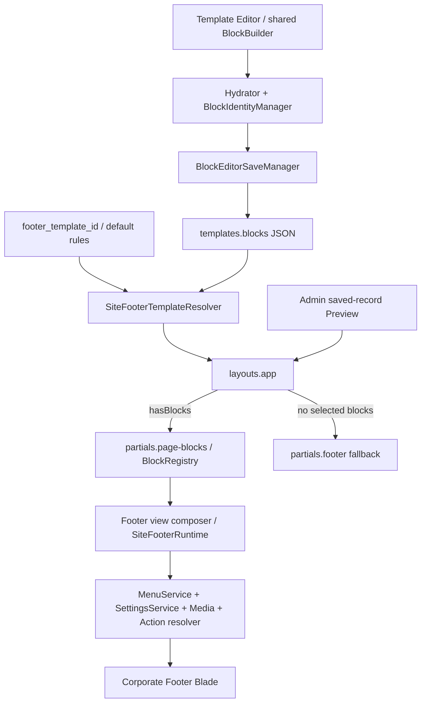

# King CMS — Footer System Source Audit & Implementation Plan

نهایی‌سازی Default Footer: [قرارداد نصب تازه و Seeder غیرمخرب](footer-default-installation-finalization.md) پیاده شد. مسیر رسمی DatabaseSeeder، Preset کامل v2 را Published/Default و منتخب ایجاد می‌کند؛ intent نصب پیش از داده پایه ثبت می‌شود و Re-seed سایت موجود Footer را تبدیل یا بازسازی نمی‌کند. Guard محدود Footer نیز متصل شد. طبق دستور این مرحله، فقط نحو فایل‌های PHP بررسی شد؛ هیچ Seed، Migration، تست یا Build اجرا نشده و نصب واقعی هنوز تأیید نشده است.

به‌روزرسانی فاز ۴: [طراحی Composition و اتصال Responsive](footer-composition-phase-4.md) با استفاده از موکاپ این مرحله پیاده شد. CSS/Renderer Legacy و Schema/Runtime حفظ شدند؛ دو خطای Editor فاز ۳ نیز در بررسی ایزوله اصلاح شدند. Browser در دسترس نبود و تأیید بصری پنج عرض همچنان نامشخص است. محدودیت نبود موکاپ در متن تاریخی Audit زیر، مربوط به مأموریت اولیه است؛ Seeder نصب تازه هنوز تغییر نکرده است.

به‌روزرسانی فاز ۳: [مدیریت Composition در ویرایشگر فعلی](footer-composition-phase-3.md) پیاده‌سازی شد: ستون/عنصر، منابع مشترک، وراثت، تبدیل صریح Legacy و توضیح Preview ذخیره‌شده. به درخواست این مرحله تست اجرا نشده است؛ Seeder، Schema/Runtime و CSS فرانت‌اند تغییر نکرده‌اند. این یادداشت وضعیت جدید را از سابقه Audit زیر جدا می‌کند.

تاریخ تکمیل: 2026-11-03، منطقه زمانی Asia/Tehran. بررسی سورس از 2026-11-02 آغاز شد.

تصمیم محصول ثبت‌شده در 2026-11-03: **Default Footer Product Requirement** در بخش A.1 الزام قطعی توسعه‌های بعدی است. توضیح وضعیت فعلی سورس در بخش‌های B و C، به معنی تحقق این الزام نیست.

به‌روزرسانی پیاده‌سازی 2026-11-03: فازهای ۰ و ۱، شامل Fixture/Regression و زیرساخت Schema v2، پیاده‌سازی شدند؛ قرارداد دقیق و محدودیت‌های این مرحله در [Footer Composition — فازهای ۰ و ۱](footer-composition-phase-0-1.md) ثبت است. وضعیت سورس و جمله‌های «در این مأموریت پیاده‌سازی نشده» در متن Audit زیر، سابقه بررسی اولیه‌اند. Renderer، Seeder و UI/CSS جدید هنوز وارد این پیاده‌سازی نشده‌اند و Product Requirement نصب تازه همچنان به فازهای بعد وابسته است.

به‌روزرسانی فاز ۲: [Runtime و Renderer Composition، همراه Map ایستا](footer-composition-phase-2.md) طبق درخواست این مرحله پیاده‌سازی و تست شدند. مسیر Legacy حفظ شده و Schema، Seeder، UI مدیریت و فایل‌های CSS تغییر نکرده‌اند. Map ایستایی که در نقشه اولیه زیر فاز ۵ آمده بود، در محدوده مصوب فاز ۲ تکمیل شد؛ Product Requirement کامل نصب تازه هنوز به مراحل بعد وابسته است.

**نوع خروجی: Source Audit و طرح پیشنهادی؛ هیچ قابلیت پیشنهادی در این مأموریت پیاده‌سازی نشده است.** فقط این سند ایجاد شده است. تست، Build، اجرای Laravel، Seeder، Migration، تغییر داده و بررسی مرورگر انجام نشده‌اند. وضعیت Production یا داده واقعی کاربران از این بررسی قابل اثبات نیست.

مسیر بررسی: `D:\khanelsf\khanelsf`. مبنا، Working Tree فعلی است؛ پروژه از ابتدا تغییرات ثبت‌نشده و فایل‌های دیگری داشت. آن تغییرات متعلق به این Audit نیستند. ارجاع‌های `path:line` به سورس هنگام بررسی اشاره دارند و ممکن است با ویرایش بعدی جابه‌جا شوند.

**محدودیت ورودی:** پیوست دریافت‌شده فقط `Pasted text.txt` بود؛ تصویر موکاپ در اختیار این بررسی نبود. بنابراین بخش H تحلیل تصویری موکاپ نیست و از توصیف متنی مأموریت استفاده می‌کند. نسبت‌ها، رنگ دقیق، لوگو، فونت و جزئیات پیکسلی تصویر تأیید نشده‌اند.

## A. Executive Summary

King زیرساخت سالم و قابل استفاده مجدد برای Template، Block Registry، Media، Navigation، Action و Preview دارد، اما فوتر سازمانی فعلی یک Footer Builder ترکیبی نیست. این فوتر یک بلوک `site_footer` با یک Renderer به نام `corporate-dark-v1` و Schema نسخه ۱ است. فرم دقیقاً سه ردیف منو می‌خواهد؛ Normalizer حداکثر سه ستون نگه می‌دارد. تماس، درباره‌ما، نمادها و نوار حقوقی نیز بخش‌های ثابت Renderer هستند، نه عناصر قابل انتقال میان ستون‌ها.

یافته‌های اصلی:

1. **محدودیت محتوا واقعی است:** هر ستون منو فقط `title` و `menu_id` دارد. تغییر CSS به‌تنهایی Logo، Map، Form یا ترکیب چند عنصر در یک ستون ایجاد نمی‌کند. شواهد: `app/CMS/Blocks/SiteFooter/SiteFooterBlock.php:88` و `SiteFooterDataNormalizer.php:27`.
2. **بخشی از داده‌های لازم از قبل موجود است:** تماس، ساعات کاری، لوگو، نام سایت و شبکه‌های اجتماعی در Settings نگهداری می‌شوند. فوتر سازمانی تماس را مصرف می‌کند، اما لوگو و Social را مصرف نمی‌کند. فوتر Blade جایگزین Social را نمایش می‌دهد. شواهد: `app/Services/SettingsService.php:127`، `:175`، `:210`؛ `resources/views/partials/footer.blade.php:41`.
3. **نصب Seedشده با نصب صرفاً Migrated یکسان نیست:** `DatabaseSeeder`، Seeder فوتر را فراخوانی می‌کند. قالب تازه Published و از طریق `footer_template_id` انتخاب می‌شود، ولی `is_default=false` است. اگر انتخاب پاک شود، همین قالب از مسیر Default انتخاب نمی‌شود مگر مدیر Default را تغییر داده باشد. شواهد: `database/seeders/DatabaseSeeder.php:630`؛ `CorporateFooterTemplateSeeder.php:30`؛ `app/Services/TemplateService.php:106`.
4. **اجرای مجدد Seeder کاملاً حافظ شخصی‌سازی نیست:** قالب غیرخالی و Setting موجود حفظ می‌شوند، اما آیتم‌های منوی هم‌عنوان با `updateOrCreate` بازنویسی می‌شوند؛ قالب عمداً خالی‌شده نیز دوباره محتوا می‌گیرد. شواهد: `CorporateFooterTemplateSeeder.php:42` و `:90`.
5. **امنیت Embed نباید بر Custom HTML بنا شود:** Custom HTML موجود عمداً خام است و HTML/CSS/JS می‌پذیرد. این مسیر، Embed امن یا راهکار پیش‌فرض اینماد نیست. شواهد: `app/Filament/Resources/TemplateResource.php:823`؛ `resources/views/partials/blocks/custom_html.blade.php:3`.
6. **Preview مشترک وجود دارد، ویرایش زنده وجود ندارد:** Preview رکورد ذخیره‌شده را با همان Layout/Runtime باز می‌کند؛ Canvas مدیریت، فهرست بلوک‌هاست و کنترل viewport سه‌حالته ندارد. شواهد: `app/Filament/Resources/TemplateResource/Pages/EditTemplate.php:36`؛ `resources/views/filament/forms/components/block-builder-editor.blade.php:127`.

**تصمیم پیشنهادی:** همان Block Key و Template Type حفظ شوند؛ یک Composition اختیاری و محدود به فوتر، داخل قرارداد نسخه ۲ همین بلوک افزوده شود. ساختار Legacy مستقل قابل نمایش و ویرایش بماند. از Repeaterهای Filament، SettingsService، MenuService، Action Foundation، Media Library و Form Runtime موجود استفاده شود. به Page Builder عمومی، جدول جدید یا Registry موازی نیاز اثبات‌شده‌ای وجود ندارد.

### A.1. Product Requirement قطعی — فوتر استاندارد نصب تازه

**وضعیت تصمیم: قطعی، به درخواست محصول. وضعیت اجرا: هنوز پیاده‌سازی و تأیید نشده است.** فوتر جدید مبتنی بر `site_footer` و Corporate Dark Footer باید فوتر استاندارد و پیش‌فرض همه نصب‌های جدید King باشد. پس از تکمیل فرآیند رسمی Bootstrap/Seeder، بدون ساخت قالب یا انتساب دستی توسط مدیر، Footer منتشرشده، قابل نمایش و قابل ویرایش وجود داشته باشد. این خروجی صرفاً یک Demo یا قالب اختیاری برای انتخاب بعدی نیست.

**مرز اختیاری‌بودن Composition:** فقط مهاجرت سایت‌های موجود به چیدمان تازه اختیاری است. نصب‌های جدید از Composition استاندارد Schema v2 شروع می‌کنند. حفظ قابلیت خواندن، نمایش و ویرایش Schema v1 الزامی است؛ هیچ سایت موجودی با Upgrade، GET، Preview یا Re-seed خودکار به چیدمان جدید منتقل نشود.

#### A.1.1. عناصر اولیه و منابع پویا

| شناسه الزام | عنصر موجود از ابتدا در Editor | منبع پیش‌فرض و رفتار مورد انتظار |
|---|---|---|
| PR-F01 | Branding: لوگو، نام کسب‌وکار و معرفی کوتاه | Site Settings؛ نام/لوگو/معرفی هنگام Runtime خوانده شوند. پیاده‌سازی معرفی می‌تواند از عنصر Rich Text موجود در طرح استفاده کند، با binding پویا به Settings. |
| PR-F02 | Navigation: منوی دسترسی سریع | Navigation System و menu_id معتبر حاصل از Bootstrap؛ URL یا عنوان مقصدهای اختصاصی یک کسب‌وکار در JSON کپی نشود. |
| PR-F03 | Contact: تلفن، موبایل، ایمیل، آدرس و ساعات کاری | Site Settings با وراثت پیش‌فرض و Override اختیاری؛ فیلدهای ناموجود خروجی عمومی تولید نکنند. |
| PR-F04 | Social Links | Site Settings؛ شبکه تعریف‌نشده لینک یا Icon تعاملی خالی تولید نکند. |
| PR-F05 | Map: موقعیت و لینک مسیریابی | عنصر قابل تنظیم از ابتدا؛ تصویر از Media Library و مقصد از Action Foundation. اگر binding معتبری برای موقعیت/تصویر/مقصد وجود ندارد، مقدار ناموجود باقی بماند؛ آدرس یا مختصات فرضی Seed نشود. |
| PR-F06 | Images & Trust Badges | عنصر/عناصر تصویری قابل افزودن با Media Library و Action اختیاری؛ نشان یا تصویر ساختگی Seed نشود. عنصر بدون رسانه در Editor باقی و در Frontend پنهان باشد. |
| PR-F07 | Copyright | سال جاری در Runtime و نام سایت از Site Settings؛ مقدار سال یا نام کسب‌وکار در زمان Seed Snapshot نشود. متن اختصاصی اختیاری قابل ویرایش باشد. |
| PR-F08 | Legal Links: قوانین و حریم خصوصی | Action Foundation؛ دو ورودی قابل تنظیم از ابتدا. فقط مقصد موجود و مجاز Resolve شود؛ در نبود مقصد معتبر، لینک عمومی نمایش داده نشود. وجود Page یا URL با نامک حدسی فرض نشود. |

چیدمان اولیه مجاز است چهارستونه باشد: ستون اول Branding/معرفی/Social، ستون دوم Navigation، ستون سوم Contact و ساعات کاری، ستون چهارم Map/Images/Trust Badges؛ Copyright و Legal در bottom قرار گیرند. این فقط **Preset اولیه محصول** است؛ تعداد ستون‌ها و عناصر در Schema، UI و Renderer چهار یا مقدار ثابت دیگری نباشد. تمام عناصر این Preset قابل ویرایش، حذف، غیرفعال‌سازی، افزودن و جابه‌جایی باشند. نام، اطلاعات تماس، لینک، نشان و موقعیت خانه LSF یا هیچ کسب‌وکار دیگری Hardcode نشود؛ عنوان‌های عمومی رابط مانند «ارتباط با ما» داده اختصاصی کسب‌وکار محسوب نمی‌شوند.

عنصر فاقد داده باید به‌صورت رکورد قابل تنظیم در Editor حفظ شود؛ صرفاً خروجی عمومی آن و wrapper خالی پنهان شود. ستون و ناحیه‌ای که هیچ خروجی مؤثر ندارند نیز فضای خالی یا عنوان بی‌محتوا نسازند. معتبرنبودن Reference پس از حذف رسانه/منو/مقصد با حذف خود عنصر از داده قالب یکی نیست. داده‌های Settings در زمان Seed در Footer کپی نشوند؛ فقط binding، ساختار، تنظیمات و Referenceهای لازم نگهداری شوند.

#### A.1.2. قرارداد نصب تازه در برابر سایت موجود

| شناسه الزام | مسیر | قرارداد قطعی |
|---|---|---|
| PR-I01 | نصب تازه رسمی | پس از آماده‌شدن Reader، Runtime، Renderer، مدیریت Composition و Responsive، `CorporateFooterTemplateSeeder` یک Composition کامل v2 از عناصر PR-F01 تا PR-F08 ایجاد کند. هیچ نوع عنصر پیاده‌سازی‌نشده به‌عنوان محتوای فعال منتشر نشود. |
| PR-I02 | انتشار و Default | قالب `type=site_footer`، `status=published`، `is_default=true` و Conditions سازگار با Default/all داشته باشد؛ `footer_template_id` به همان قالب معتبر اشاره کند. هم انتخاب صریح و هم Default Resolution فعلی به خروجی مورد انتظار برسند؛ Runtime/Resolver موازی ایجاد نشود. |
| PR-I03 | هویت | block_id و تمام Column/Element IDها معتبر و یکتا باشند؛ Save/Reload و Reorder آن‌ها را بی‌دلیل تغییر ندهند. |
| PR-I04 | Re-seed / سایت موجود | قالب شخصی‌سازی‌شده، عناصر حذف‌شده، منوهای ویرایش‌شده، قالب عمداً خالی، Default و انتخاب صریح مدیر حفظ شوند. قالب خالی دوباره پر و عناصر/آیتم‌های حذف‌شده بازسازی نشوند؛ Setting خالی‌شده مدیر نیز با «نصب تازه» اشتباه نشود. |
| PR-I05 | تفکیک Bootstrap از Upgrade | نبود Footer Template، منو، Default یا مقدار `footer_template_id` به‌تنهایی اثبات نصب تازه نیست. تشخیص نصب تازه باید در فرآیند رسمی نصب، پیش از ایجاد داده‌های پایه و با قرارداد صریح همان فرآیند مشخص شود؛ Re-seed سایت موجود نباید این تشخیص را از خالی‌بودن فوتر حدس بزند. |
| PR-I06 | بازگردانی پیش‌فرض | اگر لازم شد، Restore Default یک اقدام مستقل، صریح و قابل بازبینی مدیر باشد. اجرای مجدد Seeder معنای Reset یا Restore ندارد. |

جزئیات فنی تشخیص نصب تازه باید در فاز Seeder از سورس Bootstrap موجود نهایی شود؛ این تصمیم محصول به‌خودی‌خود مجوز Migration، بازنویسی داده یا ساخت Installer موازی نیست. در سایت موجود حتی نبود Default، مجوز تغییر Default/انتخاب مدیر نیست. حفظ Snapshot داده قدیمی صرفاً برای سازگاری/بازگشت است و نباید با ممنوعیت Snapshot کردن Settings در Preset تازه اشتباه شود.

#### A.1.3. ترتیب اجرا و شرط پایان

ترتیب بخش J حفظ می‌شود: Schema v2 و Normalizer و Legacy → Runtime و عناصر محتوا → مدیریت Composition → Responsive و عناصر Map/Image امن → Publication/Preview → Seeder نصب تازه. Seeder کامل فقط وقتی فعال شود که تمام عناصر پایه Renderer و پشتیبانی Editor داشته باشند. عنصر بدون داده با عنصر دارای Type پیاده‌سازی‌نشده متفاوت است: اولی قابل تنظیم و در Public پنهان است؛ دومی حق انتشار فعال در Preset ندارد.

استفاده واقعی از `ui-ux-pro-max` در طراحی و توسعه رابط الزامی است: کنترل‌های افزودن/حذف/غیرفعال‌سازی و Move بدون نیاز به کدنویسی، جایگزین دکمه‌ای/Keyboard برای Drag، خطای فیلدی و Summary قابل Focus، خوانایی RTL و Preview دستگاه با همان Runtime. موکاپ فقط مرجع بصری است؛ چهار ستون و محتوای نمونه، قرارداد معماری نیستند. نبود تصویر در Audit اولیه همچنان محدودیت تطبیق بصری این سند است.

این تصمیم زمانی محقق است که نصب تازه بدون تنظیم دستی فوتر را نمایش دهد؛ هشت گروه عنصر از ابتدا در Editor قابل شخصی‌سازی باشند؛ اطلاعات سایت به‌صورت پویا و بدون داده ساختگی نمایش داده شوند؛ Save/Reload تمام تنظیمات را حفظ کند؛ Re-seed تغییرات مدیر را دست‌نخورده بگذارد؛ Legacy بدون Regression بماند؛ Preview و Frontend از Runtime یکسان استفاده کنند؛ و تست‌های نصب تازه، Re-seed، Default Resolution و Personalization موفق باشند. نبود فرم کوتاه یا Embed تعاملی، مانع این Requirement هشت‌عنصری نیست؛ حذف Map یا Trust Badges از Editor اولیه به بهانه فاز تکمیلی پذیرفته نیست.

الزام محصول این بخش بر تعبیر اختیاری از فوتر نصب تازه در پیشنهادهای اولیه سند مقدم است. جزئیات اجرایی Schema و UI همچنان طرح توسعه‌اند و باید با همین الزام و قراردادهای Freeze سازگار شوند.

## B. Current Source Architecture

### B.1. نقشه فایل‌ها و مسئولیت‌ها

| بخش | سورس واقعی | مسئولیت و وضعیت فعلی |
|---|---|---|
| Template Type / Model | `app/Models/Template.php:13`، `:74`، `:85`، `:95` | نوع `site_footer`؛ ذخیره `blocks` و `conditions` به‌صورت Array Cast؛ `hasBlocks()` فقط غیرخالی‌بودن Collection را بررسی می‌کند. |
| ذخیره‌سازی | `database/migrations/2026_06_13_000000_create_templates_table.php:11` | ستون JSON موجود `blocks`، وضعیت، Default، Priority و Conditions؛ جدول اختصاصی Footer وجود ندارد و برای طرح پیشنهادی لازم نیست. |
| ثبت Block | `app/Providers/BlockServiceProvider.php:60`، `:71`؛ `bootstrap/providers.php:29` | نگاشت `site_footer => SiteFooterBlock::class` در Registry موجود؛ Provider در Bootstrap ثبت شده است. |
| Contract / Renderer selection | `app/CMS/Blocks/Contracts/BlockDefinition.php`؛ `app/CMS/Blocks/Support/AbstractBlock.php:32`، `:45` | تعریف Metadata/Schema/Templates؛ ساخت فرم؛ انتخاب Renderer و fallback به Template پیش‌فرض بلوک. |
| Registry / Target eligibility | `app/CMS/Blocks/BlockRegistry.php:45`، `:58`، `:77`، `:96`، `:119` | انتخاب View، فیلتر Editor، جمع‌آوری Normalizerها و ساخت lazy فرم‌ها. فیلتر Target برای حذف داده‌های ذخیره‌شده نیست. |
| Footer definition / UI | `app/CMS/Blocks/SiteFooter/SiteFooterBlock.php:32`، `:57`، `:78` | فقط Target فوتر و Context ویرایش Template؛ یک ظاهر؛ منوها، عناوین، درباره‌ما، نمادها و دو Action حقوقی. |
| Normalization | `app/CMS/Blocks/SiteFooter/SiteFooterDataNormalizer.php:18` | قرارداد whitelist نسخه ۱؛ Trim، حذف فیلدهای ناشناخته، حداکثر سه منو، مرتب‌سازی Badge و اعتبارسنجی ساختاری Action؛ بدون Query مستقیم. |
| Hydration / Save | `app/CMS/Blocks/BlockEditorHydrator.php:32`، `:42`؛ `BlockEditorSaveManager.php:16` | Normalization از Registry؛ حفظ envelope پنج‌کلیدی؛ مرز مشترک Save. مسیر اختصاصی ذخیره Footer وجود ندارد. |
| Stable ID | `app/CMS/Blocks/BlockIdentityManager.php:17`، `:45`، `:84` | ایجاد/ترمیم ULID و رفع تکرار در Editor؛ Clone شناسه جدید می‌گیرد. Normalizer فوتر خودش ID تولید نمی‌کند. |
| اتصال Editor lifecycle | `app/Filament/Resources/Concerns/ManagesBlockEditorIdentity.php:17`، `:40` | Hydrate هنگام Fill و Prepare هنگام Save/Create؛ `usesHeroV2Editor()` فعلاً true است. |
| Footer Runtime | `app/CMS/Blocks/SiteFooter/SiteFooterRuntime.php:29` | Normalize؛ دریافت منو، Media و Settings؛ Resolve دو Action؛ تولید داده آماده View. |
| Runtime composer | `app/Providers/BlockServiceProvider.php:194` | اتصال `prepare()` به View فوتر؛ تشخیص Preview از `isPreview` یا Context؛ تکمیل `page_url`. |
| Blade | `resources/views/partials/blocks/site-footer-corporate-dark.blade.php:1` | Footer اصلی، بخش primary، secondary و bottom؛ Blade فوتر سازمانی Query مستقیم ندارد. |
| عمومی‌سازی Rendering | `resources/views/partials/page-blocks.blade.php:7` | حلقه ترتیبی بلوک‌ها و انتخاب View از Registry یا مسیر Legacy؛ Container تو‌در‌توی عمومی ندارد. |
| انتخاب فوتر سراسری | `app/CMS/Templates/SiteFooterTemplateResolver.php:16` | ID انتخاب‌شده یا Default Resolution؛ ID مثبت نامعتبر به Default دوم fallback نمی‌کند. |
| Default Resolution | `app/Services/TemplateService.php:20`، `:51`، `:94` | Published + نوع؛ Specificity، سپس Priority، زمان Update و ID؛ حالت all به `is_default=true` نیاز دارد. |
| اتصال به Layout | `app/Providers/BlockServiceProvider.php:224`؛ `resources/views/layouts/app.blade.php:774` | تزریق قالب انتخاب‌شده؛ Render بلوک‌های آن یا فوتر Blade جایگزین. در Preview فوتر، همان رکورد Preview جایگزین انتخاب عمومی می‌شود. |
| Legacy fallback | `resources/views/partials/footer.blade.php:1` | Settings، نام سایت، متن، تماس پایه، یک Navigation فوتر، Social و Copyright؛ قرارداد و ظاهر متفاوت با Corporate دارد. |
| Template Editor | `app/Filament/Resources/TemplateResource.php:104`، `:502` | BlockBuilder مشترک؛ افزودن، Clone و Reorder؛ حفظ Schema بلوک‌های ذخیره‌شده حتی پس از تغییر Target. |
| Page Builder | `app/Filament/Resources/PageResource.php:97`؛ `SiteFooterBlock.php:80` | فوتر سازمانی در فهرست Page Builder نیست و Schema آن Context غیرTemplate را رد می‌کند. |
| Picker guard | `app/Filament/Forms/Components/BlockBuilder.php:27`، `:70` | فیلتر Picker و کنترل اجرای Add/Clone؛ وجود این Guard به معنی Validation جامع Publication نیست. |
| Inspector | `app/Filament/Forms/Components/BlockInspectorTabs.php:23`، `:93` | دسته‌بندی نمایشی Content/Design/Advanced بدون تغییر State Path؛ همه `content.*`ها Content هستند. |
| Preview | `routes/web.php:209`؛ `app/Http/Controllers/Admin/PreviewController.php:102`، `:258`، `:269` | Auth + admin-only، رکورد ذخیره‌شده، `isPreview=true` و noindex/nofollow. |
| Preview shell | `resources/views/templates/render.blade.php:4` | برای فوتر، پیام راهنما در محتوای صفحه؛ خود فوتر در پایین Layout مشترک نمایش داده می‌شود. |
| Seeder | `database/seeders/CorporateFooterTemplateSeeder.php:14` | سه منو، قالب Published، یک بلوک و Setting انتخاب؛ جزئیات در B.5. |
| CSS / Assets | `resources/css/app.css:92`؛ `resources/views/layouts/app.blade.php:54` | CSS Corporate scoped در app.css؛ ورودی مشترک Vite. Footer JS اختصاصی در مسیرهای بررسی‌شده پیدا نشد. |

### B.2. جریان واقعی داده



دریافت داده در Runtime مجاز و موجود است؛ «Query-free Rendering» در اینجا به معنی نبود Query در Blade فوتر سازمانی و Normalizer است، نه صفر Query در کل Request. `SiteFooterRuntime.php:40` برای هر ستون MenuService را صدا می‌زند و `:52` Media را دریافت می‌کند. `SettingsService.php:15` و `:36` Query و Cache در سطح Request دارند. `MenuItem.php:100` ممکن است Reference را lazy-load کند؛ تعداد Query یا نبود N+1 در این Audit اندازه‌گیری نشده است. هر توسعه باید Resolve را پیش از رندر عناصر کامل کند و از Query داخل حلقه Blade جلوگیری کند.

فوتر Legacy در خود Blade سرویس Settings و Component Navigation را فراخوانی می‌کند؛ بنابراین ادعای «همه فوترهای فعلی Query-free هستند» صحیح نیست.

### B.3. Navigation Core و حدود Reuse

- `app/Services/MenuService.php:19` منوی فعال را با ID می‌گیرد؛ `:52` rootItems و children فعال را بارگذاری و `:77` Visibility را اعمال می‌کند.
- `app/Services/NavigationSourceVisibility.php:31` فعال‌بودن و قابل نمایش‌بودن مقصد/ماژول را کنترل می‌کند. `app/Models/MenuItem.php:83` URL را از Source Registry یا Reference معتبر می‌سازد.
- فوتر سازمانی در `SiteFooterRuntime.php:146` فقط `rootItems` را به Array تبدیل می‌کند؛ children به View منتقل نمی‌شوند. پس محدودیت Nested Navigation مربوط به Runtime و Renderer فوتر است، نه فقدان parent/children در Navigation Core (`MenuItem.php:68`).
- هر ستون Corporate از `menu_id` خودش استفاده می‌کند؛ `footer_menu_id` به این ستون‌ها fallback نمی‌شود. Setting اخیر در فوتر Legacy، از `app/View/Components/Navigation.php:23` و `MenuService::footer()` مصرف می‌شود.
- Component عمومی Navigation برای Variant فوتر به‌طور پیش‌فرض Depth=1 دارد (`Navigation.php:28`). برای نمایش تو‌در‌تو باید عمق محدود و Payload آماده در Runtime تعریف شود؛ نباید Resolver و Visibility دیگری نوشته شود.
- انتخاب‌کننده منوی فوتر فقط منوهای Active را با جست‌وجو و preload نشان می‌دهد؛ برای منوی حذف‌شده/غیرفعال پیام تشخیصی اختصاصی در Schema فوتر دیده نشد.

### B.4. Preview و Publication: دو قرارداد متفاوت

Preview رکورد Draft را نیز برای Admin باز می‌کند؛ مسیر عمومی Draft را انتخاب نمی‌کند. `EditTemplate.php:43` فقط ID رکورد و Context را Redirect می‌کند؛ فرم ذخیره‌نشده برای Preview ارسال نمی‌شود. Shared Canvas، Renderer زنده نیست. Controls اختصاصی Desktop/Tablet/Mobile در Editor بررسی‌شده وجود ندارند؛ تغییر اندازه مرورگر همچنان CSS واقعی صفحه Preview را فعال می‌کند.

نکته مهم Validation: `app/CMS/Templates/TemplatePublicationValidator.php:66` شناسه، نسخه، Template و Canonical Data را بررسی می‌کند؛ اما Trait فراخواننده در `app/Filament/Resources/Concerns/ValidatesTemplatePublication.php:29` فقط چند Target از جمله service/blog/projects را به آن می‌فرستد. **`site_footer` فعلاً وارد این Validation جامع نمی‌شود.** نباید وجود این کلاس را تضمین اعتبار Publication فوتر معرفی کرد. فیلتر Target در Registry هم طبق Comment خود، Editor-only است.

`Template::hasBlocks()` تضمین نمی‌کند بلوک `site_footer` وجود دارد یا Renderer آن خروجی می‌دهد؛ قالب غیرخالی با بلوک ناشناخته می‌تواند fallback را کنار بزند و Footer قابل مشاهده‌ای نسازد. تعدد بلوک‌های `site_footer` نیز توسط Schema فعلی منع نشده و می‌تواند چند Footer landmark تولید کند.

### B.5. نصب تازه، Default و اجرای مجدد Seeder

| وضعیت | نتیجه قابل استنتاج از سورس |
|---|---|
| فقط Migration اجرا شده | جدول Template ایجاد می‌شود؛ Migration مربوطه Footer Template نمی‌سازد. |
| اجرای کامل DatabaseSeeder روی نصب تازه تا انتهای موفق | در `:581` منوی Legacy، در `:621` انتخاب آن و در `:630` CorporateFooterTemplateSeeder ایجاد می‌شوند. این Audit اجرای کامل Seed را تأیید نکرده است. |
| اجرای CorporateFooterTemplateSeeder روی داده خالی | سه منوی اختصاصی Active با location=null، قالب `corporate-dark-footer-v1` از نوع site_footer با Published و `is_default=false`؛ Setting انتخاب به ID آن اشاره می‌کند. |
| نبود Setting یا ID غیرمثبت | `footerTemplateId()` مقدار null می‌دهد؛ Resolver از `TemplateService::findTemplateFor('site_footer')` استفاده می‌کند. قالب all بدون Default واجد انتخاب نیست. |
| ID مثبت حذف‌شده، Draft یا نوع نادرست | Resolver نتیجه null می‌دهد؛ به Default دیگر مراجعه نمی‌کند؛ Layout فوتر Legacy را نمایش می‌دهد. |
| قالب انتخابی Published ولی blocks خالی | `hasBlocks()` false؛ فوتر Legacy نمایش داده می‌شود. |
| قالب انتخابی غیرخالی ولی فاقد خروجی معتبر | Layout وارد حلقه Blockها می‌شود؛ fallback خودکار پس از نتیجه خالی Renderer وجود ندارد. |
| اجرای مجدد: Template غیرخالی موجود | `firstOrCreate` و شرط `!hasBlocks()`، محتوا و Metadata موجود را نگه می‌دارند؛ Draft موجود خودکار Published نمی‌شود. |
| اجرای مجدد: Template عمداً خالی شده | دوباره بلوک Seed در آن نوشته می‌شود؛ این کار با حفظ کامل قصد مدیر سازگار نیست. |
| اجرای مجدد: Setting موجود حتی با value خالی | `firstOrCreate` مقدار آن را تغییر نمی‌دهد؛ ممکن است قالب تازه ساخته‌شده انتخاب نشود. |
| اجرای مجدد: Menu موجود | Metadata منو با firstOrCreate حفظ می‌شود؛ اما آیتم هم‌عنوان با updateOrCreate بازنویسی می‌شود. URL/Reference، Target، Status و sort_order مدیر ممکن است تغییر کنند. تغییر عنوان مدیر نیز می‌تواند باعث ساخته‌شدن آیتم Seed جدید شود. |

شواهد: `CorporateFooterTemplateSeeder.php:16`، `:30`، `:42`، `:71`، `:82`، `:100`؛ `SiteFooterTemplateResolver.php:16`؛ `TemplateService.php:106`؛ `layouts/app.blade.php:774`.

آیتم‌های about/contact فقط برای Page منتشرشده موجود ساخته می‌شوند (`Seeder:102`)؛ آیتم‌های Source از کلیدهای Navigation استفاده می‌کنند. محتوای قابل نمایش منو در نهایت تابع موجودبودن مقصد و وضعیت ماژول است؛ «سه ردیف منو در JSON» مساوی سه ستون قابل نمایش نیست.

**ناسازگاری شناسه Seed:** مقدار `01JFOOTER00000000000000000` در `CorporateFooterTemplateSeeder.php:47` شامل حرف `O` است؛ Regex ULID در `BlockIdentityManager.php:86` آن را نمی‌پذیرد. مسیر Editor آن را هنگام Hydration ترمیم می‌کند و فقط در Save پایدار می‌شود. Runtime فعلی فوتر از این ID، DOM id نمی‌سازد. این یافته ایستا است؛ در این Audit Save آزمایش نشد. Seed جدید باید از ابتدا ID معتبر داشته باشد؛ داده منتشرشده موجود نباید برای اصلاح آن دسته‌جمعی بازنویسی شود.

### B.6. اختلاف مستندات با سورس

| مستند | اختلاف / توضیح لازم |
|---|---|
| `README.md:602` | توضیح all به‌تنهایی شرط لازم `is_default=true` در `TemplateService.php:106` را روشن نمی‌کند. برای Corporate Seed این تفاوت تعیین‌کننده است. |
| `README.md:612` | از اولویت Default در تساوی Priority صحبت می‌کند؛ Comparator فعلی `TemplateService.php:63` پس از Specificity و Priority مستقیماً updated_at و ID را مقایسه می‌کند و tie-breaker جداگانه Default ندارد. |
| `README.md:670` | Debug را عمومی توصیف می‌کند؛ در `TemplateResource.php:138` فقط در محیط Local و با شرط Target نمایش داده می‌شود. نباید آن را ابزار تضمین‌شده Production دانست. |
| `README.md:639` | نبود Visual Drag-and-drop Grid با سورس سازگار است؛ Reorder فهرست بلوک‌ها جای Grid تو‌در‌تو را نمی‌گیرد. |
| `docs/reference-block-architecture.md:18` | قرارداد Normalizer query-free و مرز مشترک Save با مسیر فوتر همسو است؛ قابلیت Composition در آن مستند یا در سورس فعلی پیاده نشده است. |
| `docs/menu-management-unification-audit-2026-10-26.md:83`، `:86`، `:285` | شرح انتخاب مستقل منوها و خطر هویت index-based با سورس فعلی همسو است. Slotهای پیشنهادی آن سند، پیاده‌سازی موجود محسوب نمی‌شوند و نباید در Footer Builder مفروض گرفته شوند. |

## C. Current Capabilities

### C.1. پاسخ دقیق به ساختار ستون‌ها

| پرسش | وضعیت فعلی | لایه محدودکننده |
|---|---|---|
| تعداد ستون‌ها | UI دقیقاً ۳ ردیف منو؛ Normalizer صفر تا ۳؛ Runtime فقط منوی دارای آیتم قابل نمایش را نگه می‌دارد. تماس در بخش primary یک ستون اضافه و مستقل است. | UI: min/max=3 در `SiteFooterBlock.php:105`؛ داده: take(3) در Normalizer:29؛ Runtime:35. |
| یک Menu در هر ستون | بله؛ فقط یک `menu_id` همراه title. | Schema و Runtime. |
| چند نوع محتوا در ستون | خیر؛ تماس، About و Badge جایگاه‌های ثابت جدا دارند. | Schema، Runtime و Blade. |
| Repeater / Nested Items | Repeater منو و Badge موجود است؛ Repeater تو‌در‌توی عناصر داخل ستون وجود ندارد. children منو در Core موجود ولی در Footer حذف می‌شوند. | Composition: Schema؛ Nested Navigation: Runtime/Renderer. |
| جابه‌جایی ستون‌ها | Repeater پیش‌فرض Filament Reorder دارد؛ order آرایه menu_columns حفظ می‌شود. جابه‌جایی تماس/About/Badge به داخل ستون ممکن نیست. | Repeater: `vendor/filament/forms/src/Components/Repeater.php:41`؛ Footer Normalizer:34. |
| مرتب‌سازی Badge | فیلد `sort_order` و sortBy موجود است. Drag ردیف به‌تنهایی لزوماً ترتیب نهایی را عوض نمی‌کند، چون sort_order قبلی اولویت دارد. | UI: Block:146؛ Normalizer:47 و :50. |
| عرض/فاصله/اندازه ستون | کنترل مدیریتی ندارد؛ CSS ثابت/Responsive است. | Schema فاقد settings؛ CSS:104 و :187. |
| ساختار مستقل Desktop/Mobile | خیر؛ یک DOM با Media Query؛ بدون order یا visibility مستقل در داده. | Schema و CSS. |
| امکان افزایش ستون فقط از UI | خیر؛ Normalizer ستون چهارم را حذف می‌کند. | داده، نه فقط نمایش. |

در حالت چهار بخش primary، CSS سه ستون برابر و یک تماس با نسبت 1.25 و حداقل 15rem می‌سازد؛ در حالت تعداد متفاوت کلاس adaptive فعال می‌شود. در عرض حداکثر 1024px دو ستون و حداکثر 640px یک ستون می‌شود. About/Badge یک Grid جدا با نسبت 3:2 است (`app.css:104`، `:187`، `:278`).

### C.2. شکل واقعی ذخیره‌سازی نسخه ۱

زیر `templates.blocks` آرایه‌ای از `{type,data}` ذخیره می‌شود. مثال زیر قرارداد خروجی Normalizer را نشان می‌دهد؛ IDها صرفاً نمونه‌اند و از DB خوانده نشده‌اند:

```json
[
  {
    "type": "site_footer",
    "data": {
      "block_id": "01K8Z000000000000000000001",
      "schema_version": 1,
      "template": "corporate-dark-v1",
      "content": {
        "menu_columns": [
          {"title": "شرکت", "menu_id": 10},
          {"title": "خدمات", "menu_id": 11},
          {"title": "پیوندها", "menu_id": 12}
        ],
        "contact_title": "ارتباط با ما",
        "about_title": "درباره ما",
        "about_text": null,
        "badges_title": "مجوزها و نمادهای اعتماد",
        "badges": [
          {"title": "نماد اعتماد", "media_id": 20, "url": "https://example.com/verify", "alt": null, "sort_order": 0, "enabled": true}
        ],
        "privacy_label": "حریم خصوصی",
        "privacy_action": {"schema_version": 1, "type": "page", "reference_id": 30, "open_in_new_tab": false},
        "terms_label": "قوانین و مقررات",
        "terms_action": null
      }
    }
  }
]
```

Normalizer فعلی `settings`، شناسه ستون، نوع عنصر، children و کلیدهای ناشناخته را نگه نمی‌دارد و `template` را همیشه `corporate-dark-v1` می‌کند (`SiteFooterDataNormalizer.php:22`). افزودن فیلد فقط به فرم یا یک Variant جدید بدون اصلاح Normalizer در Save داده را از بین می‌برد. عناوین و متن About به‌شکل escaped plain text رندر می‌شوند؛ About فعلی Rich Text نیست (`Blade:66`).

### C.3. عناصر مورد انتظار و میزان Reuse

«Component جدید» در جدول، Partial نمایشی کوچک داخل فوتر است؛ به معنی ثبت Block عمومی جدید نیست.

| عنصر | قابلیت مشابه واقعی | Reuse و تغییر لازم | Block جدید؟ / امکان در فوتر فعلی |
|---|---|---|---|
| Logo & Branding | `SettingsService::logoUrl/siteName/footerText`؛ هدر `SiteHeaderRuntime.php:113` لوگو را مصرف می‌کند. | استفاده از همان Settings و Media Picker برای Override؛ Partial فوتر برای لوگو/نام لازم است. لوگوی Settings مسیر فایل/URL است، نه الزاماً media_id. | خیر؛ نیازمند افزوده‌شدن Schema و Runtime، فعلاً داخل ستون منو ممکن نیست. |
| Navigation | MenuService و Source Registry؛ سه منوی Footer موجود. | نگه‌داشتن menu_id و Visibility؛ انتقال خروجی آماده به عنصر Navigation؛ Depth محدود اختیاری. | خیر؛ قابلیت موجود، ولی Composition جدید لازم است. |
| Contact Information | `SiteFooterRuntime.php:100` و SettingsService تماس/ساعات را دارند. | Reuse داده و Iconهای موجود؛ source=site/manual/override و امکان انتخاب فیلدها افزوده شود. | خیر؛ اکنون فقط ستون ثابت با منبع Settings و بدون Override. |
| Social Links | `SettingsService.php:210`؛ Legacy Footer:41؛ Hero Schema:109 دارای Action/Icon است. | Settings برای پیش‌فرض، ActionPicker و Icon tooling موجود برای Override؛ Partial کوچک مناسب فوتر. کل Hero نباید در فوتر کپی شود. | خیر؛ Corporate فعلاً آن را ندارد. |
| Image / Badge | Media ID، Alt fallback، optional URL، enabled و sort_order موجود است. | منطق Media فعلی و Picker تکرار نشود؛ در Composition به عنصر قابل جایگذاری تبدیل شود؛ مقصد جدید از Action استفاده کند. | خیر؛ Badge فعلاً فقط در بخش secondary. |
| Map | `business_network_map` نقشه SVG استان‌های ایران و فیلتر NetworkLocation دارد. | نقشه آن برای نشانی کسب‌وکار/مسیریابی مناسب نیست؛ تصویر از Media + Action مسیریابی قابل Reuse است. Partial کوچک نقشه لازم است. | برای نیاز Footer خیر؛ Embed تعاملی ایمن قابلیت جدید و اختیاری است. |
| Rich Text | `app/Support/RichText.php:10` و `_rich_text.blade.php:1`؛ `text_image` شامل rich_text/media/action است. | Reuse RichText sanitizer و Partial؛ Title/plain description با حفظ Escape. `text_image` عمداً Footer Target را نمی‌پذیرد (`TextImageBlock.php:36`)؛ بازکردن Target آن برای این کار لازم نیست. | خیر؛ عنصر Rich Text در Footer Schema، نه بلوک تکراری عمومی. |
| Legal Links | دو Action ساختاری Privacy/Terms و Copyright فعلی. | همان Normalizer/Validator/Resolver/Presentation؛ تبدیل اختیاری به لیست قابل ترتیب در bottom؛ متن Copyright و سال بدون اجرای Template Code دلخواه. | خیر؛ دو لینک ثابت اکنون وجود دارند. |
| Form | `app/CMS/Blocks/Form/FormBlock.php:50`؛ `FormBlockRuntime.php:29`؛ `resources/views/forms/embed.blade.php:14`. | ReferenceTargetPicker با form_id؛ Published-only lookup؛ Reuse Runtime و فرم مشترک؛ adapter محدود برای instance token و attribution لازم است. | خیر؛ بلوک Form مستقل همین حالا در Template مجاز است، اما نمی‌تواند داخل ستون Corporate قرار گیرد. |

Form موجود به‌خودی‌خود سامانه ارسال خبرنامه یا اتصال سرویس Email Marketing نیست. می‌توان فرم کوتاه منتشرشده را استفاده کرد؛ نتیجه Business ثبت/ارسال آن باید از همان Form Foundation بیاید. فرم بلند، Calculator یا چندمرحله‌ای برای ستون کوچک پیش‌فرض مناسبی نیست. `FormBlockRuntime.php:65` فقط Published را می‌گیرد. `forms/_form.blade.php:84` ارسال واقعی به `forms.submit` دارد و `routes/web.php:124` Rate Limit موجود را اعمال می‌کند؛ نباید برای Footer مسیر ارسال موازی ایجاد شود.

### C.4. تماس و Override

داده‌های موجود: `contact_phone`، `contact_mobile`، `contact_email`، `contact_address` و `working_hours`؛ Metadata در `ManageSiteSettings.php:71` و UI در `:283`. متن Footer از `footer_text` و سپس site_description می‌آید (`SettingsService.php:200`). اطلاعات ساعات کاری متن آزاد است، نه برنامه ساختاری روزهای هفته.

Corporate همه تماس‌های غیرخالی را در ترتیب ثابت Phone/Mobile/Email/Address/Hours می‌سازد؛ برای tel/mailto فاصله را حذف می‌کند (`SiteFooterRuntime.php:119`). Override تماس، ترتیب یا حذف انتخابی فیلد در Footer UI وجود ندارد. About خالی از Settings پر می‌شود؛ خالی‌کردن فیلد About، گزینه «پنهان‌کردن» مستقل نیست.

پیشنهاد: `source=site` برای خواندن زنده Settings؛ `manual` برای داده دستی؛ `override` برای Patch هر فیلد. در حالت override، کلید غایب یا null یعنی ارث‌بری؛ مقدار دستی معتبر یعنی جایگزینی؛ حذف نمایشی از طریق `fields` یا enabled انجام شود. این معنا باید در UI با «از تنظیمات سایت» و «مقدار اختصاصی این فوتر» آشکار باشد. داده Settings نباید هنگام ذخیره قالب Snapshot و سپس بی‌صدا کهنه شود.

### C.5. Media، اینماد و Embed

`app/Models/Media.php:40` فقط reusable imageهای collection=`media_library` را می‌گیرد و `:47` وجود فایل روی Disk را بررسی می‌کند. Runtime فوتر Mediaها را یکجا با whereIn دریافت می‌کند؛ Alt دستی بر Alt/Title رسانه اولویت دارد. رسانه کپی یا URL آن در JSON Badge ذخیره نمی‌شود.

Picker فعلی در `resources/views/filament/forms/components/media-library-picker.blade.php:15` ID را entangle می‌کند؛ جست‌وجو Client-side است. `UsesMediaLibraryImages.php:24` همه تصاویر واجد شرایط را می‌گیرد؛ این Selector صفحه‌بندی Server-side ندارد. افزایش عناصر تصویری باید از Cache فعلی استفاده کند و مسئله تعداد زیاد رسانه را جدا اندازه‌گیری کند؛ برای Footer یک Media Library دوم ساخته نشود.

Template فعلی Trait ثبت MediaUsage ندارد؛ Badge reference با ID به معنی ثبت usage یا جلوگیری از حذف نیست. تست موجود نیز ثابت‌ماندن تعداد usage مربوط به Featured Image را انتظار دارد (`SiteFooterTemplateTest.php:132`). DeleteAction کتابخانه در `MediaResource.php:135` Guard اختصاصی ارجاع Footer نشان نمی‌دهد. Runtime رسانه حذف‌شده را پنهان می‌کند؛ UI آینده باید هشدار بدهد. پیش از ادعای حفاظت از حذف، قرارداد مصرف رسانه در کل CMS باید بررسی شود؛ این Audit یک سیستم Usage موازی پیشنهاد نمی‌کند.

| روش نشان اعتبار | ارزیابی و پیشنهاد |
|---|---|
| تصویر Media + لینک تأیید | کم‌هزینه‌ترین گزینه و نزدیک به قابلیت موجود؛ Alt، نسبت تصویر، لینک امن و rel کنترل شود. وجود این تصویر به‌خودی‌خود اعتبار رسمی نشان را ثابت نمی‌کند. |
| کد رسمی صرفاً شامل تصویر و لینک | ورود از فیلد ساختاری یا تبدیل کنترل‌شده به media/link فقط پس از بررسی الزامات ارائه‌دهنده؛ کد خام در قرارداد Composition ذخیره نشود. |
| کد رسمی نیازمند Script/iframe | پیش‌فرض خام نداشته باشد؛ فقط integration مشخص، تنظیمات محدود و allowlist بازبینی‌شده در فاز جدا. کلیدهای مجاز/منشأ مشخص و خروجی تولیدشده توسط برنامه. |
| Custom HTML موجود | Trusted escape hatch با اجرای خام است؛ Sanitizer یا Sandbox ندارد. از آن به‌عنوان عنصر عادی «نماد» در Builder استفاده نشود. |

`SiteFooterDataNormalizer.php:70` URL نماد را برای http/https و شروع با `/` یا `#` می‌پذیرد؛ در نتیجه `//host` نیز از شرط اول عبور می‌کند. این مسیر از Validator سخت‌گیرتر Action استفاده نمی‌کند؛ Validator Action در `ActionDestinationValidator.php:76`، protocol-relative و backslash را رد می‌کند. برای داده جدید Badge از Action Foundation استفاده شود؛ URLهای Legacy حفظ و بررسی سازگاری شوند، نه اینکه در Upgrade کورکورانه حذف شوند.

کتابخانه Upload، SVG را می‌پذیرد (`UploadMedia.php:57`)؛ Scope reusableImages تضمین Sanitization محتوای SVG نیست. فوتر باید تصویر را با img نمایش دهد و هرگز فایل دلخواه آپلودشده را به‌عنوان SVG/HTML خام inline نکند. این Audit ممیزی کامل Upload pipeline یا امنیت SVG نیست.

### C.6. نقشه: قابلیت موجود و گزینه‌ها

`BusinessNetworkMapBlock.php:13` وابسته به فعال‌بودن ماژول Network است؛ Runtime آن NetworkLocationها را می‌خواند و View در `business_network_map.blade.php:13` SVG داخلی استان‌ها را نمایش می‌دهد. این، موقعیت دفتر روی نقشه خیابانی نیست. قابلیت ویدیو Embed نیز وجود دارد (`app/Services/ExternalVideoResolver.php:10`) و URLهای ارائه‌دهندگان شناخته‌شده را می‌سازد؛ Resolver عمومی امن نقشه در مسیرهای بررسی‌شده پیدا نشد. وجود iframe ویدیو مجوز دریافت iframe خام نقشه نیست.

| گزینه | امنیت / Performance / Responsive | تصمیم پیشنهادی |
|---|---|---|
| تصویر محلی نقشه + لینک مسیریابی | بدون JS/iframe ثالث؛ Media ID و Action؛ aspect-ratio و lazy image؛ با JS خاموش نیز قابل استفاده. | گزینه پیش‌فرض فاز اول. تصویر باید با وضعیت موقعیت واقعی به‌روزرسانی شود. |
| لینک مسیریابی بدون تصویر | کمترین حجم؛ همان Action امن و متن قابل فهم. | fallback هنگام نبود/حذف تصویر یا عدم بارگذاری provider. |
| iframe تعاملی provider مشخص | قابلیت جدید؛ URL باید از پارامتر ساختاری و Host/Path مجاز ساخته شود؛ بارگذاری تنبل یا پس از کلیک، عنوان iframe، نسبت ثابت و لینک جایگزین. | فاز اختیاری پس از تعیین Provider، سیاست حریم خصوصی و مجوز استفاده؛ سیاست iframe/referrer/sandbox بر اساس همان Provider بررسی شود. |
| SDK نقشه | JS، کلید و محدودیت دامنه، هزینه نگهداری و بار شبکه بیشتر؛ به‌تنهایی نیاز این Footer را توجیه نمی‌کند. | از MVP خارج. |
| embed HTML دلخواه | فعال‌سازی محتوای ناشناخته و دورزدن قرارداد. | برای عنصر Map پذیرفته نشود. |

این Audit Source-only است؛ API، تعرفه، دسترس‌پذیری شبکه یا قرارداد رسمی ارائه‌دهنده نقشه/اینماد بررسی نشده است. هیچ Provider مشخصی Production Ready اعلام نمی‌شود.

## D. Gap Analysis

| Requirement | Current Support | Missing Capability | Recommended Solution | Impact |
|---|---|---|---|---|
| ستون‌های قابل افزودن/حذف | سه منو در UI؛ حداکثر سه در Normalizer | تعداد متغیر و هویت پایدار | columns[] با id در Composition اختیاری | Footer Schema/UI/Runtime |
| چند محتوا در ستون | فقط یک Menu | typed elements[] | Repeater تو‌در‌تو با عمق محدود | Footer-only؛ بدون Registry عمومی |
| لوگو و نام | Settings موجود؛ فقط نام در Copyright | Branding در Corporate | Settings + Override Media + Partial | کم |
| تماس قابل شخصی‌سازی | ستون ثابت Settings | انتخاب فیلد، ترتیب و Override | source/fields/overrides | متوسط؛ حفظ پیش‌فرض Settings |
| Social | Settings و Legacy/Hero | عنصر Social Corporate | Reuse Action/Icon و Settings | کم تا متوسط |
| تصویر و نشان قابل جایگذاری | بخش Badge ثابت موجود | جایگذاری میان عناصر، Action مقصد | Media reference و Action؛ حفظ URL Legacy | متوسط |
| نقشه | SVG شبکه کسب‌وکار | نقشه نشانی/مسیریابی | static image + Action؛ iframe اختیاری بعدی | کم در MVP؛ بالا در Embed |
| Rich Text | RichText مشترک؛ About plain | عنصر متن در ستون | Partial موجود و RichEditor | کم |
| Legal Links دلخواه | دو Action | تعداد و ترتیب متغیر | bottom.elements / legal_links.items | کم تا متوسط |
| Copyright قابل تنظیم | سال میلادی و نام سایت ثابت | متن اختصاصی و کنترل نمایش | فیلد متن/سال ساختاری؛ بدون اجرای کد | کم |
| فرم کوتاه | Form Block و ارسال موجود | embed داخل ستون و هویت instance | adapter محدود FormRuntime/ReferenceTargetPicker | متوسط؛ فاز جدا |
| Reorder مطمئن | Drag منوها؛ sort_order نماد | یک منبع ترتیب، دکمه و Keyboard | ترتیب آرایه در v2؛ کنترل بالا/پایین | UI/Data |
| اندازه و فاصله | CSS ثابت | Design controls محدود | Tokens/enums و responsive grid | UI/CSS؛ بدون CSS دلخواه |
| Preview دستگاه | صفحه Preview مشترک | viewport control و وضعیت Save | همان Preview با قاب viewport؛ Saved-data label | Admin UI |
| داده ناقص | حذف خاموش در Runtime | تشخیص در Editor/Preview | هشدار inline همراه حفظ داده | UI/Runtime diagnostics |
| Publication معتبر | Footer بیرون از Validator جامع | Shape/duplicate/version checks | افزودن کنترل Target فوتر با پوشش Legacy | حساس به سازگاری |
| Default نصب تازه | Published + explicit selection | Preset کامل v2 و Default واقعی بدون تنظیم دستی | PR-I01 تا PR-I03؛ اصلاح فقط Bootstrap نصب تازه پس از آماده‌شدن عناصر | Seeder/Resolution tests |
| Rerun غیرمخرب | Template غیرخالی حفظ می‌شود | حفاظت MenuItem و deliberate-empty | ساخت-only برای نصب تازه؛ عدم بازنویسی | Seeder behavior |
| Nested Navigation | Core children موجود | انتقال children به Footer DTO | عمق محدود اختیاری، Visibility مشترک | Runtime/Blade |

## E. Architecture Decision

| گزینه | پیچیدگی | توسعه‌پذیری | Legacy / نگهداری | ارزیابی |
|---|---|---|---|---|
| ۱. افزایش تعداد منو و افزودن فیلدهای ثابت | کم | ضعیف؛ برای هر سناریو فیلد و شرط تازه | سازگاری اولیه ساده، افزایش شرط‌های ثابت | برای اصلاح جزئی مناسب؛ هدف Footer Builder را کامل پوشش نمی‌دهد. |
| ۲. Footer Composition در همان بلوک | متوسط و محدود | خوب برای نیازهای Footer؛ columns و عناصر typed | Legacy branch حفظ؛ Schema Version روشن؛ Reuse سرویس‌ها | **پیشنهاد منتخب.** |
| ۳. استفاده از Blockهای فعلی پشت‌سرهم | کم برای Stacking | Footer چندبخشی ممکن؛ ستون ترکیبی واقعی ندارد | برخی Blockها تمام‌عرض یا دارای landmark/context نامناسب هستند | به‌تنهایی کافی نیست. Form مستقل قابل استفاده است، نه داخل Corporate. |
| ۴. Layout/Container عمومی و Blockهای تو‌در‌تو | زیاد | بسیار زیاد | تغییر Hydration/Save/Identity/Preview و قرارداد همه Blockها | در سورس فعلی Container عمومی وجود ندارد؛ برای این مأموریت توجیه ندارد. |
| ۵. Footer Builder مستقل یا Registry جدید | زیاد | تکرار قابلیت موجود | دو مسیر Permission/Media/Action/Preview و نگهداری بیشتر | رد؛ با حداقل تغییر معماری سازگار نیست. |

تصمیم: `type=site_footer`، `key=site_footer` و مسیر Template Runtime حفظ شوند. انواع عنصر، enum محلی Footer هستند، نه BlockDefinitionهای جدید. ابتدا منطق در همان سه کلاس Footer تکامل یابد؛ فقط اگر حجم واقعی اقتضا کرد helper محلی کوچک استخراج شود. Framework جدید برای Composition، Registry عنصر، Layout Engine عمومی و Relation Model جدید ایجاد نشود.

تصمیم قطعی محصول در A.1، Composition استاندارد v2 را خروجی الزامی Bootstrap نصب تازه می‌کند. اختیاری‌بودن Composition در مقایسه معماری بالا فقط حق انتخاب سایت Legacy برای مهاجرت را بیان می‌کند؛ انتشار یک Demo اختیاری، هدف محصول را محقق نمی‌کند.

Appearance Variant تعیین‌کننده رنگ، Typography، خطوط و سطوح است؛ Content Structure تعیین‌کننده ستون و نوع/ترتیب عناصر. انتخاب Dark/Light نباید JSON محتوایی را تبدیل کند یا تعداد ستون را عوض کند. `template=corporate-dark-v1` می‌تواند در نسل جدید، هر دو payload Legacy و Composition را نمایش دهد؛ افزودن Variant آینده صرفاً نیازمند Template key/Style و ثبت Composer سازگار است، نه ساخت قرارداد محتوایی متفاوت.

## F. Proposed Data & Composition Contract

### F.1. اصول قرارداد پیشنهادی

جزئیات Schema این بخش **طرح توسعه** است؛ پیش‌فرض‌بودن v2 در نصب تازه و حفظ Legacy طبق A.1 الزام قطعی محصول است. هیچ‌کدام از کلیدهای جدید زیر فعلاً توسط Normalizer نسخه ۱ حفظ نمی‌شوند.

1. Envelope موجود `{type,data}` و کلیدهای `block_id/schema_version/template/content/settings` حفظ شود. Footer Schema به نسخه ۲ ارتقا یابد؛ نسخه Action همچنان نسخه مستقل خودش باشد.
2. `content.composition=null` یعنی Legacy؛ غیرnull یعنی Composition. یک Toggle ذخیره‌شونده دوم برای همان انتخاب ساخته نشود. حالت UI از همین Discriminator مشتق شود.
3. فیلدهای نسخه ۱ در قرارداد v2 حفظ شوند. در حالت Legacy همان مسیر قبلی مصرف شود. در Composition داده فعال از composition خوانده شود؛ Legacy payload برای بازگشت و ویرایش حفظ شود و هنگام تغییر یک حالت، حالت دیگر بی‌صدا همگام‌سازی نشود.
4. `main.columns[]` شامل id، title اختیاری، elements[] و settings محدود؛ `bottom.elements[]` شامل Copyright و Legal Links. برای MVP فقط همین دو ناحیه و یک سطح عناصر؛ عنصر داخل عنصر یا Block عمومی recursive وجود نداشته باشد.
5. ترتیب آرایه، ترتیب نمایش باشد. v2 برای عناصر/ستون‌ها sort_order موازی نداشته باشد. Badge Legacy همچنان معنا و sort_order قبلی خود را حفظ کند.
6. Column/Element id پایدار و مستقل از index باشد؛ Add/Clone در Editor شناسه تولید کند. Reorder شناسه را تغییر ندهد. Normalizer تصادفی، Query یا زمان جاری برای تولید ID نداشته باشد.
7. Layout اندازه‌ها/فاصله‌ها با enum و عدد محدود؛ HTML، class، CSS، URL script یا iframe raw از داده Composition پذیرفته نشود.
8. Preset رسمی نصب تازه، Composition غیرnull با تمام گروه‌های PR-F01 تا PR-F08 داشته باشد؛ پوسته عناصر بدون داده، همراه ID معتبر در Editor باقی بماند. مقدار مؤثر Settings، سال جاری، مختصات فرضی یا رسانه نمونه در Seed Snapshot نشود. مقادیر ناموجود با null/لیست خالی مدل شوند؛ فعال‌بودن عنصر فاقد داده مجوز رندر خروجی خالی یا جعلی نیست.
9. تنظیمات source=site در Preset تازه، binding زنده‌اند. در Map، Media و Legal که binding پیش‌فرض معتبر در منابع فعلی ثابت نشده، Referenceها خالی و قابل تنظیم باقی بمانند؛ مدل/Setting جدید صرفاً برای پرکردن ظاهری نمونه فرض نشود.

### F.2. نمونه JSON پیشنهادی

این نمونه سه ستون با محتوای ترکیبی دارد تا محدودنبودن به چهار ستون روشن باشد. شناسه‌ها و Referenceها نمونه‌اند؛ اعتبار وجود و انتشار آن‌ها باید هنگام Resolve بررسی شود. اشیای source و تنظیمات زیر طرح قراردادند، نه API موجود.

این JSON مثال قرارداد است، نه payload رسمی Seeder. URLهای example، IDهای فرضی و Form داخل آن نباید عیناً Seed شوند. Preset رسمی تابع A.1 است: چهار ستون اولیه مجاز، هشت گروه پایه الزامی، sourceهای پویا، Reference ناموجود خالی و Form اختیاری خارج از Default Composition.

```json
{
  "type": "site_footer",
  "data": {
    "block_id": "01K8Z000000000000000000001",
    "schema_version": 2,
    "template": "corporate-dark-v1",
    "content": {
      "menu_columns": [],
      "contact_title": "ارتباط با ما",
      "about_title": "درباره ما",
      "about_text": null,
      "badges_title": "مجوزها و نمادهای اعتماد",
      "badges": [],
      "privacy_label": "حریم خصوصی",
      "privacy_action": null,
      "terms_label": "قوانین و مقررات",
      "terms_action": null,
      "composition": {
        "main": {
          "columns": [
            {
              "id": "01K8Z000000000000000000010",
              "title": null,
              "settings": {"span": 1},
              "elements": [
                {
                  "id": "01K8Z000000000000000000011",
                  "type": "branding",
                  "enabled": true,
                  "content": {"source": "site", "name": null, "logo_media_id": null, "logo_alt": null}
                },
                {
                  "id": "01K8Z000000000000000000012",
                  "type": "rich_text",
                  "enabled": true,
                  "content": {"title": "درباره ما", "source": "site", "text": null}
                },
                {
                  "id": "01K8Z000000000000000000013",
                  "type": "social_links",
                  "enabled": true,
                  "content": {"source": "site", "items": []}
                }
              ]
            },
            {
              "id": "01K8Z000000000000000000020",
              "title": null,
              "settings": {"span": 1},
              "elements": [
                {
                  "id": "01K8Z000000000000000000021",
                  "type": "navigation",
                  "enabled": true,
                  "content": {"title": "دسترسی سریع", "menu_id": 10, "depth": 1}
                },
                {
                  "id": "01K8Z000000000000000000022",
                  "type": "contact",
                  "enabled": true,
                  "content": {
                    "title": "ارتباط با ما",
                    "source": "override",
                    "fields": ["phone", "mobile", "email", "address", "working_hours"],
                    "overrides": {"phone": "02112345678"}
                  }
                }
              ]
            },
            {
              "id": "01K8Z000000000000000000030",
              "title": null,
              "settings": {"span": 1},
              "elements": [
                {
                  "id": "01K8Z000000000000000000031",
                  "type": "map",
                  "enabled": true,
                  "content": {
                    "mode": "static",
                    "title": "موقعیت دفتر",
                    "media_id": 20,
                    "alt": "موقعیت دفتر مرکزی",
                    "directions_action": {"schema_version": 1, "type": "custom_url", "value": "https://example.com/directions", "open_in_new_tab": true}
                  }
                },
                {
                  "id": "01K8Z000000000000000000032",
                  "type": "image",
                  "enabled": true,
                  "content": {
                    "title": "نشان اعتماد",
                    "media_id": 21,
                    "alt": null,
                    "action": {"schema_version": 1, "type": "custom_url", "value": "https://example.com/verify", "open_in_new_tab": true}
                  }
                },
                {
                  "id": "01K8Z000000000000000000033",
                  "type": "form",
                  "enabled": false,
                  "content": {"title": "خبرنامه", "form_id": 40}
                }
              ]
            }
          ]
        },
        "bottom": {
          "elements": [
            {
              "id": "01K8Z000000000000000000040",
              "type": "copyright",
              "enabled": true,
              "content": {"source": "site", "text": null, "show_year": true}
            },
            {
              "id": "01K8Z000000000000000000041",
              "type": "legal_links",
              "enabled": true,
              "content": {
                "items": [
                  {"label": "حریم خصوصی", "action": {"schema_version": 1, "type": "page", "reference_id": 30, "open_in_new_tab": false}},
                  {"label": "قوانین", "action": {"schema_version": 1, "type": "page", "reference_id": 31, "open_in_new_tab": false}}
                ]
              }
            }
          ]
        }
      }
    },
    "settings": {
      "container": "default",
      "spacing": "comfortable",
      "grid": {"desktop": "auto", "tablet": 2, "mobile": 1}
    }
  }
}
```

برای Social دستی، items شامل label، icon از گزینه‌های مجاز و Action باشد. contact با fields فقط ساعات کاری نیز قابل ساخت باشد؛ Type تکراری working_hours لازم نیست. چند نشان با چند عنصر image یا یک گروه کوچک در صورت نیاز واقعی ساخته شوند؛ در فاز اول Image و Badge دو Block همسان ثبت نشوند.

### F.3. Validation و Fail-safe

| سطح | قواعد پیشنهادی |
|---|---|
| Envelope | type صحیح؛ block_id با قرارداد فعلی؛ schema_version پشتیبانی‌شده؛ template از فهرست تعریف‌شده. نسخه آینده ناشناخته نباید به نسخه ۱/۲ تنزل داده و Save شود. |
| Composition | null یا ساختار معتبر main/bottom؛ ممنوعیت recursion؛ حد عملیاتی پیشنهادی ۱ تا ۸ ستون، حداکثر ۱۲ عنصر در ستون و ۴۸ عنصر کل؛ این حدود پیشنهاد برای جلوگیری از payload نامحدودند، نه محدودیت چهارستونی محصول. |
| Identity | idهای ستون/عنصر یکتا در همان بلوک؛ Clone نسخه جدید بگیرد؛ Reorder حفظ کند. برای فرم adapter، شناسه یکتای instance از parent block_id و element id مشتق شود تا Clone و چند Footer/Form تداخل نکنند. |
| Type / Region | main فقط branding/navigation/contact/social_links/image/map/rich_text/form؛ bottom فقط copyright/legal_links در MVP؛ نوع ناشناخته در نسخه جدید ویرایش‌پذیر نباشد و هنگام Save بی‌صدا حذف نشود. |
| Strings | عنوان/Alt محدود، مثلاً ۲۵۵ کاراکتر؛ Rich Text حد اندازه مشخص؛ Escape متن ساده؛ RichText::render برای HTML مجاز؛ بدون اجرای Blade/JS در Copyright. |
| منابع | source فقط site/manual/override در عناصر پشتیبان؛ معنی null/ارث‌بری در UI و Normalizer یکسان باشد؛ داده Resolveشده در JSON ذخیره نشود. |
| References | ID صحیح مثبت و بدون تبدیل اعشاری مبهم؛ Media reusable و موجود؛ Menu فعال؛ Form منتشرشده؛ Action همان Normalizer/Validator/Resolver موجود. Validation ساختاری Query-free و بررسی وجود/انتشار در Resolve/Save validation جدا بمانند. |
| تصویر/نقشه | Alt مناسب؛ مقصد اختیاری Action؛ image-only بدون مقصد نیز معتبر؛ ابعاد/ratio از مقادیر محدود؛ بدون srcdoc یا HTML خام. |
| Contact / Social | تلفن/ایمیل معتبر؛ URLها از Action امن؛ Icon از مجموعه موجود، نه SVG/HTML دلخواه؛ fields بدون تکرار و با ترتیب مشخص. |
| Layout | gap/container/span/grid از enum یا بازه عددی محدود؛ هیچ مقدار آزاد CSS در style تزریق نشود. span بیشتر از Grid به‌صورت امن محدود شود. |
| داده حذف‌شده | Runtime بخش ناموجود را پنهان و wrapper خالی را حذف کند؛ Editor علت و Reference قبلی را نگه دارد؛ «شناسه دیگر در دسترس نیست» با «خالی» یکی نشود. |

در Production خطاهای Reference نباید Placeholder مدیریتی یا عنوان محتوای غیرمجاز افشا کنند. Preview می‌تواند هشدار مدیریتی داشته باشد، ولی Resolverها نباید داده Draft/غیرمجاز را خارج از سیاست موجود نمایش دهند. داده فرم، Contact و مقصدها صرفاً به دلیل Preview بودن مجازتر نشوند.

### F.4. Upgrade بدون تخریب داده

1. Fixtureهای v1 واقعی از شکل‌های شناخته‌شده سورس تهیه شوند؛ از DB Production در این مأموریت چیزی خوانده نشده است.
2. Normalizer جدید v1 را **در حافظه** به v2 با `composition=null` و همه فیلدهای Legacy ارتقا دهد؛ خروجی دوم دقیقاً برابر خروجی اول باشد. مسیر Legacy Runtime/Blade همان معنای فعلی را حفظ کند. خواندن عمومی یا Preview هیچ Write نداشته باشد.
3. Editor نسخه قدیمی را با همان کنترل‌های Legacy باز کند؛ فقط Save صریح کاربر canonical v2 را پایدار کند. شناسه معتبر موجود حفظ و ترمیم شناسه نامعتبر فقط توسط lifecycle مشترک انجام شود. هیچ backfill یا Migration بازنویس JSON لازم نیست.
4. «تبدیل به چیدمان ترکیبی» یک اقدام مشخص و قابل برگشت در Editor باشد. Mapping محتوا، ترتیب منو، تماس، About، Badge و دو Legal را حفظ کند؛ Content Snapshot قدیمی برای برگشت بماند. چون v1 دو ردیف primary/secondary دارد، تبدیل به یک main اختیاری الزاماً همان ظاهر نیست؛ پیش‌نمایش قبل از ذخیره لازم است و تبدیل خودکار روی Upgrade ممنوع باشد.
5. اگر برای تبدیل Preview نیاز به ID باشد، از هویت parent و مسیر Legacy، مقدار deterministic تولید شود یا IDها در اقدام Editor ساخته و نگهداری شوند؛ داخل Normalizer در هر اجرا ULID تازه تولید نشود.
6. Publication Guard نسخه canonical نصب‌شده را پس از Prepare بسنجد. صرف تغییر `SiteFooterBlock::version()` به ۲، بدون هماهنگی Hydration و Footer Validation کافی نیست. Generic Validator فعلی برابری نسخه را می‌خواهد؛ سازگاری v1 باید پیش از فعال‌کردن Guard پوشش داده شود.
7. استقرار کد Runtime/Normalizer خواننده v2 پیش از فعال‌شدن UI ذخیره‌کننده v2 باشد. بازگشت به کد v1 پس از ذخیره v2 خطرناک است: Normalizer فعلی Composition را حذف می‌کند. Rollback امن باید خواندن v2 را حفظ کند و فقط ویرایش ویژگی تازه را غیرفعال کند؛ Downgrade داده راهکار عادی نباشد.

## G. Admin UI/UX Plan

### G.1. مبنای تحلیل Skill

اسکیل در `C:/Users/Marco/.agents/skills/ui-ux-pro-max/SKILL.md` خوانده شد. جست‌وجوهای محلی `dragging movements keyboard alternative` و `error summary validation` در Domain=ux، نتایج مرتبط Web/Accessibility دادند: راه جایگزین Drag، ترتیب Keyboard، Focus واضح و Error Summary لینک‌دار همراه خطای هر فیلد. هیچ Design System فایل‌محور جدیدی تولید نشد.

جست‌وجوی `RTL forms accessibility` در Stack=laravel نتیجه نداشت؛ retry با `validation form` نتیجه داد، اما داده Skill مربوط به Laravel 13 بود و پروژه طبق `composer.json:10` و `:14` از Filament 3 و Laravel 11 استفاده می‌کند. بنابراین مثال‌های API نسخه ۱۳ به پروژه تعمیم داده نشدند؛ فقط اصول عمومی حفظ داده نامعتبر و خطای فیلدی استفاده شدند. قواعد native مانند safe-area یا اندازه pt به‌عنوان الزام Desktop Admin اعمال نمی‌شوند.

### G.2. امکانات موجود و فاصله UX

در نصب تازه، مدیر باید خود Composition آماده A.1 را در همین Editor باز کند؛ ساخت Template، افزودن دستی اولین Footer یا انتخاب دستی آن پیش‌شرط شخصی‌سازی نباشد. Map/Logo/Social/Trust Badge فاقد داده، کارت تنظیم‌پذیر با پیام کمبود داده داشته باشند؛ پنهان‌شدن Public آن‌ها نباید کنترل Editor را حذف کند. امکان حذف، غیرفعال‌سازی، افزودن و انتقال همه عناصر Preset، از جمله Copyright و Legal در ناحیه مجازشان، شرط پذیرش است. راهنمای Skill در G.1 هنگام این به‌روزرسانی دوباره بررسی شد و نتایج مرتبط Drag Alternative و Error Summary مجدداً مبنای این کنترل‌ها قرار گرفتند؛ اجرای UI هنوز انجام نشده است.

| موضوع | موجود | پیشنهاد اجرایی |
|---|---|---|
| انتخاب بلوک | Picker Target-aware، Add/Clone Guard و فهرست بلوک | همان Picker حفظ شود؛ برای قالب تازه پیشنهاد یک Footer اصلی؛ به داده چندبلوکی قدیمی دست زده نشود. |
| Canvas | فهرست قابل انتخاب و Drag؛ نه Preview تصویری | داخل Footer Inspector، فهرست Columnها و عناصر با عنوان معنی‌دار؛ Canvas عمومی بازنویسی نشود. |
| مدیریت ستون | سه ردیف Repeater | Add/Delete/Clone Column با عناصر nested، پیام حذف محتوای داخل ستون و Undo در حد امکانات موجود. |
| نوع عنصر | وجود ندارد | Select نوع از فهرست محدود؛ فرم شرطی؛ تغییر نوع غیرخالی با جلوگیری از حذف خاموش داده. |
| Reorder | Drag عمومی و Repeater | دکمه بالا/پایین؛ انتقال عنصر به ستون مقصد از Select/Menu؛ عدم وابستگی به Drag-only و حفظ Focus بعد از انتقال. |
| Tabs | Content/Design/Advanced مشترک موجود | Content برای columns/elements/source، Design برای grid/gap/container/appearance؛ Advanced فقط کنترل‌های واقعاً موجود؛ تب خالی با متن واضح. |
| وراثت Settings | About helper محدود | badge «از تنظیمات سایت»، نمایش مقدار مؤثر به‌صورت read-only و گزینه Override/بازنشانی ارث‌بری؛ عدم کپی خودکار داده. |
| وضعیت خالی | Canvas و تب خالی متن دارند؛ Runtime محتوای ناقص را پنهان می‌کند | Empty Column و «افزودن اولین عنصر»؛ وضعیت Reference حذف‌شده یا غیرفعال از خالی جدا شود. |
| Preview | Saved-record Preview موجود | اعلام «پیش‌نمایش آخرین ذخیره» و dirty warning؛ Desktop/Tablet/Mobile با همان endpoint و Renderer؛ بدون Preview Engine دوم. |

سورس Inspector در `block-builder-editor.blade.php:68` role=tablist و aria-selected دارد، اما در بخش بررسی‌شده ارتباط tab/tabpanel و کلیدهای جهت‌دار کامل دیده نمی‌شود. انتخاب کارت در `:157` روی li با click است و Keyboard selection آشکار ندارد. در Canvas فعلی فقط Handle Drag ارائه می‌شود و دکمه Move بالا/پایین رندر نشده است. این‌ها یافته ایستا هستند؛ دسترس‌پذیری اجرایی آزموده نشده است.

Media Picker در `media-library-picker.blade.php:93` به body teleport می‌شود و Escape/Close دارد، اما در سورس آن dialog semantics/focus trap و بازگشت Focus صریح دیده نشد. اصلاح احتمالی آن باید در Component مشترک و با بررسی همه مصرف‌کنندگان باشد؛ یک Dialog مستقل Footer ساخته نشود.

### G.3. RTL، Validation و Preview

- Labels، Actionها و ترتیب خواندن RTL؛ تلفن/ایمیل/URL با جهت LTR یا bdi؛ عنوان و توضیح فارسی. از تغییر visual order که با Tab order ناسازگار است پرهیز شود.
- خطای هر Reference در کنار همان عنصر؛ Summary بالای فرم با لینک به Column/Element و بازشدن تب/Repeater مربوط. خطا نباید State تایپ‌شده یا ترتیب عناصر را پاک کند. تغییر Focus روی هر keystroke انجام نشود.
- کنترل Reorder دارای نام شامل عنوان عنصر؛ نتیجه انتقال با پیام قابل دسترس؛ Focus بعد از Delete به کنترل نزدیک منتقل شود.
- قاب Preview فقط viewport را تغییر دهد و همان Public CSS/JS را بارگذاری کند. نام Device صرفاً preset اندازه است؛ عرض‌های مرزی نیز جدا بررسی شوند. تغییر viewport، داده محتوا را تغییر ندهد.
- Preview زنده داده ذخیره‌نشده، قابلیت جدا و خارج از MVP باشد. اگر بعداً لازم شد، انتقال payload احراز‌شده و موقتی با همان Runtime طراحی شود؛ انتشار خودکار یا Save ضمنی برای Preview قابل قبول نیست.

## H. Frontend & Responsive Plan

### H.1. مرز تحلیل موکاپ

تصویر دریافت نشده است؛ در نتیجه ارزیابی سلسله‌مراتب واقعی، کنتراست اندازه‌گیری‌شده و وفاداری بصری به موکاپ ممکن نیست. جدول زیر تشخیص می‌دهد نیازهای **توصیف‌شده** با Appearance حل می‌شوند یا به Content Structure نیاز دارند.

| نیاز بصری توصیف‌شده | وضعیت فعلی | نوع تغییر لازم |
|---|---|---|
| زمینه تیره، رنگ متن/تیتر و Divider | Corporate دارای #101722، #cbd5e1، #f8fafc و خطوط نیمه‌شفاف | CSS/Appearance؛ مقادیر مؤثر با Theme و Selectorهای بعدی بررسی شوند. |
| Typography فارسی | RTL در ریشه Layout؛ font و اندازه‌ها از Theme متغیرند | استفاده از فونت موجود، line-height و وزن محدود؛ Font جدید پیش‌فرض نصب نشود. |
| فضای سفید و فاصله‌ها | clamp gap/padding و line-height 1.9 برای About موجود | Design Tokens محدود و CSS scoped؛ بدون تغییر داده محتوا. |
| ستون‌های نامساوی | نسبت ثابت فعلی و Adaptive | span/grid settings محدود؛ اتصال Schema به Renderer، نه فقط انتخاب رنگ. |
| لوگو، معرفی و Social در یک ستون | Corporate لوگو/Social ندارد و About جای ثابت دارد | Composition + Runtime + Partial؛ CSS به‌تنهایی کافی نیست. |
| تماس با Icon | Heroicons، address، tel/mailto موجود | Reuse فعلی؛ Override و جایگذاری نیازمند Schema است. |
| کارت نقشه کنار نشان‌ها | در Footer وجود ندارد؛ Badge جداست | عناصر Map/Image در یک Column + CSS کارت. |
| نشان‌ها با تصویر و Alt | موجود در secondary | ظاهر با CSS؛ جایگذاری آزاد با Composition. |
| Copyright و Legal bar | flex-wrap و دو Action موجود | ظاهر با CSS؛ متن/تعداد/ترتیب متغیر با Schema. |
| Mobile stack | یک DOM؛ دو و یک ستون در breakpointهای فعلی | Responsive CSS موجود قابل استفاده؛ کنترل تعداد ستون با settings محدود. |

### H.2. طرح Renderer و دسترس‌پذیری

Renderer اصلی یک `<footer>` داشته باشد. مسیر Legacy با همان کلاس‌ها و ترتیب فعلی بماند. مسیر Composition main/bottom و عناصر ساده بسازد؛ Blockهای کامل با `<footer>` یا Layout تمام‌عرض داخل عنصر تزریق نشوند. Partialهای جدید فقط به Array آماده Runtime دسترسی داشته باشند و DB، SettingsService یا MenuService را صدا نزنند.

منو و Legal با nav و label معنی‌دار؛ Contact با address و Icon تزئینی aria-hidden؛ Icon-only Social دارای نام قابل دسترس. Logo لینک‌دار Alt مناسب و ابعاد مشخص بگیرد. Header levels با ساختار صفحه هماهنگ و از H1 تکراری جلوگیری شود. تلفن و Email در متن فارسی با bdi/dir=ltr قابل بررسی باشند.

تصویر نشان و نقشه از Media و با `loading=lazy`، ابعاد/نسبت رزروشده و object-fit مناسب نمایش داده شود؛ Badge فعلی lazy-loading و ابعاد intrinsic در HTML ندارد (`Footer Blade:77`). رنگ لینک قابل تشخیص، Focus واضح و کنتراست مستقل سطح کارت روشن روی زمینه تیره بررسی شود. Rule عمومی `.corporate-footer a` با specificity بیشتر می‌تواند رنگ متن لینک Badge را تحت تأثیر قرار دهد؛ خوانایی لینک نشان در بررسی بصری باید صریحاً سنجیده شود، نه از رنگ تعریف‌شده `.corporate-footer__badge` نتیجه‌گیری شود.

برای Main از Grid با minmax(0,1fr) و span محدود؛ Tablet دو و Mobile یک ستون به‌عنوان پیش‌فرض. تعداد واقعی Column می‌تواند ۱، ۲، ۳، ۴ یا بیشتر تا حد عملیاتی تعیین‌شده باشد. DOM order واحد مرجع خواندن/Tab order بماند. MVP ساختار محتوای مستقل موبایل ندارد؛ کنترل تعداد ستون و فاصله کافی است. Accordion منو یا Visibility مستقل Device تنها در صورت نیاز محصول و با قواعد دسترس‌پذیری فاز بعدی باشد.

عرض‌های پذیرش پیشنهادی: 320، 375، 640، 768، 1024، 1280 و 1440px، همراه مقادیر دو سوی breakpoint. Email/URL طولانی، نام فارسی طولانی، متن چندخطی، نبود یک ستون، تصویر عمودی و چند Badge بررسی شوند. Bottom Footer Wrap کند و Scroll افقی ایجاد نشود. این بررسی‌ها در این مأموریت اجرا نشده‌اند.

## I. Compatibility & Risk Assessment

| قرارداد / ریسک | ارزیابی سورس | الزام توسعه |
|---|---|---|
| Registry / Block Contract | پایه مشترک برقرار | key و type حفظ؛ نوع عنصر Footer به Block مستقل تبدیل نشود. |
| Schema Versioning | Normalizer فعلی همیشه v1 و template ثابت می‌دهد | v2 خواننده Legacy؛ عدم Downgrade نسخه ناشناخته؛ تست canonical و save roundtrip. |
| Stable Block ID | Manager مشترک موجود؛ Seed فعلی ID نامعتبر دارد | استفاده از lifecycle موجود؛ تولید ID فقط در Editor/Bootstrap؛ بدون بازنویسی منتشرشده‌ها. |
| Element Identity | در v1 وجود ندارد | ID محلی پایدار؛ Clone/Move/Reorder و Form instance مستقل؛ عدم تکیه به index. |
| Idempotent Normalization | الگوی خالص موجود؛ Suite اختصاصی Footer Normalizer دیده نشد | `N(N(x))=N(x)` برای v1، v2، ورودی معیوب و ترتیب‌ها؛ بدون Query/Write/Random. |
| Query-free Rendering | Corporate Blade داده آماده می‌گیرد؛ Runtime Query دارد | تمام منابع پیش از Blade Resolve؛ Batch رسانه/Action؛ memoization request-scoped منوهای تکراری در صورت نیاز اندازه‌گیری‌شده. |
| Navigation Core | MenuService و SourceVisibility مشترک | حفظ status/module/reference؛ تولید URL دوم یا Slot حدسی ایجاد نشود. |
| Action Foundation | Legal از Action استفاده می‌کند؛ Badge URL مسیر مستقل دارد | مقصد جدید از Action؛ reference_id ذخیره شود، URL داخلی Resolveشده ذخیره نشود؛ فرم Action و embed از هم متمایز بمانند. |
| Media | ID و فایل موجود بررسی می‌شود؛ usage حفاظت حذف Footer نیست | Reuse Library و Alt؛ هشدار missing؛ بدون Copy فایل یا اطمینان نادرست به حذف‌نشدن. |
| Preview / Production Parity | Renderer و Layout مشترک | payload واحد، assets واحد؛ Preview فقط تشخیص مدیریتی اضافه کند، نه bypass مجوز. |
| Publication | Footer فعلاً از Guard جامع خارج است | Guard جدید Footer با Legacy fixtureها؛ enforce یک Footer برای ساخت تازه، بدون حذف خودکار بلوک‌های قدیمی. |
| Empty Legacy editing | Normalizer ۰ تا ۳ ستون؛ UI دقیقاً ۳ می‌خواهد | roundtrip داده کم‌ستون/خالی بررسی؛ UI جدید داده قدیمی را به دلیل minItems جدید غیرقابل Save نکند. |
| Seeder / Default | Published منتخب ولی non-default؛ rerun برخی داده‌ها را می‌نویسد | تفکیک صریح نصب تازه از سایت موجود طبق PR-I01 تا PR-I06؛ فقط نصب تازه Preset v2، Default و انتخاب سازگار بگیرد؛ نبود Default در سایت موجود مجوز تغییر نیست. |
| Security / Custom HTML | HTML/CSS/JS خام موجود و عمداً Trusted | هیچ عنصر composition به raw code map نشود؛ سیاست Trusted موجود بدون مجوز تغییر نکند. |
| External embeds | Map resolver عمومی وجود ندارد | Provider Integration مشخص و محدود؛ بدون درخواست Server-side به URL دلخواه کاربر؛ لینک/تصویر fallback. |
| Forms | Runtime و endpoint موجود، instance-aware errors | حفظ CSRF/Rate Limit/validation/attribution و عدم تداخل فرم‌های تکراری. Preview فرم موجود ارسال واقعی دارد؛ UI جدید باید این رفتار را روشن کند یا حالت غیرارسال صریح و جدا طراحی کند. |
| Performance | منوها مستقل Resolve؛ Picker همه تصاویر را preload می‌کند | حد payload و بودجه Query/Asset بر پایه اندازه‌گیری؛ SDK نقشه eager اضافه نشود. |
| Rollback | کد v1 کلید جدید را حذف می‌کند | Rollback رابط با Reader v2؛ قبل از Save v2 برنامه بازگشت مشخص باشد. |

داده‌های منتشرشده نباید برای یکدست‌کردن ظاهر، ID، انتخاب منو، Default یا تبدیل Composition تغییر کنند. شرط Freeze در این مأموریت به‌عنوان قید حفظ قراردادهای موجود اعمال شده است؛ این سند گواهی ممیزی کامل همه زیرسامانه‌های King نیست.

## J. Implementation Phases

مسیرهای «جدید پیشنهادی» زیر در این مأموریت ایجاد نشده‌اند؛ نام آن‌ها طرح اجرایی است. ترتیب وابستگی‌ها باید حفظ شود.

| فاز / اولویت | کار و وابستگی | فایل‌های محتمل | معیار پذیرش |
|---|---|---|---|
| ۰ / P0 — تثبیت قرارداد Legacy | ثبت fixtureهای v1، تصمیم canonical v2 و راه Rollback؛ پیش‌نیاز همه فازها | `tests/Feature/SiteFooterTemplateTest.php`؛ فایل جدید پیشنهادی `tests/Unit/SiteFooterDataNormalizerTest.php`؛ همین سند | تمام فیلدهای فعلی و خروجی Legacy مشخص؛ missing data و Seed edge case قابل آزمون؛ هیچ داده فعلی تبدیل نشود. |
| ۱ / P0 — Reader و Normalizer v2 | Composition اختیاری، whitelist/type/limits، idempotence، تشخیص نسخه آینده؛ پس از فاز ۰ | `app/CMS/Blocks/SiteFooter/SiteFooterDataNormalizer.php`، `SiteFooterBlock.php`؛ فقط در صورت نیاز helper محلی | v1 قابل خواندن/ویرایش؛ normalize دوباره بدون تغییر؛ GET/Preview بدون Write؛ Legacy default layout محفوظ. |
| ۲ / P1 — Runtime و Rendering پایه | Branding، RichText، Navigation، Contact، Social، Image، Legal/Copyright؛ پس از Reader | `SiteFooterRuntime.php`؛ `resources/views/partials/blocks/site-footer-corporate-dark.blade.php`؛ Partialهای جدید پیشنهادی زیر `resources/views/partials/blocks/site-footer/`؛ `app/Providers/BlockServiceProvider.php` فقط اگر wiring لازم شد | یک Footer landmark، داده آماده، Visibility موجود، Media/Action مشترک؛ بدون Query در Partial؛ حذف wrapper خالی. |
| ۳ / P1 — مدیریت Composition | nested Repeaters، Type picker، Move buttons، وراثت Settings و تبدیل اختیاری؛ پس از Runtime | `SiteFooterBlock.php`؛ `BlockInspectorTabs.php` فقط اگر grouping فعلی واقعاً کافی نبود؛ View مشترک Builder فقط با بررسی مصرف‌کنندگان | Add/Delete/Clone/Move صحیح؛ id پایدار؛ Save/Reload بدون حذف داده؛ Editor Legacy همچنان قابل استفاده. |
| ۴ / P1 — Design و Responsive | Tokens محدود و Grid متغیر؛ سپس QA بصری | `resources/css/app.css`؛ Footer Partialها؛ `SiteFooterBlock.php` | ۱/۲/۳/۴/بیش از۴ ستون؛ Desktop/Tablet/Mobile بدون overflow؛ focus و contrast و RTL قابل قبول؛ Legacy CSS مستقل. |
| ۵ / P1 — Static Map و Badge hardening | Media + directions Action؛ سیاست لینک جدید و حفظ URL Legacy؛ پس از عناصر پایه | `SiteFooterDataNormalizer.php`، `SiteFooterRuntime.php`، Partialهای Footer؛ بدون Block Registry جدید | نقشه با JS خاموش کار کند؛ missing image لینک جایگزین؛ بدون iframe/script ورودی؛ Legacy Badge همچنان نمایش داده شود. |
| ۶ / P1 — Footer Publication و Preview UX | Footer Guard پس از canonical v2؛ Saved-state notice و viewport presets | `app/Filament/Resources/Concerns/ValidatesTemplatePublication.php`؛ `app/CMS/Templates/TemplatePublicationValidator.php` در صورت نیاز سازگاری؛ `EditTemplate.php`؛ Preview shell | Footer تازه نامعتبر منتشر نشود؛ v1 هنگام Save از Prepare عبور کند؛ Draft Preview admin-only و noindex؛ همان assets/runtime. |
| ۷ / P1 — نصب تازه غیرمخرب | پس از تکمیل فازهای ۱ تا ۶ و تمام عناصر پایه A.1؛ قرارداد انتخاب فعلی Resolver حفظ و مسیر fresh از upgrade/re-seed تفکیک شود | `database/seeders/CorporateFooterTemplateSeeder.php`؛ `DatabaseSeeder.php` و Bootstrap موجود طبق قرارداد رسمی نصب؛ تست‌های Seeder | PR-I01 تا PR-I06: Composition کامل v2 شامل هشت گروه پایه، Published، is_default=true، all و footer_template_id به همان قالب؛ بدون تنظیم دستی؛ شناسه‌های معتبر؛ Re-seed حتی حذف عنصر/آیتم و deliberate-empty و انتخاب خالی مدیر را حفظ کند. |
| ۸ / P2 — فرم کوتاه | بعد از تثبیت identity و ستون؛ adapter محدود | `SiteFooterRuntime.php`، `SiteFooterBlock.php`؛ `app/CMS/Blocks/Form/FormBlockRuntime.php` فقط اگر extension ضروری شد؛ `forms/embed.blade.php` با حفظ مصرف‌کنندگان | Published-only، ارسال به endpoint فعلی، instance بدون تداخل، Validation/Success و Attribution صحیح؛ هیچ سرویس Newsletter فرض نشود. |
| ۹ / P2 — Embed provider مشخص | فقط پس از تعیین الزامات واقعی نقشه/نشان و ارزیابی امنیت | helper محلی Provider و Footer Partial پیشنهادی؛ config محدود فقط در صورت ضرورت | whitelist دقیق، lazy/on-demand، fallback، سیاست کلید و دامنه روشن؛ هیچ Custom HTML عمومی به عنصر اضافه نشود. |

فازهای ۱ تا ۷، همراه فاز ۰ به‌عنوان پیش‌نیاز، Release الزامی Default Footer طبق A.1 را می‌سازند؛ پایان آن مشروط به موفقیت تست‌های نصب تازه، Re-seed، Default Resolution و Personalization است. Map ایستا، Images/Trust Badges و هشت گروه پایه از این Release حذف نمی‌شوند؛ حتی بدون داده باید در Editor حاضر و قابل تنظیم باشند. فرم کوتاه فاز ۸ و Embed تعاملی فاز ۹ قابلیت‌های تکمیلی مستقل‌اند و شرط این Requirement هشت‌عنصری نیستند. هیچ‌یک از این فازها نیاز پیش‌فرض به Migration جدید ندارند.

## K. Tests & Acceptance Criteria

### K.1. پوشش موجود در سورس، بدون ادعای اجرا

`tests/Feature/SiteFooterTemplateTest.php` این سناریوها را تعریف کرده است:

- `:35`: selector/template editor/media foundation.
- `:86`: سه منو، تماس، About و Legal Action با reference_id.
- `:132`: Reuse رسانه و واکنش به تغییر Metadata بدون Copy.
- `:169`: missing/disabled data بدون Placeholder.
- `:187`: Default resolution در نبود Setting انتخاب.
- `:198`: Draft Preview، Seed و بررسی رشته‌های CSS responsive.

وجود assertionهای CSS، نتیجه مشاهده بصری یا اثبات Responsive در مرورگر نیست. این Audit هیچ‌یک از تست‌های بالا را اجرا نکرده است. نمونه Fixture ID همین فایل نیز از رشته‌های Footer نامعتبر برای ULID استفاده می‌کند؛ پوشش سخت‌گیر identity باید با ULID معتبر و حالت repair جدا تکمیل شود.

تست‌های همجوار برای Regression: `tests/Feature/TemplatePreviewTest.php`، `TemplateBuilderTest.php`، `TemplateBlockPickerTest.php`، `TextImageBlockTest.php`، `FormBlockTest.php`، `SettingsAdminPageTest.php` و Unitهای `BlockEditorHydratorTest.php`، `BlockEditorSaveManagerTest.php`، `BlockIdentityManagerTest.php`، `NavigationRendererTest.php` و `TemplateSelectionRuleTest.php`. ذکر این فایل‌ها گزارش اجرای آن‌ها نیست.

### K.2. ماتریس تست موردنیاز توسعه

| حوزه | سناریوی ضروری | معیار پذیرش |
|---|---|---|
| Legacy schema | v1 کامل، کم‌ستون، بدون Menu، بدون About/Badge/Legal | Reader v2 همان محتوای مؤثر و ترتیب قدیمی را می‌سازد؛ Save قابل انجام و بدون حذف فیلد است. |
| Canonical v2 | همه Typeها، empty/null، ورودی scalar به‌جای Array، enum نامعتبر، حجم بیش‌ازحد | خطای قابل فهم یا fallback تعریف‌شده؛ TypeError/حذف خاموش داده معتبر رخ ندهد. |
| Idempotence | نمونه‌های معتبر و معیوب و Upgrade v1 | normalize دوباره دقیقاً برابر؛ بدون Query، Write یا Random. |
| Unknown version/type | schema_version آینده و element ناشناخته | Public fail-safe؛ Editor overwrite/downgrade نکند؛ پیام نیاز به نسخه پشتیبان. |
| Identity | Add/Clone/Reorder/Move، clone template، چند عنصر فرم | block_id معتبر قبلی ثابت؛ clone شناسه تازه؛ ID ستون/عنصر unique؛ instance فرم تداخل نداشته باشد. |
| Editor roundtrip | Fill → تغییر متن/ترتیب → Save → Reload؛ خطای Validation | State و Source/Override حفظ؛ خطا داده را پاک نکند؛ انتخاب تب/عنصر مربوط قابل دسترس باشد. |
| تبدیل Legacy | تبدیل اختیاری، Preview، انصراف و برگشت | منوها/عناوین/Badge/Legal/تماس گم نشوند؛ بدون Save عمومی تغییری نکند؛ Legacy snapshot محفوظ. |
| Settings | site/manual/override، مقدار خالی و حذف فیلد از fields | وراثت زنده؛ تغییر Settings در حالت site دیده شود؛ Manual مستقل؛ hide با empty اشتباه نشود. |
| Navigation | Active/Inactive/deleted، Reference Draft، ماژول خاموش، Source URL، child depth | همان Visibility Core؛ هیچ لینک غیرمجاز/شکسته در خروجی؛ عمق محدود و بدون lazy Query داخل Blade. |
| Actions | Page/Product/Service reference، custom URL، anchor و مقصد ناموجود | reference_id در JSON؛ Resolve در Runtime؛ javascript/data/protocol-relative طبق قرارداد رد؛ rel و target صحیح. |
| Media | reusable/non-reusable، فایل مفقود، Alt override/Metadata، تغییر عنوان، حذف | بدون Copy؛ Alt fallback درست؛ missing media هشدار مدیریتی و حذف امن public؛ بدون HTML/SVG inline. |
| Security | RichText حاوی script/event handler؛ Map/Badge HTML raw؛ CSS injection | sanitization/escaping؛ Composition کد اجرا نکند؛ raw Custom HTML موجود با مسیر عادی عناصر مخلوط نشود. |
| Query boundary | prepare سپس render Partial روی payload آماده | هنگام render مستقیم Partial Query تازه صفر؛ بودجه prepare جدا ثبت و برای منوی تکراری/رسانه/Action کنترل شود. |
| Preview / Public | Published same-data، Draft template admin، مهمان/کاربر غیرAdmin | payload و Renderer واحد؛ noindex؛ مجوز درست؛ Preview Draft قالب عمومی را تغییر ندهد. |
| Saved-state Preview | تغییر ذخیره‌نشده، سپس Preview و پس از Save | UI صریحاً آخرین ذخیره را اعلام کند؛ Save ضمنی رخ ندهد. |
| Resolution | ID معتبر، missing، empty/zero، Draft، wrong type، Default چندگانه، non-default all | نتایج با B.5 و قرارداد مصوب یکی باشد؛ invalid explicit ID بی‌صدا به قالب دیگری تغییر نکند. |
| Seeder fresh | فرآیند رسمی Bootstrap در محیط ایزوله بدون داده | بدون انتساب دستی: site_footer Published با Schema v2 و Composition کامل PR-F01 تا PR-F08، is_default=true و all؛ footer_template_id همان قالب؛ Block/Column/Element ID معتبر؛ Footer از Runtime فعلی در صفحه عمومی نمایش داده شود. |
| Seeder rerun | شخصی‌سازی Template/MenuItem/Setting، حذف عنصر/آیتم منو، قالب Draft، deliberate-empty، عنوان تغییرکرده و انتخاب خالی | Template/Composition/Menuها/Default/انتخاب صریح و خالی مدیر با مقایسه قبل/بعد حفظ شوند؛ عنصر و آیتم حذف‌شده برنگردد؛ قالب خالی پر نشود؛ Re-seed معنای Restore نداشته باشد. |
| Dynamic Default | Seed سپس تغییر نام/لوگو/معرفی/تمام تماس‌ها/Social در Settings و تغییر منوی متصل | همان قالب بدون Save مجدد اطلاعات تازه را نمایش دهد؛ JSON Seed حاوی Snapshot اطلاعات سایت یا سال ثابت نباشد؛ هیچ اطلاعات اختصاصی خانه LSF یا کسب‌وکار نمونه Seed نشده باشد. |
| Missing Default data | لوگو/Social/Map/Media/Legal Reference تعریف‌نشده یا حذف‌شده | عناصر و IDهایشان در Editor محفوظ و قابل تنظیم؛ Public فاقد محتوای ساختگی، لینک شکسته، عنوان/Wrapper خالی؛ تکمیل داده عنصر را بدون بازسازی قالب قابل نمایش کند. |
| Default Personalization | تمام هشت گروه Preset: Edit/Add/Delete/Disable/Move، تغییر تعداد ستون و Save/Reload، سپس Re-seed | تنظیمات، IDهای معتبر، ترتیب و حذف‌ها پایدار؛ برای Personalization به کدنویسی یا ساخت/انتساب Template نیاز نباشد؛ هیچ عنصر حذف‌شده یا منوی ویرایش‌شده پس از Seed بازنویسی نشود. |
| Fresh vs Existing | سایت موجود بدون Footer، بدون Default، بدون Setting انتخاب یا با value خالی؛ سایت Legacy v1 | به‌عنوان نصب تازه حدس زده نشود؛ هیچ انتخاب/Default/Composition خودکار تغییر نکند؛ Legacy با Reader مشترک قابل نمایش و ویرایش بماند. |
| Unsupported seeded type | Preset حاوی نوع بدون Renderer/Editor یا disabled بودن قابلیت ناتمام | Bootstrap/Publication اجازه فعال‌سازی و انتشار آن Type را ندهد؛ Preset رسمی فقط پس از تکمیل همه انواع پایه منتشر شود. |
| Form | دو نمونه یک فرم، Clone، Draft/deleted، Validation/Success، Submit در Preview | Published-only و endpoint فعلی؛ error bag/old input مجزا؛ Attribution درست؛ رفتار Preview مشخص و بدون غافلگیری. |
| Responsive / RTL | عرض‌های H، متن بلند، تعداد ستون متغیر و داده ناقص | بدون overflow یا overlap؛ ترتیب خواندن و Keyboard صحیح؛ Legal و Social قابل استفاده. |
| Accessibility | Keyboard-only، Move buttons، Tabs، Dialog Focus، Focus بعد از Delete، Error summary | همه عملیات بدون Drag/Pointer ممکن؛ نام‌ها و stateها قابل خواندن؛ Focus گم/پنهان نشود. |
| Regression | Legacy fallback، Header، Page Builder و Templateهای غیرFooter | هیچ Target یا Renderer قبلی حذف نشود؛ TextImage همچنان قرارداد Target خودش را حفظ کند؛ shared component تغییرکرده همه مصرف‌کنندگان را پاس کند. |

پیش از اجرای آتی تست DB، الزامات `docs/test-database-safety.md` خوانده و محیط تست ایزوله شود. معیار این Audit فقط اثبات سورس است؛ معیار توسعه بعدی شامل آزمون‌های واقعی و بازبینی بصری خواهد بود. اجرای کامل Seeder روی دیتابیس فعلی، ابزار تست غیرمخرب محسوب نمی‌شود.

## L. Final Recommendation

شروع توسعه باید از **ثبت رفتار Legacy و طراحی Normalizer نسخه ۲ همان بلوک `site_footer`** باشد؛ نه از CSS موکاپ یا ساخت Footer Builder مستقل. علت عملی این است که Normalizer فعلی هر کلید جدید را حذف می‌کند و ستون‌ها را به سه مورد محدود می‌کند؛ تا Reader سازگار و Roundtrip داده مشخص نباشد، فرم ظاهراً کار می‌کند ولی داده جدید پایدار نمی‌ماند.

پس از تثبیت Reader، عناصر پایه را با سرویس‌های فعلی در Runtime آماده کنید، سپس Repeater ستون/عنصر و Renderer ترکیبی را اضافه کنید. مسیر Legacy باید بدون تبدیل اجباری باقی بماند. Design Variant تنها Appearance را تغییر دهد و ساختار Content از آن مستقل باشد. تصویر نقشه و لینک مسیریابی، گزینه پیش‌فرض سبک و قابل پیاده‌سازی است؛ کد خام نشان یا SDK نقشه پیش‌نیاز Footer Builder نیست.

طبق تصمیم قطعی A.1، نصب تازه باید پس از Bootstrap رسمی، بدون تنظیم دستی، Composition استاندارد v2 با تمام هشت گروه پایه، Published، Default معتبر و footer_template_id سازگار داشته باشد. این Footer استاندارد محصول است؛ Map/Logo/Social/نشان فاقد داده در Editor قابل تنظیم و در Public فاقد خروجی جعلی باشند. منابع پویا هنگام Runtime خوانده شوند و داده Settings در Seed کپی نشود.

فاز Seeder پس از آماده‌شدن Reader، تمام عناصر پایه، Editor و Responsive انجام شود؛ Type ناتمام منتشر نشود. مسیر نصب تازه از Upgrade/Re-seed جدا و غیرمخرب باشد؛ قالب عمداً خالی، حذف عناصر/آیتم‌ها، منوهای ویرایش‌شده، Default و انتخاب مدیر در سایت موجود محفوظ بمانند. Legacy v1 بدون تبدیل اجباری کار کند؛ Restore Default در صورت نیاز اقدام مستقلی باشد. موفقیت تست‌های نصب تازه، Re-seed، Default Resolution، Personalization و Parity شرط پایان توسعه است. Form و Embed provider مشخص همچنان فازهای تکمیلی مستقل‌اند.

خروجی این مأموریت، همین گزارش و نقشه توسعه است. پیاده‌سازی، تست اجرایی، تأیید دیتابیس/Production و تطبیق تصویری با موکاپ انجام نشده‌اند.
