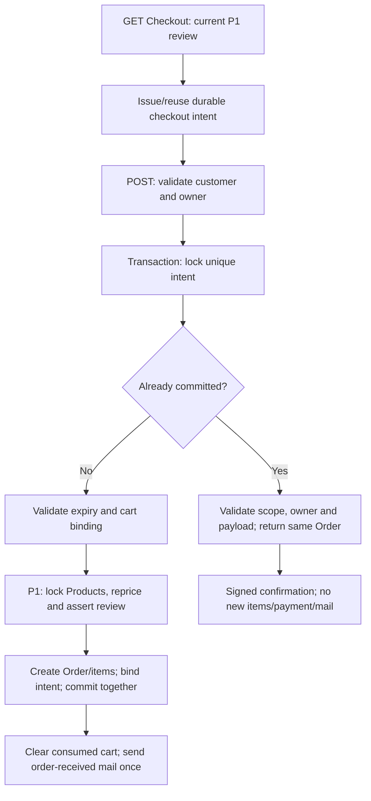

# King CMS — Commerce Extension — P2 Completion Report

نام فایل مطابق درخواست P2 است؛ تاریخ اجرای این مرحله و بررسی نهایی: **۲۰۲۶-۱۰-۲۷**.

## A. Implementation Summary

P2 روی همان Commerce موجود پیاده شد. Product، قیمت دقیق P1، Session Cart، Checkout، Order/OrderItem، PaymentGateway، دو Gateway موجود، Signed Confirmation و PublicOrderAccess حفظ شدند. Order، Checkout، Navigation، Template یا سیستم حسابداری موازی ساخته نشد.

### علت‌های اثبات‌شده پیش از اصلاح

- `app/Models/Order.php` در ابتدای P2: `markCompleted()` هم `status=completed` و هم `payment_status=paid` ثبت می‌کرد؛ هیچ مدرک مالی لازم نداشت.
- `app/Filament/Resources/OrderResource.php`: status، payment_status و payment_method قابل ویرایش بودند؛ markPaid بدون دلیل، actor یا سابقه مستقل اجرا می‌شد.
- `app/Http/Controllers/CheckoutController.php`: transaction و کنترل‌های قیمت P1 وجود داشت، اما کلید یکتای پایدار خرید وجود نداشت؛ clear کردن Session مانع دو درخواست همزمان نبود.
- `app/Contracts/PaymentGateway.php`، `app/Services/ManualPaymentGateway.php`، `app/Services/ZarinpalPaymentGateway.php` و callback بررسی شدند: قرارداد فعلی method/initialPaymentStatus/instructions است؛ initiate/verify زرین‌پال هنوز placeholder و بدون مسیر موفقیت واقعی است.
- مدل‌ها، migrationها، composer.json و الگوی `InvoiceLifecycle`/`Invoice` بررسی شدند. زیرساخت audit عمومی مناسب Commerce پیدا نشد؛ ClientProjectActivity فعالیت عملیاتی است. بنابراین audit دستی در همان PaymentAttempt نگهداری شد؛ ledger یا Activity subsystem عمومی اضافه نشد.

### نتیجه پیاده‌سازی

1. تکمیل سفارش فقط fulfillment را تغییر می‌دهد؛ پرداخت نمی‌سازد.
2. تأیید دستی فقط برای مدیر فعال، با بازخوانی مجوز از DB و ثبت actor/time/reason/reference انجام می‌شود.
3. PaymentAttempt پایدار، مبلغ و واحد دقیق، منشأ، lifecycle و قیدهای یکتا دارد.
4. Checkout intent پایدار از token بازبینی قیمت مستقل است؛ ایجاد Order و اقلام و اتصال intent در یک transaction انجام می‌شود.
5. replay موفق سفارش یا تأیید دستی، رکورد مالی، اقلام یا ایمیل دریافت سفارش را تکرار نمی‌کند.
6. شروع واقعی درگاه و تسویه آنلاین در سرویس P2 صریحاً unavailable هستند. هیچ authority، reference یا verification موفق ساختگی تولید نمی‌شود.

هیچ داده، تنظیم یا migration در سایت واقعی اجرا/تغییر داده نشد. تغییرات قبلی Homepage، Header، گزارش منو و P1 در working tree حفظ شدند.

## B. Files & Migrations

فقط فایل‌های همین P2 در جدول آمده‌اند. diff کلی workspace شامل تغییرات قبلی نیز هست و نباید به‌عنوان diff خالص P2 معرفی شود.

| فایل | وضعیت و هدف |
| --- | --- |
| `database/migrations/2026_10_27_000000_create_commerce_payment_foundation.php` | جدید؛ دو جدول افزایشی checkout_intents و payment_attempts، FKها و unique/indexها؛ بدون تغییر Order تاریخی |
| `app/Models/PaymentAttempt.php` | جدید؛ رابطه Order/actor، castهای exact/JSON/date؛ جلوگیری از save/delete خارج از سرویس مالی |
| `app/Services/OrderPaymentService.php` | جدید؛ تأیید دستی audited، رزرو intent داخلی پرداخت، وضعیت‌های بدون تسویه، قفل و transitionهای مجاز، درگاه غیرفعال P2 |
| `app/Services/CheckoutIdempotency.php` | جدید؛ صدور intent، binding Session/owner/cart، payload hash، transaction و replay پایدار |
| `app/Policies/OrderPolicy.php` | جدید؛ مشاهده/ویرایش مدیریت فقط مدیر فعال؛ ایجاد/حذف از Resource مجاز نیست |
| `app/Models/Order.php` | تغییر؛ رابطه تلاش‌ها، نمایش منشأ، حفاظت snapshot/وضعیت مالی و واگذاری helperها به سرویس کنترل‌شده |
| `app/Http/Controllers/CheckoutController.php` | تغییر؛ هماهنگی intent با P1، replay قبل از بررسی سبد خالی، owner معتبر، UUID شماره سفارش و ارسال ایمیل فقط برای ایجاد جدید |
| `app/Services/CartService.php` | فقط public شدن ثابت SESSION_KEY برای مصرف همان منبع Session؛ محاسبه/بازبینی P1 بازنویسی نشد |
| `resources/views/shop/checkout.blade.php` | hidden intent و خطای فارسی Checkout؛ فرم و ظاهر موجود حفظ شدند |
| `app/Filament/Resources/OrderResource.php` | وضعیت/روش فقط خواندنی، منشأ و سوابق پرداخت، اقدام تأیید دستی با دلیل/مرجع؛ نمایش exact مبلغ؛ relationshipهای snapshot فقط خواندنی |
| `app/Filament/Resources/OrderResource/Pages/EditOrder.php` | allowlist سمت سرور: فقط admin_note قابل ذخیره است؛ forged Livewire state وضعیت مالی را عوض نمی‌کند |
| `tests/Feature/CommercePaymentFoundationTest.php` | جدید؛ حالت مالی، مجوز، audit، legacy، lifecycle، unique constraints و تزریق فرم مدیریت |
| `tests/Feature/CheckoutIdempotencyTest.php` | جدید؛ replay، conflict، rollback، review P1، مالکیت، Session loss و عدم تکرار ایمیل |
| `tests/Feature/CommerceConcurrencyTest.php` | جدید؛ دو process مستقل روی SQLite موقت، Order/اقلام و تسویه دستی |
| `tests/Feature/CommerceInnoDbConcurrencyTest.php` | جدید؛ همان raceها روی نمونه InnoDB ایزوله، قیدهای واقعی و قفل Product مسیر P1؛ بدون نمونه صریح تست skip می‌شود |
| `tests/Support/commerce-payment-worker.php` | جدید؛ worker تست همزمانی با barrier، منع HTTP واقعی و محدودیت DB تست |
| `tests/Support/IsolatedCommerceMySql.php` | جدید؛ اتصال فقط به نمونه موقت localhost پس از تطبیق @@datadir با پوشه صریح تست؛ جلوگیری از استفاده از DB سایت |
| `tests/Feature/ShopTest.php` | helper مالی اکنون با مدیر و دلیل صریح تست می‌شود؛ assertionهای دو شکست قدیمی تغییر نکردند |
| `tests/Feature/OrderOperationsTest.php` | همان تطبیق helper با تأیید مالی مجاز؛ مجوز مهمان تضعیف نشد |
| `tests/Feature/ShopAccountIntegrationTest.php` | پاک‌سازی صریح intent در fixture پیش از حذف Order آزمایشی؛ FK جدید عمداً حذف Order دارای سابقه را محدود می‌کند |
| همین گزارش | قرارداد، نتایج واقعی و محدودیت‌های P2 |

PaymentGateway، ShopServiceProvider، ManualPaymentGateway، ZarinpalPaymentGateway، ZarinpalGraphqlClient، callback، PublicOrderAccess، OrderConfirmationUrl، OrderItem، Template Runtime و قراردادهای ServiceOffering/Portal در P2 تغییر نکردند.

Migration فقط schema جدید ایجاد می‌کند؛ هیچ insert/backfill یا تغییر status/total تاریخی ندارد. down ابتدا payment_attempts و سپس checkout_intents را حذف می‌کند. rollback این migration پس از ثبت سابقه مالی، داده همان جدول‌های جدید را حذف خواهد کرد و برای Production در این مرحله اجرا/توصیه نشده است.

## C. Payment Data Model

### checkout_intents

| ستون | قرارداد |
| --- | --- |
| id | کلید اصلی |
| key_hash CHAR(64), unique | SHA-256 شناسه intent؛ شناسه خام فرم در DB نگهداری نمی‌شود |
| scope_hash CHAR(64) | binding HMAC به scope محرمانه Session و owner معتبر/guest |
| cart_hash CHAR(64) | شناسه و تعداد اقلام؛ مستقل از acknowledgment قیمت |
| payload_hash nullable CHAR(64) | پس از ایجاد سفارش، hash قطعی customer fields + owner + payment method |
| order_id nullable, unique, FK | هر intent به حداکثر یک Order و هر Order به یک intent؛ restrict on delete |
| expires_at, timestamps | intent مصرف‌نشده یک روز معتبر است؛ سابقه commit‌شده با انقضا پاک یا آزاد نمی‌شود |

این جدول سفارش یا سبد دوم نیست؛ فقط درخواست ایجاد Order موجود را deduplicate می‌کند. هیچ مبلغ یا customer PII خام در آن تکرار نمی‌شود.

### payment_attempts

| گروه ستون‌ها | قرارداد |
| --- | --- |
| id, order_id | کلید اصلی و FK اجباری به Order، restrict on delete |
| provider, merchant_context nullable | manual/zarinpal از Order معتبر؛ context امن provider برای P3، بدون token/secret |
| amount DECIMAL(12,2), currency, amount_unit | snapshot دقیق Order.total و IRT؛ تغییرناپذیر در عملیات سرویس |
| gateway_amount nullable string, gateway_amount_unit nullable | تا مشخص‌شدن قرارداد رسمی provider خالی؛ تبدیل/واحد بانکی حدس زده نشده |
| status | pending/succeeded/failed/uncertain/cancelled، index مستقل و composite order_id/status |
| initiation_key CHAR(64), unique | hash intent داخلی شروع پرداخت؛ مستقل از intent Checkout |
| authority nullable, provider_reference nullable | unique روی provider+authority و provider+provider_reference؛ حتی بین Orderهای مختلف collision مجاز نیست |
| active_order_id nullable, unique, FK | جایگاه یکتای تلاش باز/نامشخص هر Order؛ مانع دو تلاش فعال همزمان |
| settlement_order_id nullable, unique, FK | جایگاه یکتای تسویه هر Order؛ بدون افزودن payment_status رقیب روی Order |
| source, verification_outcome, verified_at nullable | منشأ/نتیجه و زمان verification واقعی؛ P2 فقط manual_confirmed می‌نویسد و verified_at را خالی می‌گذارد |
| confirmed_by nullable FK, actor_snapshot JSON | مدیر تأییدکننده؛ حذف حساب FK را null می‌کند و snapshot id/name باقی می‌ماند |
| confirmed_at, manual_reference, confirmation_reason | زمان، مرجع اختیاری و دلیل اجباری تأیید دستی |
| diagnostics JSON, timestamps | فقط codeهای داخلی allowlist؛ بدون payload، credentials یا exception خام provider |

دو ستون slot، وضعیت مالی دوم نیستند؛ راه سازگار SQLite/MySQL برای unique شرطی «یک تلاش فعال» و «یک تسویه» با nullable unique هستند. سرویس همیشه slot را برابر order_id همان attempt می‌نویسد. FK وجود Order را تضمین می‌کند؛ برابری slot/order_id و transition مجاز، قرارداد سرویس است، نه CHECK یا trigger عمومی جدید.

قیدهای authority/reference برای کل provider یکتا هستند و merchant_context اختیاری uniqueness را با NULL تضعیف نمی‌کند. این انتخاب محافظه‌کارانه است؛ اگر P3 قرارداد رسمی namespace مرجع در هر merchant یا طول/حساسیت حروف دیگری نشان داد، پیش از اتصال واقعی باید بازبینی شود. provider-specific fieldها فعلاً nullable و بدون داده ساختگی‌اند.

## D. Financial State Contract

`Order.payment_status` همان ستون مالی موجود است. `Order.status` وضعیت کلی/انجام و alias قدیمی paid را نگه می‌دارد.

| عملیات | شرط و نتیجه |
| --- | --- |
| ایجاد Order | فقط pending/unpaid؛ مبلغ و اقلام همان snapshot معتبر P1 |
| confirmManual | مدیر فعال بازخوانی‌شده، method=manual، مبلغ مثبت معتبر، unpaid/failed، وضعیت pending/completed، بدون settlement یا تلاش فعال نامشخص |
| تأیید دستی pending | payment_status=paid و status=paid برای سازگاری قدیمی؛ source=manual_confirmed؛ بدون verified_at بانکی |
| تأیید دستی completed/unpaid | payment_status=paid؛ completed حفظ می‌شود؛ تحویل دوباره ایجاد نمی‌شود |
| تکرار تأیید دستی ثبت‌شده | همان attempt؛ actor/reason/reference/time اولیه بازنویسی نمی‌شود |
| complete | مدیر فعال، غیرcancelled و بدون تعارض Legacy؛ فقط status=completed؛ payment_status و evidence حفظ می‌شوند |
| cancel | مدیر فعال، غیرcompleted/cancelled، بدون تلاش باز/نامشخص؛ فقط status=cancelled؛ پرداخت و سابقه تسویه حذف نمی‌شوند؛ refund نیست |
| Legacy paid بدون attempt | خواندنی با برچسب «پرداخت قدیمی؛ منشأ تأیید نامشخص»؛ هیچ attempt بانکی backfill نمی‌شود و پرداخت مجدد ممنوع است |
| Legacy متناقض status=paid/payment_status!=paid | آغاز پرداخت، complete و cancel مسدود تا تعیین تکلیف صریح؛ حذف alias نباید تنها نشانه پرداخت قدیمی را محو و امکان شارژ دوباره ایجاد کند |

Orderهای واقعاً paid قدیمی همچنان قابل complete/cancel طبق شروط قبلی‌اند؛ قاعده completed غیرقابل cancel حفظ شد. Order جدید با total صفر همچنان pending/unpaid ثبت می‌شود؛ prepare و تأیید دستی مالی برای صفر رد می‌شوند. مدیر می‌تواند fulfillment را مستقل کامل کند؛ هیچ free/gateway verification ساختگی ثبت نمی‌شود.

`Order::markPaid()` دیگر paid setter آزاد نیست: wrapper مسیر دستی، با مدیر معتبر و دلیل اجباری است. فراخوانی قدیمی بدون actor authenticated یا دلیل، عمداً مجاز نیست. complete/cancel نیز سرویس دارای کنترل سمت سرور را صدا می‌زنند.

Model saving ایجاد paid و update/forceFill وضعیت، روش، total/subtotal و ownership موجود را رد می‌کند. فرم مدیریت فقط admin_note را ذخیره می‌کند و Repeaterهای items/paymentAttempts در سمت سرور disabled و non-saving هستند؛ حذف/تزریق state رابطه، snapshot یا سابقه را عوض نمی‌کند. PaymentAttempt save/delete عادی نیز ممنوع است.

مرز اعتماد: سرویس مالی برای نوشتن مجاز، داخل transaction از Query Builder استفاده می‌کند. SQL خام، DB::table یا saveQuietly/بدون event در کد trusted، مکانیزم authorization کاربر نیستند و نباید برای داده request استفاده شوند؛ این فاز trigger/ledger در سطح کل DB اضافه نکرده است. importer یا integration سفارشی خارج از repository باید به قرارداد سرویس مهاجرت کند.

## E. Checkout Idempotency



- فرم فعلی `_checkout_intent` تصادفی ۶۴ کاراکتری می‌گیرد. refresh با همان سبد و intent مصرف‌نشده، همان شناسه را نگه می‌دارد؛ تغییر اقلام یا اتمام خرید، intent جدید می‌دهد.
- `_cart_review` همان token مستقل P1 است. idempotency به معنای تأیید مبلغ نیست؛ قبل از ایجاد Order، P1 با همان DB query/lock و BCMath دوباره اجرا می‌شود.
- scope سمت سرور از HMAC و seed Session ساخته می‌شود؛ seed ابتدا از Session ID مشتق و در Session نگهداری می‌شود تا rotation معمول Session ID، فرم را بی‌دلیل باطل نکند. owner نیز داخل scope/payload و هنگام replay با Order.user_id تطبیق دارد. possession کلید به‌تنهایی یا شماره تلفن/ایمیل یکسان، دسترسی نمی‌دهد.
- intent در DB قید یکتا دارد و پیش از ایجاد Order lock می‌شود. قفل intent → Productهای مرتب‌شده P1 → ایجاد Order/اقلام → اتصال intent، یک transaction است. سه retry داخلی transaction برای خطاهای قابل retry Laravel وجود دارد.
- درخواست دوم پس از commit، با وجود سبد خالی و review token پاک‌شده، همان Order را برمی‌گرداند؛ customer payload یا method متفاوت رد می‌شود. داده مالی Client همچنان مرجع نیست.
- بعد از commit، callback ایجاد دیگر اجرا نمی‌شود؛ تغییر/حذف Product در این replay snapshot Order را تغییر نمی‌دهد. سبد فعلی متفاوت به‌عنوان خرید تازه داخل همان intent پردازش نمی‌شود؛ برای خرید تازه فرم/intent مستقل لازم است.
- intent مصرف‌نشده به cart identity بسته است؛ تغییر سبد در فرم قدیمی، خطای فارسی و فرم جدید لازم دارد. تغییر صرف قیمت، intent را مصرف نمی‌کند و بازبینی تازه P1 می‌تواند با همان intent ادامه دهد.
- شکست پیش از commit، Order/اقلام و binding را rollback می‌کند؛ intent مصرف‌نشده باقی می‌ماند و retry معتبر ممکن است. انقضا فقط intent مصرف‌نشده را رد می‌کند؛ هیچ intent commit‌شده‌ای دوباره آزاد نمی‌شود.
- Session loss یا تغییر customer owner، replay را رد می‌کند؛ key hash به‌تنهایی مسیر بازیابی سفارش مشتری دیگر نیست. Signed Confirmation و PublicOrderAccess قبلی تغییری نکردند.
- برای POSTهای قدیمی بدون hidden key، intent سروری از scope + cart identity + نسل خرید مشتق و با upsert یکتا durable می‌شود؛ این مسیر صرفاً Session check نیست. اگر فرم جدید صادر شده باشد همان intent جاری استفاده می‌شود؛ حذف review token کنترل P1 را دور نمی‌زند.
- فقط Order جدید ایمیل دریافت سفارش می‌گیرد؛ replay موفق هیچ payment-success event یا ایمیل جدیدی ندارد. Session قدیمیِ درخواست همزمان، فقط سبد همان intent مصرف‌شده را پاک می‌کند؛ سبد خرید بعدی با intent متفاوت حفظ می‌شود.
- شماره سفارش جدید UUID دارد تا random چهاررقمی قبلی، برخورد تصادفی را وارد ثبت سفارش نکند؛ Order قدیمی یا route/lookup آن تغییر نکرد.

تضمین DB مربوط به **همان intent** است؛ دو intent مستقل، دو خرید مستقل‌اند. تشخیص خودکار اینکه مشتری واقعاً قصد دو خرید مشابه داشته یا خیر، با fingerprint یا شماره تلفن انجام نمی‌شود.

## F. PaymentAttempt Lifecycle & P3 Contract

| مرحله | رفتار P2 |
| --- | --- |
| prepare(Order, intent) | قفل Order، کنترل unpaid/مبلغ/وضعیت، snapshot از Order، ایجاد pending داخلی و اشغال active slot؛ بدون HTTP/authority |
| replay همان initiation intent | همان attempt حتی اگر failed/cancelled/uncertain باشد؛ عملیات تازه‌ای شروع نمی‌کند |
| pending → failed | فقط code داخلی initiation_unavailable؛ active slot آزاد؛ Order paid نمی‌شود |
| pending → cancelled | فقط cancelled_before_send؛ active slot آزاد؛ لغو تلاش به معنی تسویه نیست |
| pending → uncertain | transport_unknown؛ attempt و active slot حفظ؛ retry جدید، manual settlement و لغو Order مسدود |
| uncertain → terminal | در P2 مسیر آزاد عمومی ندارد؛ نیازمند reconciliation معتبر P3 است؛ timeout به failed یا succeeded تبدیل نمی‌شود |
| failed/cancelled → retry | فقط intent جدید، روی همان Order و پس از کنترل وضعیت مالی؛ attempt قبلی حفظ می‌شود |
| manual settlement | تلاش موفق مستقل با source=manual_confirmed و settlement slot؛ بدون verified_at/authority/reference بانکی |
| gateway initiate/settle | متدهای صریح unavailable و exception؛ حتی array دارای verified=true هیچ تسویه‌ای نمی‌سازد |

قفل مالی همواره Order پیش از attempt است. دو مدیر برای یک Order، زیر همان قفل به یک settlement می‌رسند؛ قید unique settlement_order_id دفاع DB اضافه است. active_order_id نیز اجازه چند تلاش باز یا ایجاد charge دوم برای وضعیت نامعلوم را نمی‌دهد.

در P3 لازم است reservation پایدار ابتدا commit شود، شبکه خارج از قفل DB انجام شود و سپس نتیجه واقعی با قفل Order/attempt و همان uniqueها ثبت شود. provider/merchant، authority، مبلغ، ارز، واحد، reference و نتیجه تجاری رسمی باید تطبیق داده شوند. callback یا HTTP 200 به‌تنهایی مجوز settlement نیست. entry point غیرفعال فعلی باید با این قرارداد واقعی تکمیل شود؛ array result یک راه پذیرش verification ادعاشده Client نیست.

### Exact money و Legacy

- همان ProductPricingService.amount و BCMath P1 استفاده می‌شود؛ هیچ حساب مالی با float انجام نمی‌شود.
- snapshot مالی از **Order.total ذخیره‌شده** می‌آید؛ نه قیمت جاری Product، Pricing Cards، Service یا request.
- دامنه فعلی DECIMAL(12,2) حفظ شده است؛ مبلغ خراب، منفی، precision اضافه و overflow رد می‌شوند. zero policy عمداً بدون تسویه خودکار باقی است.
- مبلغ Legacy دو اعشار معتبر برای تأیید دستی exact باقی می‌ماند. اگر provider آینده اعشار IRT را نپذیرد، P3 باید صریحاً رد/سیاست‌گذاری کند؛ P2 آن را round یا به IRR تبدیل نمی‌کند.
- اگر مبلغ تاریخی قبلاً توسط DB یا سیستم بیرونی گرد شده باشد، P2 اصل قبل از گردکردن را از ستون DECIMAL قابل استنتاج نمی‌داند و آن را بازسازی/بازنویسی نمی‌کند.

## G. Backward Compatibility

- Products، Cart، publication/availability، exact totals و reviewهای P1، guest/account Checkout، snapshot اقلام و signed/owned order access با تست مرتبط حفظ شدند.
- Order بدون PaymentAttempt معتبر است. Migration هیچ تاریخچه بانکی به paid قدیمی نسبت نمی‌دهد.
- payment_status موجود حفظ شد؛ جدول تلاش، منبع evidence است و فیلد مالی موازی روی Order ندارد.
- manual payment باقی است؛ تأیید آن اکنون عملیات صریح دارای دلیل/مجوز است. نصب دارای zarinpal نمی‌تواند از این مسیر، پرداخت خود را verified معرفی کند؛ تغییر بی‌صدای method هم مجاز نیست.
- فرم، runtime، SEO، Portal، operational Services و مسیرهای Template دست‌کاری نشدند. تغییرات قدیمی workspace بازنشانی نشدند.
- تفاوت عمدی: ساخت Order جدید paid از mass assignment، markPaid بدون مجوز/دلیل و ویرایش آزاد مالی در پنل دیگر ممکن نیست. integrationهای سفارشی متکی به این رفتار ناامن باید سازگار شوند.
- حذف Order متصل به intent/attempt به دلیل حفظ evidence محدود شده است؛ Orderهای Legacy بدون این رابطه از migration تغییری نمی‌گیرند. حذف مدیریتی از Resource نیز مجاز نیست.

ایمیل فعلی همچنان «سفارش دریافت شد» همراه payment_status واقعی است. تأیید دستی در P2 notification موفقیت جدیدی منتشر نمی‌کند؛ تأیید بانکی و automation مربوط به P3 است. ایمیل دریافت فقط در branch ایجاد جدید و پس از برگشت transaction ارسال می‌شود. crash پس از commit و پیش از ارسال می‌تواند ایمیل دریافت را از دست بدهد؛ replay عمداً آن را دوباره ارسال نمی‌کند. تضمین delivery/exactly-once ایمیل یا Outbox عمومی در این فاز ادعا نمی‌شود.

## H. Test Results

### نتیجه نهایی واقعی

**۱۶۹ تست، ۱۰۵۲ assertion: ۱۶۷ موفق، ۲ شکست شناخته‌شده؛ صفر error و صفر skip.**

**تست‌های افزوده P2: ۵۳ تست و ۲۶۲ assertion، همگی موفق.** تمام ۳۱ تست P1 با ۲۸۷ assertion نیز موفق‌اند.

| تست | تعداد | assertion | شکست |
| --- | ---: | ---: | ---: |
| CommercePaymentFoundationTest | 35 | 129 | 0 |
| CheckoutIdempotencyTest | 12 | 94 | 0 |
| CommerceConcurrencyTest — SQLite | 2 | 14 | 0 |
| CommerceInnoDbConcurrencyTest — MariaDB/InnoDB | 4 | 25 | 0 |
| CheckoutTransactionIntegrityTest — P1 | 31 | 287 | 0 |
| ShopTest | 19 | 83 | 1 |
| ShopAccountIntegrationTest | 12 | 45 | 0 |
| OrderOperationsTest | 6 | 22 | 1 |
| ZarinpalPaymentGatewayTest | 5 | 15 | 0 |
| ProductDomainServicesTest | 5 | 39 | 0 |
| ProductFoundationDatabaseTest | 4 | 17 | 0 |
| ProductTemplateRuntimeTest | 8 | 31 | 0 |
| ProductMediaSeoContractTest | 4 | 16 | 0 |
| SiteHeaderTemplateTest | 22 | 235 | 0 |

دو شکست همان موارد ثبت‌شده در P1 هستند:

1. `ShopTest::test_product_preview_is_auth_protected_and_noindexed`
2. `OrderOperationsTest::test_guest_cannot_access_printable_order_page`

هر دو انتظار redirect دارند و پاسخ واقعی guest روی admin route برابر 404 است. middleware این رفتار در P2 تغییر نکرد؛ assertionها برای سبزکردن نتیجه بازنویسی نشدند. همان دو تست با bootstrap/classmap موقت P1 که شش کلاس اولیه Product/pricing/cart/controller/header را از HEAD بار می‌کرد نیز دوباره اجرا شدند: **۲ تست، ۲ assertion، همان ۲ شکست**. این baseline کل application را به snapshot تاریخی برنمی‌گرداند؛ شاهد مکمل گزارش P1 و عدم تغییر middleware است.

### محیط و همزمانی

- Feature/financial tests روی SQLite `:memory:` با RefreshDatabase، HTTP واقعی ممنوع و Mail fake/mock اجرا شدند؛ DB واقعی سایت استفاده نشد.
- دو race SQLite با دو process مستقل، barrier مشترک و فایل موقت اختصاصی اجرا شدند. worker فقط برای SQLite می‌تواند busy lock upgrade را با همان intent حداکثر ۹ بار retry کند؛ این retry تست، اثبات semantics ردیفی InnoDB نیست.
- MariaDB **10.4.32** از binary محلی XAMPP پیدا شد. برای این کار نمونه مستقل با datadir تازه زیر OS Temp، bind به 127.0.0.1 و پورت مستقل راه‌اندازی شد؛ instance موجود و دیتابیس‌های آن دست‌نخورده‌اند.
- قبل از هر write، helper مقدار واقعی `@@datadir` را با پوشه موقت صریح تطبیق داد. schemaهای تصادفی دارای پسوند `_testing` در همان نمونه ایجاد و پس از تست حذف شدند. migration واقعی P2 بدون تغییر روی fixture پایه اجرا شد؛ داده Legacy واقعی مهاجرت نشد.
- پس از آزمون‌ها، نمونه اختصاصی تست متوقف و خروج process آن تأیید شد؛ process قبلی XAMPP همچنان برقرار بود. بررسی خودکار مجوز، فرمان ترکیبی توقف/حذف بازگشتی پوشه موقت را با دلیل کلی `blocked by policy` رد کرد. توقف مستقل موفق شد؛ پوشه پایه موقت `C:\Users\Marco\AppData\Local\Temp\king_p2_mysql_testing_59c80ecb2076435bbcea1520592f81a2` برای پاک‌سازی دستی باقی ماند. DB سایت یا فایل‌های آن حذف نشدند.
- روی InnoDB، دو process با barrier و تأخیر کنترل‌شده پس از row lock، ثبت همان Checkout intent و تأیید دستی همان Order را همزمان انجام دادند؛ یک Order/مجموعه اقلام و یک settlement حاصل شد. retry اضافه SQLite در این مسیر ممنوع است؛ فقط transaction retry عادی سرویس وجود دارد.
- collision واقعی uniqueهای authority/reference/initiation/active/settlement روی InnoDB با خطای duplicate key بررسی شد؛ uniqueهای intent و order binding نیز از schema واقعی خوانده شدند.
- مسیر واقعی `CartService::authoritativeItems(lock: true)` روی Product آزمایشی InnoDB اجرا شد؛ UPDATE قیمت از اتصال دوم با lock timeout=1 و خطای 1205 متوقف شد، سپس بعد از commit موفق شد. این، بررسی واقعی قفل P1 روی همین MariaDB محلی است.
- raceها در سطح domain/persistence با process مستقل‌اند؛ HTTP server، session backend اشتراکی Production، مرورگر و reverse proxy همزمان تست نشده‌اند.
- MariaDB/InnoDB محلی با نسخه MySQL و تنظیمات واقعی Production یکسان فرض نشده است. MySQL 8 و محیط استقرار جداگانه همچنان تأییدنشده‌اند.

دستور اجرای نهایی، پس از آماده‌کردن نمونه موقت InnoDB و تنظیم دو متغیر صریح آن:

```powershell
$env:APP_ENV='testing'
$env:DB_CONNECTION='sqlite'
$env:DB_DATABASE=':memory:'
$env:DB_URL=''
$env:CACHE_STORE='array'
# KING_P2_INNODB_TEST_PORT / KING_P2_INNODB_TEST_DIRECTORY:
# only an independently initialized temporary local instance, never the site's DB.
php -d memory_limit=512M vendor/bin/phpunit `
  tests/Feature/CommercePaymentFoundationTest.php `
  tests/Feature/CheckoutIdempotencyTest.php `
  tests/Feature/CommerceConcurrencyTest.php `
  tests/Feature/CommerceInnoDbConcurrencyTest.php `
  tests/Feature/CheckoutTransactionIntegrityTest.php `
  tests/Feature/ShopTest.php tests/Feature/ShopAccountIntegrationTest.php `
  tests/Feature/OrderOperationsTest.php tests/Feature/ZarinpalPaymentGatewayTest.php `
  tests/Feature/ProductDomainServicesTest.php tests/Feature/ProductFoundationDatabaseTest.php `
  tests/Feature/ProductTemplateRuntimeTest.php tests/Feature/ProductMediaSeoContractTest.php `
  tests/Feature/SiteHeaderTemplateTest.php --no-progress
```

شواهد اجرای نهایی در OS Temp: `king-p2-verified.xml` و `king-p2-verified.txt`؛ baseline دو شکست: `king-p2-baseline.xml/.txt`. در نبود متغیرهای محیطی نمونه صریح، تست InnoDB skip می‌شود و نباید آن را pass حساب کرد؛ اجرای نهایی گزارش‌شده skip نداشت.

مسیر ایمنیِ نبود نمونه نیز پس از توقف سرور جداگانه اجرا شد: **۴ تست، صفر assertion، ۴ skip و بدون error/failure** (`king-p2-no-innodb.xml/.txt`). این اجرای جداگانه به شمار موفقیت‌های مجموعه نهایی اضافه نشده است.

پوشش امنیتی اضافه شامل administrator غیرفعال/لغو مجوز، دلیل خالی، ثبت دستی روی zarinpal، replay با actor متفاوت، بقای actor snapshot پس از حذف حساب، legacy متناقض، سفارش صفر/مبلغ خراب، وضعیت نامشخص، حفظ evidence پس از completion/cancel، forceFill مالی و جعل state روابط مدیریت است. idempotency شامل guest/owner، key جعلی، تغییر owner/Session، conflict payload، pre-commit rollback، intent جدید، بازبینی قیمت، expiry و Session snapshot قدیمی است.

کیفیت: PHP syntax و Pint --test روی هر ۱۹ فایل PHP همین P2 و `git diff --check` موفق بودند. build دارایی‌ها لازم نشد؛ JavaScript، CSS و component Alpine تغییر نکردند. کل suite پروژه، browser/E2E، ارسال واقعی ایمیل و درگاه واقعی اجرا نشدند.

## I. Remaining Risks

1. **P3 اجرا نشده:** initiate/verify زرین‌پال، قرارداد merchant/environment، conversion/واحد، business response، callback correlation، reconciliation و post-payment notifications هنوز لازم‌اند. وجود token یا PaymentAttempt به معنای پرداخت آنلاین آماده عرضه نیست.
2. **Callback قدیمی:** placeholder فعلی paid نمی‌کند؛ مسیر محدود افشای status با order_number مطرح‌شده در G06 فاز صفر در این P2 تغییر نکرده است. در P3 correlation و پاسخ عمومی کم‌اطلاعات باید بررسی شوند.
3. **Production concurrency:** نمونه MariaDB محلی موفق بود؛ نسخه/engine/isolation/SQL mode، session driver، چند application node و timeoutهای محیط واقعی تأیید نشده‌اند. collision/deadlockهای چند Order مختلف با initiation key اشتباه، ممکن است خطای constraint بدهند؛ داده ناسازگار یا تسویه دوم ایجاد نمی‌شود.
4. **Legacy unknown provenance:** paid قدیمی readable است، اما منشأ بانکی از سورس قابل اثبات نیست. reconciliation واقعی یا اصلاح دستی داده متناقض، تصمیم عملیاتی جداگانه است؛ migration خودکار انجام نمی‌شود.
5. **Zero/fractional policy:** سفارش صفر unpaid باقی می‌ماند؛ تسویه رایگان خودکار و تبدیل اعشار برای بانک نیازمند تصمیم صریح‌اند. P2 به‌جای rounding یا fake verification آن مسیر را مسدود نگه می‌دارد.
6. **Notification delivery:** ایمیل دریافت at-most-once در مسیر ایجاد است؛ crash window و delivery واقعی پوشش داده نشده‌اند. هیچ ادعای exactly-once mail یا automation مالی انجام نمی‌شود.
7. **Integration سفارشی:** helper قدیمی بدون دلیل، write مستقیم status و حذف Order دارای evidence باید با قرارداد جدید تطبیق یابد. Raw SQL trusted همچنان خارج از حفاظت Model events است.
8. **Migration استقرار:** additive بودن و اجرای fixture تأیید شد، اما اجرا روی schema واقعی، backup/rollback plan و ترتیب rollout باید پیش از استقرار بررسی شوند. در Production هیچ migration یا داده‌ای اجرا/اصلاح نشد.

## J. P3 Readiness

**زیرساخت داخلی P2 برای بازبینی معماری و آغاز پیاده‌سازی P3 فراهم است:** Order معتبر و immutable، intent خرید پایدار، attempt وابسته به Order، مقدار exact، provenance، قید یکتا و مسیر settlement دستی مجاز وجود دارند. درگاه واقعی همچنان unavailable است.

پیش از عرضه P3 باید قرارداد رسمی و معتبر همان زرین‌پال/merchant مشخص، درخواست شبکه خارج از lock، correlation authority/reference، تطبیق مبلغ/ارز/واحد، verification تجاری سمت سرور، عدم شارژ مجدد برای uncertain/paid و رقابت callback/admin به همین foundation متصل و تست شوند. پذیرش آرایه callback یا mock موفق به‌تنهایی کافی نیست.

**پایان P2؛ هیچ مرحله P3 خودکار آغاز نشده است. این گزارش تأیید عملکرد سایت واقعی یا Production readiness نیست.**
