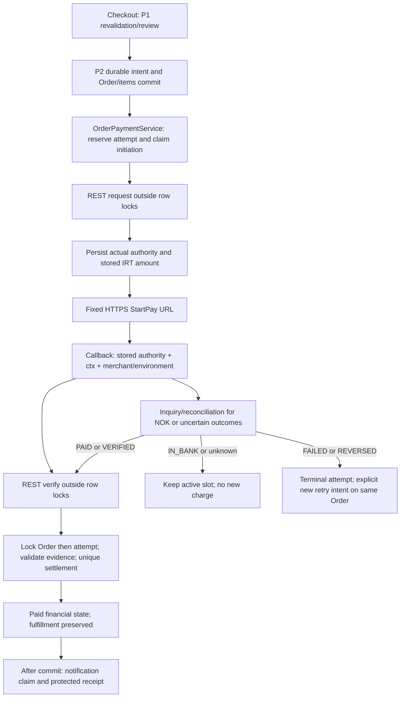

# King CMS — Commerce Extension — P3 Completion Report

تاریخ: ۲۰۲۶-۱۰-۲۷. محدوده: اتصال REST زرین‌پال، verification، بازیابی و تسویه روی همان Commerce مربوط به P1/P2.

**سطح تأیید: Sandbox verified, production not verified.** این عبارت به آزمون واقعی API، صفحه شبیه‌ساز Sandbox و callback داخل test kernel اشاره دارد؛ دسترسی عمومی callback نصب واقعی، مرورگر مشتری و پرداخت با مرچنت Production تأیید نشده‌اند.

## A. Official API Contract

### منابع و انتخاب پروتکل

- [راهنمای اتصال رسمی](https://www.zarinpal.com/docs/paymentGateway/connectToGateway): REST v4 با Merchant ID، request، StartPay و verify؛ موفقیت verify کد 100 و تکرار verification کد 101 با ref_id است.
- [واحد پولی رسمی](https://www.zarinpal.com/docs/paymentGateway/moreFeatures/currency): پارامتر صریح IRT/IRR و amount صحیح در request. Commerce همین IRT را نگه می‌دارد.
- [Sandbox رسمی](https://www.zarinpal.com/docs/paymentGateway/sandBox): host آزمایشی و UUID دلخواه برای Merchant ID؛ authority آزمایشی با S آغاز می‌شود. Enamad یا مرچنت واقعی برای توسعه لازم نیست.
- [Inquiry رسمی](https://www.zarinpal.com/docs/paymentGateway/otherMethods/Inquiry): وضعیت‌های PAID/VERIFIED/IN_BANK/FAILED/REVERSED؛ inquiry به‌تنهایی روش تأیید پرداخت نیست.
- [خطاهای رسمی](https://www.zarinpal.com/docs/paymentGateway/errorList): از جمله -41 سقف ۱۰۰ میلیون تومان، -50 عدم تطبیق مبلغ، -51 پرداخت ناموفق، -53 مرچنت متفاوت، -54 authority نامعتبر و 101 verification تکراری.
- [SDK رسمی PHP](https://github.com/ZarinPal/zarinpal-php-sdk): README بررسی شد؛ وابستگی جدید نصب نشد. HTTP client موجود Laravel برای سه متد مستند کافی است.

سورس قبلی با Bearer token و `next.zarinpal.com/api/v4/graphql/` صرفاً skeleton بود. این توکن برای REST payment API استفاده نمی‌شود. PaymentGateway contract کوچک موجود حفظ شد؛ شبکه پرداخت در `ZarinpalPaymentGateway` به `ZarinpalApiClient` مبتنی بر REST منتقل شد. کلاس GraphQL فقط برای compatibility غیرپرداختی باقی است؛ تنظیمات قدیمی حذف یا به Merchant ID تبدیل نشده‌اند.

| عملیات | مسیر و ورودی authoritative |
| --- | --- |
| request | POST `/pg/v4/payment/request.json`: merchant_id سرور، amount صحیح ذخیره‌شده، currency=IRT، callback_url همین نصب، description و metadata.order_id |
| redirect | فقط HTTPS host مصوب + `/pg/StartPay/{authority}`؛ URL ادعاشده provider یا browser مصرف نمی‌شود |
| verify | POST `/pg/v4/payment/verify.json`: merchant_id همان context، authority و amount همان attempt؛ نه مبلغ request مرورگر |
| inquiry | POST `/pg/v4/payment/inquiry.json`: merchant_id و authority ذخیره‌شده؛ PAID/VERIFIED فقط به verify منجر می‌شوند |
| callback | Authority و Status=OK/NOK مستند، به‌علاوه ctx که King در callback URL خودش تولید کرده است |

host واقعی `https://payment.zarinpal.com` و host آزمایشی `https://sandbox.zarinpal.com` هستند. credential در body HTTPS ارسال می‌شود؛ نه query string یا Bearer token قدیمی.

### رفع ابهام واحد با شواهد واقعی Sandbox

جدول verify راهنمای اتصال از «ریال» نام می‌برد، در حالی که صفحه currency ادامه مراحل را مشترک توصیف می‌کند. رفتار را حدس نزدیم: درخواست IRT با amount=10000، صفحه Sandbox مبلغ ۱۰۰٬۰۰۰ ریال/۱۰٬۰۰۰ تومان نشان داد. verify با 100000 کد -50 گرفت؛ با **همان 10000** کد 100 و در تکرار کد 101 و همان ref_id برگشت. Inquiry نیز PAID پیش از verify و VERIFIED پس از آن را برگرداند.

بنابراین request و verify هر دو عدد صحیح IRT ذخیره‌شده را ارسال می‌کنند؛ تبدیل ×۱۰ وجود ندارد. قرارداد production هنوز با مرچنت واقعی acceptance نشده و نباید از Sandbox بالاتر گزارش شود.

حد پایین ۱٬۰۰۰ تومان در Sandbox با رد 1/100/999 و پذیرش 1000 بررسی شد؛ حد بالا از خطای رسمی -41 است. بازه محلی محافظه‌کارانه ۱٬۰۰۰ تا ۱۰۰٬۰۰۰٬۰۰۰ تومان است؛ محدودیت خاص مرچنت ممکن است سخت‌گیرانه‌تر باشد و پاسخ تجاری provider همچنان کنترل می‌شود. fractional/zero/overflow بدون rounding رد می‌شوند.

در آزمون واقعی مشخص شد metadata.order_id حداکثر ۴۰ کاراکتر می‌پذیرد؛ از ID داخلی عددی Order استفاده شد، نه شماره تاریخی با طول نامعلوم. این metadata راه عمومی lookup در callback نیست. سقف description و fee به مبلغ Order اضافه نشده‌اند و expiry زمانی authority حدس زده نشده است.

## B. Implementation Summary

پیاده شد:

1. تنظیم صریح Sandbox/Production، Merchant ID مجزا، فعال‌سازی پیش‌فرض خاموش و gate مستقل Production؛
2. رزرو پایدار attempt و claim یک‌باره شروع شبکه پیش از HTTP؛
3. درخواست REST واقعی، ثبت authority، redirect محدود به host مصوب؛
4. correlation بر اساس authority ذخیره‌شده، context خصوصی و merchant/environment؛
5. verify واقعی، evidence داخلی typed و تسویه idempotent در همان OrderPaymentService؛
6. inquiry، بازیابی callback ازدست‌رفته، code 101 و failure بعد از verification ولی پیش از ثبت محلی؛
7. حفظ active slot برای نتایج نامشخص و جلوگیری از ارسال charge جدید؛
8. رسید فارسی با مرجع/مبلغ/زمان/منشأ و برچسب صریح Sandbox، retry/reconcile امضاشده و مجاز؛
9. عملیات بررسی وضعیت در OrderResource و ارسال ایمیل تأیید فقط پس از commit، با claim پایدار at-most-once؛
10. تست‌های mock، Sandbox واقعی و race مستقل MariaDB/InnoDB.

Order، Cart، Checkout یا PaymentAttempt موازی ساخته نشد. قیمت/بازبینی و Order snapshots همان P1، Checkout idempotency و manual audit همان P2 هستند. P4، Product types، Service association، fulfillment automation، refund و entitlement آغاز نشدند. هیچ migration، credential، setting یا داده واقعی Production تغییر نکرد.

## C. Files Changed

این فهرست مخصوص P3 است؛ working tree از قبل تغییرات Homepage، Header، گزارش‌ها، P1 و P2 داشت. هیچ reset/checkout یا commit روی آنها انجام نشد.

| فایل | هدف |
| --- | --- |
| `config/payments.php` — جدید | تنظیمات per-installation، merchantهای مجزا، timeout و production gate |
| `.env.example` | کلیدهای خالی/خاموش؛ بدون credential واقعی یا UUID ثابت |
| `app/Services/ZarinpalConfiguration.php` — جدید | config/settings، callback HTTPS canonical، UUID، context HMAC، amount صحیح و host ثابت |
| `app/Services/ZarinpalApiClient.php` — جدید | REST v4، TLS، timeout/response limits، parsing سخت‌گیرانه و خطای عمومی بدون secret |
| `app/Services/ZarinpalVerification.php` — جدید | مدرک داخلی typed حاصل verification؛ array عمومی verified=true مجوز تسویه نیست |
| `app/Services/ZarinpalPaymentGateway.php` | initiate/redirect/callback correlation/verify/inquiry واقعی، کنترل نتیجه تجاری و recovery |
| `app/Services/OrderPaymentService.php` | توسعه همان سرویس P2: claim/lease، persistence outcome، تسویه بانکی و afterCommit |
| `app/Services/PaymentReceiptNotifier.php` — جدید | claim پایدار ارسال یک‌باره ایمیل و تحمل شکست ارسال بدون rollback پرداخت |
| `app/Models/PaymentAttempt.php` | castهای زمان operation/request/notification |
| `app/Models/Order.php` | نمایش منشأ Sandbox جدا از تأیید واقعی و حفظ Legacy unknown provenance |
| `database/migrations/2026_10_27_000001_add_zarinpal_operations_to_payment_attempts.php` — جدید | ستون‌های عملیاتی و namespace محیط برای مرجع provider |
| `app/Http/Controllers/CheckoutController.php` | کنترل مبلغ provider، شروع شبکه پس از commit، یادآوری دسترسی رسید و داده‌های receipt/retry |
| `app/Http/Controllers/ZarinpalCallbackController.php` | حذف lookup با order_number و حذف افشای اطلاعات در پاسخ عمومی |
| `app/Http/Controllers/ZarinpalPaymentController.php` — جدید | POST retry/reconcile امضاشده با کنترل owner |
| `app/Services/OrderConfirmationUrl.php` | استفاده مجدد از signed URL و کنترل owner، capability Session برای بازگشت callback مهمان |
| `routes/web.php` | دو POST signed؛ CSRF exemption فقط callback قبلی باقی است |
| `resources/views/shop/checkout.blade.php` | نمایش خطای قابل بازیابی پرداخت در همان فرم |
| `resources/views/shop/thank-you.blade.php` | نتیجه واقعی، محیط، reference، time و فرم‌های POST محافظت‌شده |
| `resources/views/shop/payment-callback.blade.php` | پاسخ عمومی ثابت بدون شماره/وضعیت/اطلاعات سفارش |
| `app/Filament/Pages/ManageSiteSettings.php` | UI REST، Sandbox UUID generator، محیط/فعال‌سازی و جلوگیری از نشت secret در خطای ذخیره credential |
| `app/Filament/Resources/OrderResource.php` | نمایش محیط/مبلغ ارسالی/زمان/کد بررسی؛ اقدام reconciliation با مجوز سمت سرور |
| `app/Services/ZarinpalGraphqlClient.php` | علامت legacy غیرپرداختی؛ timeout/عدم redirect و حذف exception message حساس از log |
| `tests/Feature/ZarinpalIntegrationTest.php` — جدید | mockهای امنیتی و تراکنشی/UX و namespace محیط |
| `tests/Feature/ZarinpalSandboxTest.php` — جدید | سه آزمون واقعی opt-in با UUID تولیدشده؛ بدون credential Production |
| `tests/Feature/ZarinpalPaymentGatewayTest.php` | assertion جدید پاسخ عمومی callback و نام تست disabled؛ تست قدیمی placeholder دیگر ادعای اتصال نیست |
| `tests/Feature/CommerceConcurrencyTest.php` | اجرای migration P3 روی fixture و امکان workerهای متفاوت؛ تست P2 حفظ شد |
| `tests/Feature/CommerceInnoDbConcurrencyTest.php` | دو race جدید verification/callback در همان harness ایزوله |
| `tests/Support/commerce-payment-worker.php` | worker mock verification و رقابت manual؛ ممنوعیت شبکه واقعی در concurrency |
| `README.md` | جایگزینی توضیح skeleton با تنظیمات REST و الزامات فعال‌سازی |
| همین گزارش | شواهد، محدودیت‌ها و rollout |

PaymentGateway interface، ManualPaymentGateway، PublicOrderAccess، ShopServiceProvider، ProductPricingService، CartService، CheckoutIdempotency، OrderItem، Navigation Core و Template/Block Runtime در P3 تغییر نکردند.

### Migration و compatibility

به payment_attempts ستون‌های environment، requested_at، operation، operation_token، operation_expires_at و notification_claimed_at اضافه شد. environment پیش‌فرض `legacy` فقط یعنی محیط بانکی قبلی نامشخص/نامرتبط است؛ history بانکی ساخته نمی‌شود. مبلغ، status، source، reference و verified_at قبلی backfill نشدند.

uniqueهای initiation، active slot و settlement slot P2 حفظ شدند. authority همچنان provider-wide یکتا است؛ prefix محیط نیز اعتبارسنجی می‌شود. مرجع provider اکنون در **provider + environment + provider_reference** یکتا است تا یک ref آزمایشی با ref واقعی مستقل برخورد نکند؛ collision میان دو Order در همان محیط همچنان رد می‌شود. Legacyها در namespace legacy محافظت می‌شوند. این رفتار با fixture جداگانه Sandbox/Production و مرجع برابر تست شد؛ همه پاسخ‌های production آن تست mock بودند.

down قید قبلی مرجع را برمی‌گرداند. اگر مرجع یکسان در محیط‌های متفاوت وجود داشته باشد، بازگشت آن قید ممکن است fail کند؛ پس rollback کور migration مجاز/توصیه نیست. داده مالی برای سازگارکردن rollback حذف یا بازنویسی نمی‌شود.

## D. Payment Flow



ایجاد سفارش از ارسال request جدا است. شبکه هیچ‌وقت داخل transaction طولانی Product/Order انجام نمی‌شود. درخواست اول، پیام «سفارش دریافت شد» را از تسویه جدا نگه می‌دارد؛ اگر درگاه unavailable باشد Order معتبر/رسید آن باقی می‌مانند. مقدار provider ناسازگار مانند fractional قبل از ایجاد Order رد می‌شود و سبد حفظ می‌شود.

Default initiation intent برای همان Order پایدار است. replay Checkout یا action با همان intent، attempt/request تازه نمی‌سازد. retry پس از failure قطعی باید intent صریح مبتنی بر ID تلاش terminal قبلی داشته باشد؛ double-click همان URL به یک intent می‌رسد. retry به Order قبلی متصل است و Product دوباره برای عوض‌کردن total خوانده نمی‌شود.

## E. Financial Security

### Correlation و دسترسی

- callback با شماره سفارش یا Order ID browser چیزی را پیدا یا paid نمی‌کند. authority باید ذخیره‌شده و متعلق به provider/context/محیط فعال باشد؛ ctx با HMAC و داده همان attempt تطبیق داده می‌شود.
- Status فقط راهنمای مسیر بررسی است. OK به verify و NOK به inquiry همان **attempt همبسته** می‌رود؛ callback قدیمی، تلاش جدیدتر را به‌جای آن بررسی نمی‌کند.
- callback عمومی برای missing/forged/unknown context پاسخ ثابت دارد؛ order number/status/reference/PII برنمی‌گرداند. حتی callback معتبر، بدون owner یا Session capability، فقط همان پاسخ عمومی را می‌بیند.
- بازگشت به receipt برای owner حساب فعال یا مهمانی است که Checkout همان Session او انجام شده باشد. Signed confirmation و کنترل owner قبلی باقی‌اند. از callback بدون Session نمی‌توان لینک تازه جزئیات مشتری گرفت.
- retry/reconcile با POST، signed URL منقضی‌شونده، CSRF معمول و کنترل owner اجرا می‌شوند. امضای لینک مهمان همان capability محدود است؛ Order number مجوز نیست. CSRF exemption جدید عمومی ساخته نشد.

### Evidence و تسویه

verify فقط با merchant/context معتبر و amount/authority ذخیره‌شده ارسال می‌شود. REST پاسخ amount/merchant echo را الزام نکرده؛ اثبات تطبیق از درخواست معتبر سرور و semantics تجاری verify است، از جمله خطای -50. اگر echo اختیاری متناقضی برسد، آن را رد می‌کنیم؛ فیلد ساختگی برای پرکردن مدرک اضافه نشده است.

فقط code عددی 100/101، ref_id معتبر مثبت، پاسخ موفق بدون errors و مدرک typed با attempt/Order/environment/context/unit/amount یکسان وارد تسویه می‌شوند. missing reference، HTTP 200 با errors، verified=true، داده متناقض و بدنه خراب مدرک مالی نیستند. Source فقط پس از commit برابر gateway_verified می‌شود و verified_at/reference ثبت می‌شوند. paid قدیمی بدون چنین evidence هرگز verified معرفی نمی‌شود.

قفل‌ها همیشه **Order → PaymentAttempt** هستند. operation token/lease فقط یک verification همزمان را ارسال می‌کند؛ token قدیمی نمی‌تواند نتیجه worker جدید را overwrite کند. حتی اگر lease پس از crash منقضی و verify تکرار شود، verification سمت provider و unique settlement/reference مانع اثر مالی دوم‌اند. callback replay هیچ notification دوم یا fulfillment ایجاد نمی‌کند.

Manual confirmation P2 همچنان مجوز/دلیل می‌خواهد و روی method=zarinpal مجاز نیست؛ مسیر recordUnsettled قدیمی نیز نمی‌تواند attempt ارسال‌شده به provider را failed کند و slot آزاد کند. cancel عادی با attempt باز مسدود است. اگر وضعیت تاریخی/بیرونی با وجود attempt باز، cancelled شده باشد و بانک پرداخت را واقعاً تأیید کند، evidence و payment_status=paid ثبت می‌شوند ولی **status=cancelled باقی می‌ماند**؛ وجه دریافت‌شده پنهان و سفارش دوباره فعال/تحویل نمی‌شود. refund خارج از P3 است.

### شبکه و secret

hostها ثابت، redirect شبکه غیرفعال، TLS verification فعال، connect timeout=5 و timeout کل در بازه ۳ تا ۶۰ ثانیه‌اند. progress/body limit برابر ۶۴KiB و JSON depth محدود است. HTTP init retry خودکار وجود ندارد. exception/body/message خام provider در log، diagnostics یا UI بازتاب داده نمی‌شود؛ diagnostics فقط codeهای داخلی/عددی مجاز دارد.

Merchant ID فقط از تنظیم نصب/سرور می‌آید؛ authority یا مبلغ HTTP client هرگز credential را overwrite نمی‌کند. HMAC context به‌جای Merchant ID خام روی attempt ذخیره شده است. خطای DB هنگام ذخیره credential پنل با خطای عمومی و بدون زنجیره exception اصلی بسته می‌شود؛ logger قدیمی نباید SQL دارای credential را چاپ کند.

## F. Failure & Reconciliation

| وضعیت | رفتار و retry |
| --- | --- |
| خطای قطعی request مستند | failed؛ slot آزاد؛ retry جدید فقط با intent صریح همان Order |
| HTTP/JSON نامعتبر یا پاسخ متناقض | uncertain؛ slot حفظ؛ کد خطای business هم اگر با داده success متناقض باشد failure قطعی فرض نمی‌شود |
| timeout یا crash پس از claim شروع | requested_at دائمی است؛ ارسال request دوم ممنوع، حتی بعد از انقضای lease |
| authority دریافت نشده | نمی‌توان inquiry مبتنی بر authority را با Order number حدس زد؛ نیازمند پیگیری پذیرنده/provider است؛ attempt و مبلغ حفظ می‌شوند |
| verify timeout/خطای تجاری/مغایرت | uncertain؛ active باقی؛ inquiry بعدی نتیجه را بررسی می‌کند، charge تازه مجاز نیست |
| inquiry=IN_BANK | تلاش باز؛ ادامه همان authority ممکن است، تلاش دوم ممنوع |
| inquiry=PAID یا VERIFIED | فقط verify واقعی؛ inquiry به‌تنهایی paid نمی‌کند |
| inquiry=FAILED یا REVERSED | terminal؛ unpaid بودن Order حفظ؛ intent جدید می‌تواند attempt جدید بسازد |
| browser=NOK | failure مالی فرض نمی‌شود؛ inquiry همان attempt لازم است |
| bank verify موفق، DB محلی failed/crashed | ثبت تسویه rollback/نامشخص؛ inquiry=VERIFIED و verify دوباره با code 101/ref یکسان، همان attempt را بازیابی می‌کنند |
| reference/authority collision | تسویه/redirect cross-order انجام نمی‌شود؛ uncertainty و سابقه حفظ؛ نیازمند بررسی پذیرنده |
| merchant/environment یا APP_KEY تغییر کرده | context معتبر نیست؛ درخواست شبکه با context جدید روی تلاش قدیمی ارسال نمی‌شود؛ credential/key معتبر قبلی باید برای reconciliation حفظ شود |

Inquiry رسمی فقط authority می‌پذیرد. API قابل‌اعتمادی برای اثبات ارتباط authority گمشده با یک Order از روی metadata در منابع بررسی‌شده تثبیت نشد؛ بنابراین هیچ جست‌وجو/انتساب حدسی یا دکمه آزادکردن slot اضافه نشده است. مدیر از سابقه تلاش و وضعیت «نامشخص» برای پیگیری پذیرنده استفاده می‌کند؛ نبود authority یک محدودیت recovery provider است، نه مجوز charge دوم. نتیجه بانکی یا history ساختگی ثبت نمی‌شود.

روند reconciliation معمول بدون نیاز به callback: رسید امضاشده → «بررسی وضعیت پرداخت»، یا اقدام مجاز OrderResource → inquiry → در صورت PAID/VERIFIED، verify → تسویه همان attempt. این عملیات scheduler/accounting جدید نمی‌سازد.

رفتار واقعی Sandbox پس از انتخاب انصراف در شبیه‌ساز، در زمان آزمون همچنان IN_BANK بود؛ تست مربوطه حفظ slot و بازاستفاده همان attempt را تأیید می‌کند. terminal failure و retry جدید با fixture مستند mock تست شدند؛ آن را به‌عنوان terminal cancellation واقعی Sandbox گزارش نمی‌کنیم.

## G. Customer Experience & Notifications

- همان Checkout/thank-you فارسی RTL حفظ شد؛ Header/Footer یا frontend تازه ساخته نشد.
- حالت‌های سفارش دریافت‌شده، pending، verified، failed و uncertain از snapshot/evidence سرور نمایش داده می‌شوند. receipt آنلاین، reference و زمان و مبلغ دقیق دارد و fulfillment را جدا نشان می‌دهد.
- رسید Sandbox صریحاً می‌گوید وجه واقعی دریافت نشده است؛ منشأ مدیریت نیز «تأیید آزمایشی درگاه (Sandbox)» است. با تغییر محیط، سابقه Sandbox به production verification تبدیل نمی‌شود.
- رسید سفارش موجود از shop_enabled جدا شد تا خاموش‌کردن فروش جدید مانع مشاهده رسید/بازیابی پرداخت شروع‌شده نشود. خرید جدید همچنان همان module gate را دارد؛ account ownership و signed access تغییر نکردند.
- instructions رسید از payment_method ذخیره‌شده Order انتخاب می‌شوند؛ تغییر تنظیم عمومی درگاه، دستور پرداخت دستی تاریخی را عوض نمی‌کند.
- ایمیل «سفارش دریافت شد» P1/P2 همچنان فقط برای ایجاد جدید است. ایمیل تأیید پرداخت فقط afterCommit و پس از gateway_verified ارسال می‌شود؛ محیط Sandbox در متن مشخص است.
- notification_claimed_at با update شرطی claim می‌شود. replay یا شکست Mail سبب ایمیل دوباره، rollback پرداخت یا charge دوم نمی‌شود. این **at-most-once dispatch attempt** است؛ crash بعد از claim یا خرابی Mail می‌تواند ایمیل را از دست بدهد. exactly-once delivery و ارسال واقعی SMTP ادعا نشده‌اند؛ رسید پایدار مرجع وضعیت است.

## H. Test Results

**اجرای نهایی: ۲۶۳ تست، ۱۷۵۸ assertion؛ ۲۶۱ موفق، ۲ شکست شناخته‌شده، صفر error و صفر skip.**

تست‌های افزوده P3: **۶۴ تست، ۴۴۱ assertion، همگی موفق**؛ شامل ۵۹ mock integration، سه Sandbox واقعی و دو race بانکی InnoDB. ۳۱ تست P1 و تمام تست‌های مالی/idempotency P2 نیز موفق بودند. این مجموعه کل suite پروژه نیست.

| مجموعه | تست | assertion | شکست |
| --- | ---: | ---: | ---: |
| ZarinpalIntegrationTest | 59 | 373 | 0 |
| ZarinpalSandboxTest — واقعی | 3 | 54 | 0 |
| CommercePaymentFoundationTest | 35 | 129 | 0 |
| CheckoutIdempotencyTest | 12 | 94 | 0 |
| CommerceConcurrencyTest — SQLite | 2 | 14 | 0 |
| CommerceInnoDbConcurrencyTest — چهار P2 + دو P3 | 6 | 39 | 0 |
| CheckoutTransactionIntegrityTest — P1 | 31 | 287 | 0 |
| ShopTest | 19 | 83 | 1 |
| ShopAccountIntegrationTest | 12 | 45 | 0 |
| OrderOperationsTest | 6 | 22 | 1 |
| ZarinpalPaymentGatewayTest | 5 | 15 | 0 |
| ProductDomainServicesTest | 5 | 39 | 0 |
| ProductFoundationDatabaseTest | 4 | 17 | 0 |
| ProductTemplateRuntimeTest | 8 | 31 | 0 |
| ProductMediaSeoContractTest | 4 | 16 | 0 |
| SiteHeaderTemplateTest | 22 | 235 | 0 |
| HomepageManagementTest | 15 | 119 | 0 |
| HomepageHeaderIntegrationTest | 15 | 146 | 0 |

دو شکست همان موارد P1/P2 هستند:

- `ShopTest::test_product_preview_is_auth_protected_and_noindexed`
- `OrderOperationsTest::test_guest_cannot_access_printable_order_page`

انتظار redirect دارند، ولی مهمان روی مسیر admin پاسخ 404 می‌گیرد. middleware این رفتار تغییر نکرده و assertionها برای سبزکردن suite بازنویسی نشدند. گزارش‌های P1/P2 baseline قبلی را ثبت کرده‌اند؛ اینها regression پرداخت نیستند. assertion callback قدیمی عمداً به پاسخ عمومی بدون افشای وجود Order تغییر کرد؛ آن تست مربوط به دو failure بالا نیست.

همان baseline/classmap موقت P1 در این مرحله هم برای این دو تست اجرا شد: **۲ تست، ۲ assertion، همان ۲ failure** (`king-p3-baseline.xml/.txt`). این classmap شش کلاس اولیه را از HEAD بار می‌کند و بازگردانی کامل application به snapshot تاریخی نیست؛ شاهد مکمل عدم تغییر middleware و نتایج قبلی است.

دستور اجرای نهایی با محیط SQLite امن و دو opt-in صریح:

```powershell
$env:APP_ENV='testing'
$env:DB_CONNECTION='sqlite'
$env:DB_DATABASE=':memory:'
$env:DB_URL=''
$env:CACHE_STORE='array'
$env:KING_ZARINPAL_SANDBOX_TESTS='1'
# KING_P2_INNODB_TEST_PORT / KING_P2_INNODB_TEST_DIRECTORY:
# dedicated temporary localhost instance, validated by actual @@datadir.
# Set curl.cainfo / openssl.cafile only to a valid trusted CA bundle if PHP needs it.
php -d memory_limit=512M vendor/bin/phpunit `
  tests/Feature/ZarinpalIntegrationTest.php tests/Feature/ZarinpalSandboxTest.php `
  tests/Feature/CommercePaymentFoundationTest.php tests/Feature/CheckoutIdempotencyTest.php `
  tests/Feature/CommerceConcurrencyTest.php tests/Feature/CommerceInnoDbConcurrencyTest.php `
  tests/Feature/CheckoutTransactionIntegrityTest.php tests/Feature/ShopTest.php `
  tests/Feature/ShopAccountIntegrationTest.php tests/Feature/OrderOperationsTest.php `
  tests/Feature/ZarinpalPaymentGatewayTest.php tests/Feature/ProductDomainServicesTest.php `
  tests/Feature/ProductFoundationDatabaseTest.php tests/Feature/ProductTemplateRuntimeTest.php `
  tests/Feature/ProductMediaSeoContractTest.php tests/Feature/SiteHeaderTemplateTest.php `
  tests/Feature/HomepageManagementTest.php tests/Feature/HomepageHeaderIntegrationTest.php --no-progress
```

شواهد نهایی در OS Temp: `king-p3-final.xml` و `king-p3-final.txt`. در نبود opt-in، Sandbox یا نمونه InnoDB اجرا نمی‌شود؛ skip را نباید pass واقعی شبکه/قفل شمرد. اجرای نهایی گزارش‌شده هر دو opt-in را داشت.

مسیر بدون opt-in نیز جداگانه اجرا شد: **۹ تست، صفر assertion، ۹ skip و بدون error/failure** (`king-p3-optin-disabled.xml/.txt`)؛ به تعداد موفقیت‌های آزمون اصلی اضافه نشده است.

syntax و Pint --test روی ۲۴ فایل PHP مربوط به P3 و whitespace diff موفق بودند؛ JS/CSS/Alpine یا dependency جدیدی اضافه نشد و build دارایی لازم نبود. browser/E2E، ارسال واقعی SMTP، عمومی‌بودن callback نصب واقعی، MySQL 8 و پرداخت Production اجرا/تأیید نشدند.

### حدود آزمون واقعی

Sandbox tests با `KING_ZARINPAL_SANDBOX_TESTS=1` فعال می‌شوند، UUID هر بار تولید می‌شود و production gate در آنها false است. API و صفحه Sandbox واقعی‌اند. action «پرداخت/انصراف» فقط روی شبیه‌ساز رسمی Sandbox با HTTPS و بدون follow redirect خارجی اجرا می‌شود؛ callback برگشتی در Laravel test kernel اجرا می‌شود. مثال example.com فقط fixture است؛ هیچ درخواست callback به آن دامنه ارسال نمی‌شود.

مسیر CA در PHP محلی خالی بود و ابتدا cURL error 60 رخ داد؛ TLS غیرفعال نشد. گواهی‌های مورد اعتماد ROOT/CA Windows به PEM موقت export و با `-d curl.cainfo`/`-d openssl.cafile` فقط برای اجرای تست استفاده شدند. تغییر php.ini یا trust store سراسری انجام نشد. سرور استقرار باید CA معتبر خودش را داشته باشد.

MariaDB 10.4.32/InnoDB در نمونه مستقل localhost با datadir تازه OS Temp و port مستقل اجرا شد؛ اتصال helper پیش از write، @@datadir را تطبیق داد. schemaهای اختصاصی `_testing` و migrationهای واقعی P2/P3 روی fixture اجرا شدند. نمونه موجود XAMPP و DB سایت خوانده/تغییر داده نشدند. MySQL 8 یا isolation/SQL mode واقعی Production جداگانه تأیید نشده است.

در پایان، نبود schemaهای fixture با SHOW DATABASES روی همان نمونه تأیید، نمونه اختصاصی shutdown و خروج process آن بررسی شد؛ process قبلی XAMPP برقرار ماند. فایل‌های پایه نمونه متوقف‌شده در `C:\Users\Marco\AppData\Local\Temp\king_p2_mysql_testing_f03a01a367b84267b51de115c5d959d6` و CA موقت تست برای بازبینی باقی‌اند؛ فایل یا credential سایت واقعی حذف/تغییر نکرد.

دو process مستقل با barrier و تأخیر کنترل‌شده، callback/callback و callback/manual را اجرا کردند. فقط یک verify mock خارج از DB transaction و یک settlement ثبت شد. تست‌های P2 ایجاد Order/تأیید دستی و تست واقعی قفل Product P1 نیز در همان harness اجرا شدند. این آزمایش domain/database است؛ HTTP server، reverse proxy، مرورگر و چند node واقعی را پوشش نمی‌دهد.

آزمون‌های mock شامل نتیجه معتبر/ناقص/متناقض، حد و اعشار، authority/reference collision، credential/context/environment mismatch، code 101، bank-success/local-failure recovery، lease و رقابت، callback جعلی، signed retry/owner، Legacy unknown، خطای Mail و عدم نشت secret هستند. mock production صرفاً host/config/namespace را تست می‌کند؛ هیچ درخواست واقعی به payment.zarinpal.com در تست‌ها انجام نشده است.

## I. Remaining Risks & Rollout

1. مرچنت واقعی فعال/Enamad در اختیار نبود؛ **production merchant configuration و live payment verification انجام نشده‌اند**. این موضوع توسعه و آزمون Sandbox را متوقف نکرد.
2. عمومی‌بودن callback واقعی، DNS، certificate، trusted proxy، APP_URL، registered terminal domain/IP و محدودیت پذیرنده باید روی نصب واقعی acceptance شوند. URL/credential معتبر محلی اثبات اتصال Production نیست.
3. عدم دریافت authority پس از ارسال، خودکار قابل resolve نیست؛ slot نباید دستی/زمانی آزاد شود. روند پیگیری provider لازم است و claim بانکی تخمینی مجاز نیست.
4. credential یا APP_KEY قبلی را پیش از تعیین تکلیف تلاش‌های باز حذف/rotate نکنید. HMAC context/ctx با key نصب مرتبط است؛ از دست‌رفتن آن می‌تواند بازیابی تلاش قدیمی را مسدود کند.
5. Lease clock، session cookie/SameSite، customer browser، multi-node و پایگاه داده Production باید جدا آزموده شوند. Session loss، جزئیات callback را عمومی نمی‌کند؛ guest باید signed receipt قبلی را نگه دارد.
6. paid قدیمی همچنان provenance نامشخص دارد؛ reconciliation یا بازنویسی خودکار آن انجام نمی‌شود. trace مالی نمی‌تواند از وضعیت قدیمی جعل شود.
7. Sandbox fixtures را در development/test database نگه دارید. environment جدا و receipt صریح از اشتباه منشأ جلوگیری می‌کنند؛ هیچ entitlement یا تحویل خودکار اضافه نشده است.
8. تحویل ایمیل، refund، financial disputes و dashboard/ledger عمومی خارج از محدوده‌اند. پرداخت cancelled ولی واقعاً دریافتی باید توسط عملیات کسب‌وکار بررسی شود؛ status آن خودکار باز نمی‌شود.

### روند فعال‌سازی آینده بدون بازنویسی Commerce

1. backup از DB، تنظیمات و APP_KEY؛ بررسی schema واقعی و برنامه غیرمخرب rollback؛ حفظ تمام payment evidence.
2. نصب migration افزایشی P3 در محیط کنترل‌شده؛ بعد از ایجاد داده مالی، migration را کورکورانه down نکنید.
3. merchant رسمی همان سایت، environment=production، callback canonical HTTPS، CA/BCMath/PHP64 و timeout معتبر را پیکربندی کنید؛ secrets از مسیر امن وارد شوند.
4. ابتدا ZARINPAL_PRODUCTION_ENABLED=false بماند؛ merchant domain/IP، route، TLS و owner/session/signed receipt را قبول‌سنجی کنید.
5. تحت مجوز صریح، gate و اتصال را فعال و یک جریان واقعی با تطبیق مبلغ، verify/ref، callback، replay و reconciliation در همان نصب acceptance کنید. محدودیت‌ها/واحد production نیز با provider تطبیق داده شوند.
6. فقط پس از این acceptance، پذیرش وجه واقعی مشتری اعلام شود. در rollback عملیاتی، شروع پرداخت جدید را خاموش و داده/مسیر بازیابی تلاش‌های باز را حفظ کنید؛ از حذف جدول مالی یا بازنویسی وضعیت‌ها برای rollback پرهیز شود.

این مراحل در این اجرا روی Production انجام نشده‌اند. اتصال واقعی آینده به credential/config/acceptance نیاز دارد، نه ایجاد Checkout/Order یا پروتکل پرداخت تازه.

## J. Production Readiness

| سطح | نتیجه |
| --- | --- |
| Code implemented + repeatable automated tests | پیاده شده؛ نتیجه دقیق تست و دو failure قدیمی در بخش H |
| Real Sandbox flow verified | بله؛ request، redirect/simulator، IRT exact، callback kernel، verify، duplicate و recovery واقعی |
| Production merchant configured + live payments verified | خیر؛ هیچ credential Production استفاده یا charge واقعی اجرا نشده است |

وضعیت انتخاب‌شده: **Sandbox verified, production not verified.** از این نتیجه، آماده‌بودن برای دریافت وجه واقعی مشتری استنتاج نمی‌شود.

## K. Next Phase Readiness

P4 — Product Types & Service/Product Association — از نظر foundation داخلی می‌تواند برای طراحی/پیاده‌سازی شروع شود؛ P1/P2 و اتصال قابل آزمون P3 در همان Commerce موجودند. عرضه پولی Production و هر تحویل وابسته به پرداخت باید همچنان منتظر acceptance واقعی و سیاست environment باشد.

**P4 در این مرحله آغاز نشده است. پایان P3؛ گزارش برای بازبینی معماری ارائه می‌شود.**
