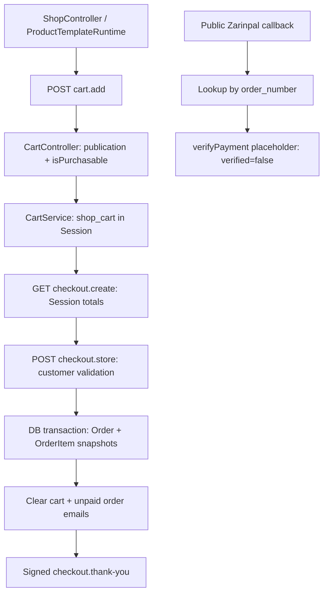

# King CMS — Commerce Extension
## Phase 0: Source Audit & Implementation Plan

تاریخ: ۲۰۲۶-۱۰-۲۶؛ وضعیت: فقط ممیزی سورس و پیشنهاد، بدون پیاده‌سازی.

## ۱. Executive Summary

Commerce فعلی، یک فروشگاه با **Cart مبتنی بر Session و ثبت Order/OrderItem برای پرداخت دستی** است؛ زیرساخت پرداخت آنلاین تکمیل نشده است. قابلیت خرید خدمات با توسعه همان مسیر ممکن است، اما صرف اتصال Service به Product برای عرضه امن کافی نیست. ابتدا صحت قیمت نهایی، سابقه تلاش پرداخت، verification و جداسازی وضعیت مالی از انجام سفارش باید تکمیل شوند.

یافته‌های تعیین‌کننده:

- Cart، Checkout، Order، snapshot پایه اقلام، پنل سفارش و مالکیت سفارش کاربران موجودند و قابل استفاده‌اند؛ Cart/Checkout/Order موازی لازم نیست.
- `ZarinpalPaymentGateway::createPayment()` و `verifyPayment()` صریحاً پیاده‌نشده‌اند. Checkout هیچ‌کدام را برای شروع پرداخت فراخوانی نمی‌کند؛ حتی با token تنظیم‌شده، سفارش unpaid ثبت و به صفحه «سفارش دریافت شد» هدایت می‌شود.
- مبلغ Order از snapshot سبد Session گرفته می‌شود؛ در POST نهایی، قیمت، انتشار و قابلیت خرید Product از DB دوباره بررسی نمی‌شوند. transaction فعلی، این مشکل را رفع نمی‌کند.
- Product فاقد type تجاری، اتصال به Service، visibility مستقل از publication و تنظیم اطلاعات اختصاصی Checkout است. موجودی فقط دو flag است؛ انبار عددی/رزرو موجودی وجود ندارد.
- Guest Checkout واقعی است. `Order.user_id` اختیاری، لینک تأیید HMAC امضاشده و یک‌روزه، و محدودیت مالکیت سفارش در حساب عمومی اکنون پیاده شده‌اند؛ این بخش دیگر صرفاً Roadmap نیست.
- دو وضعیت status و payment_status وجود دارد، ولی مستقل نیستند: `Order::markCompleted()` پرداخت را هم paid می‌کند. این عمل مدیریتی، verification بانکی نیست و نباید مجوز خودکار تحویل آنلاین تلقی شود.
- Services دارای hierarchy، Template Runtime و قیمت عملیاتی‌اند. همچنین ServiceOffering/نسخه‌های قرارداد خدمات وجود دارند؛ هیچ‌کدام به خرید عمومی Cart/Order متصل نیستند.
- Pricing Cards مبلغ نمایشی خودش را دارد و Action تولید می‌کند؛ مبلغ تراکنش از آن استخراج نمی‌شود. Product documents نیز فایل عمومی معرفی محصول‌اند، نه entitlement دانلود پس از پرداخت.

**تصمیم پیشنهادی:** Product مالک عرضه قابل خرید و قیمت، Service مالک محتوا و نمایش، و همان Order/OrderItem مالک معامله باقی بمانند. برای MVP، یک Product از نوع service به Service متصل، یک واحد از آن در همان Checkout مهمان خریده و انجام خدمت دستی مدیریت شود. فروش downloadable تا ایجاد دسترسی خصوصی و entitlement فعال نشود.

قیمت ۸۰۰٬۰۰۰ تومان و وضعیت خدمت شیفتن، اطلاعات نیاز محصول از درخواست کاربر است؛ از DB تأیید نشده و نباید در کد عمومی King hardcode شود.

### محدوده شواهد

فقط سورس، migrationهای موجود، مستندات و متن تست‌ها خوانده شدند. هیچ کد عملیاتی، Model، Migration، Schema، داده یا تنظیمی ساخته/تغییر نکرد؛ فقط همین گزارش ایجاد شد. هیچ تست، build، Artisan، درخواست بانکی، تغییر وضعیت پرداخت یا عملیات DB اجرا نشد. تغییرات قبلی Homepage و گزارش منو در workspace دست‌نخورده‌اند. سایت واقعی، نسخه مستقر، تنظیمات درگاه، migrationهای اجراشده، کش و شبکه Production تأیید نشده‌اند.

شماره خطوط زیر از فایل‌های واقعی همین checkout است. مسیر/کلاس/متد جدید فرضی به‌عنوان جزء موجود معرفی نشده است؛ نام ستون‌های پیشنهادی در بخش Schema صریحاً پیشنهادند. نام فایل و کلاس زیرساخت‌هایی که هنوز وجود ندارند، باید در مرحله پیاده‌سازی تعیین شود.

## ۲. Current Architecture Map

### ۲.۱ مسیر واقعی خرید فعلی

هیچ edge اجرایی از Checkout به createPayment، redirect بانک یا ثبت پرداخت verified وجود ندارد. مسیر callback فعلی نیز Order را paid نمی‌کند.

| مرحله | شاهد واقعی | قرارداد |
| --- | --- | --- |
| Product page | `app/Http/Controllers/ShopController.php:169`؛ `app/Services/ProductTemplateRuntime.php:18` | Product منتشرشده؛ Template اختصاصی یا fallback موجود shop.show |
| افزودن به سبد | `routes/web.php:154`؛ `app/Http/Controllers/CartController.php:25` | POST؛ بررسی انتشار و isPurchasable؛ quantity هر درخواست ۱ تا ۹۹ |
| سبد | `app/Services/CartService.php:10` و `:24` | Session key=`shop_cart`؛ ذخیره ID/title/slug/SKU/price/image/quantity |
| نمایش Checkout | `app/Http/Controllers/CheckoutController.php:21` | shop_enabled و سبد غیرخالی؛ مبلغ از Session |
| ایجاد سفارش | همان فایل، `:35` و `:72` | اعتبارسنجی اطلاعات مشتری؛ transaction ایجاد Order و اقلام؛ user_id از guard client سمت سرور |
| snapshot اقلام | همان فایل، `:88`؛ `app/Models/OrderItem.php:12` | product_id/title/SKU/unit_price/quantity/total؛ فاقد type/currency/custom answers |
| تأیید دریافت | `app/Services/OrderConfirmationUrl.php:10`؛ `routes/web.php:160`؛ `CheckoutController.php:106` | URL یک‌روزه signed؛ برای سفارش account-owned تطبیق client owner نیز لازم است |
| پنل سفارش | `app/Filament/Resources/OrderResource.php:35` و `:170` | ویرایش status/payment_status و عملیات دستی paid/complete/cancel |
| حساب مشتری | `app/Services/PublicOrderAccess.php:11` و `:20` | query محدود به user_id؛ سفارش مهمان از روی شماره تلفن به حساب نسبت داده نمی‌شود |
| درگاه | `app/Contracts/PaymentGateway.php:7`؛ `app/Providers/ShopServiceProvider.php:24` | قرارداد فقط method/initialPaymentStatus/instructions؛ انتخاب manual پیش‌فرض یا zarinpal |
| callback | `routes/web.php:163`؛ `app/Http/Controllers/ZarinpalCallbackController.php:12` | GET/POST عمومی، معاف از CSRF؛ order/Authority/Status اختیاری؛ بدون رکورد تلاش پرداخت |

### ۲.۲ Product Domain

Schema در `database/migrations/2026_06_12_000000_create_shop_tables.php:26` و مدل `app/Models/Product.php:26` شامل title، slug، content/excerpt، price/sale_price، SKU، status، published_at، is_featured، sort_order، has_stock، stock_status، دسته و SEO است. **type، service_id، visibility تجاری، stock_quantity، manage_stock، shipping requirement و currency محصول وجود ندارند.**

- وضعیت‌های فرم فعلی draft/published هستند؛ publication با published_at خالی یا گذشته ترکیب می‌شود. [Product.php:68؛ ProductResource.php:280]
- `isPurchasable()` فقط `has_stock && stock_status == in_stock` است. publication و module activation در CartController جدا بررسی می‌شوند. has_stock در UI عنوان «قابل خرید» دارد؛ false به معنی «بدون نیاز به انبار» نیست، بلکه خرید را متوقف می‌کند. [Product.php:163؛ ProductResource.php:89]
- انبار عددی یا تخصیص موجودی وجود ندارد؛ بنابراین محصول بدون سیستم انبار عددی قابل خرید است، به شرط true/in_stock بودن flagها. این، پشتیبانی صریح از نوع خدمت یا مجوز نادیده‌گرفتن موجودی فیزیکی نیست.
- `ProductResource.php:71` قیمت غیرمنفی و sale_price کمتر از price را می‌پذیرد؛ ستون‌ها DECIMAL(12,2) و castها decimal:2 هستند. حفاظت قیمت تجاری کامل در خود Model اعمال نشده است.
- دو محاسبه قیمت وجود دارد: `Product::currentPrice()` در Cart، و `ProductPricingService::effectivePrice()` در Template/SEO. برای sale معتبر هم‌خوان‌اند، ولی داده Legacy نامعتبر مانند sale بزرگ‌تر از regular ممکن است متفاوت تفسیر شود. Model هر sale truthy را می‌گیرد؛ سرویس فقط sale کمتر از regular را می‌پذیرد. [Product.php:153؛ ProductPricingService.php:11]
- منتشرشدن، visible بودن کاتالوگ و قابل خرید بودن مستقل نشده‌اند. draft کردن Product راه unlist نیست؛ direct add نیز آن را رد می‌کند. is_featured=false هم فقط Featured بودن را برمی‌دارد.
- queryهای کاتالوگ فقط در ProductQueryService متمرکز نیستند: ShopController، PublicSearchService، SitemapService و بعضی مصرف‌کنندگان CMS مستقیم Product query دارند. افزودن visibility صرفاً در یک query کافی نیست. [ShopController.php:29 و :92؛ ProductQueryService.php:12؛ PublicSearchService.php:61؛ SitemapService.php:135]

### ۲.۳ Service Domain و تفاوت عرضه عملیاتی

`app/Models/Service.php:40` فیلدهای محتوا، parent_id، publication و قیمت عملیاتی را دارد. relationهای parent/children، کنترل self-parent/cycle در saving و traversalهای descendant/ancestor موجودند. `ServiceQueryService.php:76` مسیر ancestor را کنترل می‌کند؛ ServiceController از published query و public_services_enabled استفاده می‌کند. وضعیت active قدیمی نیز در publication Service پذیرفته می‌شود؛ این قرارداد با Product یکسان نیست و نباید در توسعه خرید تغییر کند.

مسیر نمایش: `routes/web.php:137` → `ServiceController::show` → `ServiceTemplateRuntime::render` → `ServiceTemplateContextBuilder::build` → templates.render. context شامل معرفی، رسانه، projects، children، breadcrumbs و SEO است؛ Product یا قیمت خرید در آن نیست. [ServiceController.php:63؛ ServiceTemplateRuntime.php:22؛ ServiceTemplateContextBuilder.php:18]

فیلدهای `pricing_mode`، `unit`، `custom_unit_label`، `default_unit_price`، `currency_code` و `operational_enabled` وجود دارند. pricing modeها hourly/per_unit/fixed و قیمت decimal:4 است. ServiceSettings، قیمت و فعال‌بودن کاتالوگ فعالیت را مستقل از انتشار عمومی کنترل می‌کند. `ServiceActivityPricingCalculator.php:10` محاسبه Activity را با BCMath انجام می‌دهد؛ این قیمت، مبلغ Checkout نیست. [Service.php:54؛ ServiceResource.php:214؛ migration `2026_08_14_000000_add_commercial_fields_to_services_table.php:13`]

علاوه بر آنها، `Service::offerings()`، `ServiceOffering` و `ServiceOfferingVersion` موجودند: بسته‌ها و نسخه immutable منتشرشده برای قرارداد ClientProject، amount/currency/terms/deliverables دارند. **این ساختار معادل Product.type=service نیست و به Cart/Order عمومی وصل نیست.** استفاده از آن برای خرید یک خدمت مهمان، نیازمند اتصال به قرارداد/مشتری/پروژه است که برای MVP ضروری نیست. [Service.php:220؛ ServiceOfferingVersion.php:15 و :41؛ `docs/service-offering-phase-1.md`]

### ۲.۴ Cart، Checkout، Guest و Shipping

- سبد در Session سمت سرور است؛ درخواست cart.add مقدار price یا title را مصرف نمی‌کند. بنابراین ارسال price جعلی در POST، به‌تنهایی به معنی کنترل مبلغ توسط Client نیست.
- stale بودن snapshot واقعی است: پس از add، تغییر قیمت، draft شدن یا ناموجودشدن Product در POST Checkout دوباره بررسی نمی‌شود. CartService.update نیز فقط quantity را عوض می‌کند.
- max=99 روی هر add است؛ چند add می‌تواند quantity تجمعی را بیشتر کند. quantity خدمت باید در مسیر سرور دقیقاً یک واحد محدود شود، نه فقط input مخفی یا max HTML.
- Guest نیازی به ثبت‌نام ندارد؛ user_id فقط برای client غیرادمین فعال ثبت می‌شود. نام و تلفن required، ایمیل و آدرس و notes optional هستند. تلفن فعلی صرفاً string با min:4 است؛ احراز مالکیت شماره نیست. [CheckoutController.php:43 و :67]
- هیچ Shipping service/cost/tax rule در این مسیر دیده نشد؛ total=subtotal است. آدرس حتی برای فیزیکی optional است. «آدرس برای خدمت لازم نیست» از قبل قابل ثبت است، اما حذف شرطی UI و ترکیب نیازهای چند نوع محصول وجود ندارد.
- Buy Now در Route/CartController فعلی یافت نشد؛ add همیشه به cart.index می‌رود. توسعه محدود همان POST و CartService برای intent رفتن به Checkout ممکن است؛ GET یا Action link نباید خودش خرید/تغییر سبد انجام دهد.
- Routeهای عمومی Checkout در این فایل throttle اختصاصی و idempotency key ندارند. transaction DB ایجاد کامل Order/اقلام را پوشش می‌دهد، نه جلوگیری از دو Checkout همزمان؛ قفل/شرط یکتای درخواست هم دیده نشد.

### ۲.۵ Order، Fulfillment و مالکیت

Order.status: pending/paid/cancelled/completed؛ payment_status: unpaid/paid/failed. این دو ستون جدا هستند ولی رفتارشان مستقل نیست: markPaid وضعیت pending را paid می‌کند؛ markCompleted بدون بررسی evidence بانکی payment_status را paid می‌کند؛ فرم ادمین هر دو ستون را قابل ویرایش دارد. [Order.php:14 و :98 و :106؛ OrderResource.php:39 و :47]

اطلاعات مشتری در Order، snapshot کالا در OrderItem و یادداشت خصوصی مدیر در admin_note موجود است. product_id اقلام nullable و با حذف Product null می‌شود؛ عنوان و مبلغ snapshot حفظ می‌شوند. اما داده اختصاصی خدمت، snapshot نوع، schema پاسخ‌ها، وضعیت انجام هر قلم، فایل تحویل یا entitlement دانلود وجود ندارد. [migration create_shop_tables.php:66؛ OrderItem.php:12]

حساب عمومی از PublicOrderAccess استفاده می‌کند؛ تغییر Order ID بدون مالکیت با query محدود به user_id به نتیجه نمی‌رسد. امضای thank-you نیز از تغییر شناسه جلوگیری می‌کند. برای Guest، لینک signed یک bearer capability یک‌روزه است؛ دارنده لینک معتبر می‌تواند اطلاعات همان سفارش مهمان را ببیند. این را نباید با IDOR ساده یا اثبات مالکیت شماره تلفن اشتباه گرفت. مسیر بازیابی/تمدید امن پیگیری مهمان و تحویل بلندمدت در این مسیر موجود نیست. [PublicOrderAccess.php:20؛ OrderConfirmationUrl.php:10؛ tests/Feature/ShopAccountIntegrationTest.php:136]

### ۲.۶ Payment و سطح امنیت واقعی

مدل یا جدول اختصاصی **پرداخت Commerce / تلاش پرداخت / entitlement** در مدل‌ها و migrationهای بررسی‌شده یافت نشد. نگهداری payment_method/payment_status روی Order جای سابقه authority، reference، مبلغ درگاه، verification، retry و idempotency را نمی‌گیرد.

| سؤال | پاسخ سورس |
| --- | --- |
| آیا پرداخت آنلاین واقعی متصل است؟ | خیر؛ createPayment/verifyPayment هر دو خطای پیاده‌نشده برمی‌گردانند؛ Checkout فقط method/status/instructions را می‌گیرد |
| آیا verification سمت سرور انجام می‌شود؟ | endpoint callback متد verify را صدا می‌زند، ولی متد واقعی پیاده نشده؛ نتیجه فعلی verified=false است |
| Callback تکراری چه می‌کند؟ | در وضع فعلی فقط lookup و پاسخ نمایشی؛ تغییر پرداخت/تحویل ندارد. این، اثبات idempotency پرداخت آینده نیست |
| قفل و Race protection مالی؟ | transaction ایجاد Order هست؛ قفل تلاش پرداخت/conditional transition/unique gateway reference وجود ندارد |
| Paid بدون بانک ممکن است؟ | از عملیات ادمین و helperهای Order بله؛ از callback عمومی فعلی مسیر paid شدن یافت نشد |
| Fulfillment تکراری؟ | Fulfillment خودکار Commerce موجود نیست؛ محافظت exactly-once/effectively-once آن هم هنوز پیاده نشده |
| تطبیق مبلغ بانک و Order؟ | اجرا نمی‌شود؛ هیچ conversion/verify واقعی نیست |
| تغییر ID رسید؟ | thank-you signed و برای account-owned نیازمند owner است؛ تغییر ID امضا را نامعتبر می‌کند. callback مسیر مجزایی است و این حفاظت را ندارد |

`ZarinpalGraphqlClient::post()` HTTP+Bearer را آماده کرده، اما HTTP موفق را ok=true تلقی می‌کند و GraphQL errors/business verification را به معنای پرداخت معتبر تحلیل نمی‌کند. isConfigured فقط وجود token را بررسی می‌کند. هیچ تماس بانکی در این ممیزی انجام نشده و معتبر/به‌روز بودن endpoint، merchant contract یا واحد API از سورس قابل تأیید نیست. [ZarinpalGraphqlClient.php:15 و :48 و :66؛ ZarinpalPaymentGateway.php:35 و :52]

Callback با order_number ورودی یک Order را می‌یابد؛ Authority به تلاش ذخیره‌شده‌ای bind نیست. View عمومی شماره و status/payment_status را نشان می‌دهد، نه اطلاعات کامل مشتری. در نتیجه با دانستن شماره سفارش، وضعیت آن قابل خواندن است؛ شماره سفارش حاوی زمان و random چهاررقمی، secret احراز مالکیت نیست. این ضعف محدود اطلاعاتی با IDOR صفحه thank-you متفاوت است. [ZarinpalCallbackController.php:14؛ resources/views/shop/payment-callback.blade.php:12]

### ۲.۷ Currency & Money

ProductPricingService.CURRENCY ثابت IRT است؛ UI Product، Cart، Checkout، Order، ایمیل سفارش و SEO تومان/IRT را مصرف می‌کنند. تنظیم `default_service_currency` برای Service عملیاتی است و ارز Commerce را تعیین نمی‌کند. Product/Order/OrderItem ارز snapshot ندارند. [ProductPricingService.php:9؛ ManageSiteSettings.php:98 و :417؛ CheckoutController.php:187؛ SeoService.php:450]

DB ستون DECIMAL دارد ولی Model.currentPrice، ProductPricingService، CartService و subtotal از float استفاده می‌کنند. number_format نمایشی غالباً صفر رقم اعشار نمایش می‌دهد؛ این نمایش با precision ذخیره‌شده یک قرارداد محاسبه تراکنش نیست. rounding مرکزی Commerce یا تبدیل IRT/IRR در مسیر پرداخت وجود ندارد. در مقابل، محاسبه دقیق رشته‌ای با BCMath در ServiceActivityPricingCalculator و اعتبارسنجی decimal در ServiceAgreementData وجود دارد؛ الگوی قابل استفاده است، نه مجوز استفاده از نرخ عملیاتی خدمت در فروش.

### ۲.۸ Form Builder و Action/Template

`forms.schema` با schema_version=2، FormSchema.fields/validationRules/normalizeSubmissionInput و SubmissionAnswerSnapshot.answers موجود است. snapshot پاسخ شامل key، label، raw_value و display_value است. برای اطلاعات قلم سفارش قابل استفاده مجدد است، با افزودن snapshot تعریف/نسخه فرم در خود قلم. [Form.php:13؛ FormSchema.php:34 و :145 و :242؛ SubmissionAnswerSnapshot.php:18]

اما FormSubmissionService.submit، Submission و گاهی Lead/Calculator/notification/attachment ایجاد می‌کند؛ اتصال OrderItem ندارد. کل forms._form نیز فرم مستقل با endpoint/submit/honeypot خودش است و نباید داخل فرم Checkout تو‌در‌تو قرار گیرد. FormController کلید website را prohibited می‌داند؛ این کلید honeypot نباید برای آدرس واقعی وب‌سایت استفاده شود. type=url در لیست ورودی‌های FormSchema وجود ندارد؛ text عادی به‌تنهایی URL را اعتبارسنجی معنایی نمی‌کند. [FormSubmissionService.php:28؛ FormController.php:122؛ FormSchema.php:20؛ resources/views/forms/_form.blade.php:86]

Action typeهای فعلی custom_url/page/project/product/service/form/anchor/email/phone هستند. ProductActionResolver مقصد shop.show و ServiceActionResolver مقصد services.show می‌دهد؛ خرید مستقیم نیستند. ActionPresentation برای غیر form یک link می‌دهد؛ تنها form رفتار submit مخصوص دارد. `template_add_to_cart` فعلی نیز context از نوع product می‌خواهد و در Preview خرید را غیرفعال می‌کند. [CoreActionType.php:5؛ ProductActionResolver.php:22؛ ServiceActionResolver.php:20؛ ActionPresentation.php:14؛ resources/views/partials/blocks/template_add_to_cart.blade.php:1]

ServiceHeaderRuntime همین Action Foundation را برای CTAهای فعلی مصرف می‌کند. PricingCardsRuntime مبلغ ذخیره‌شده کارت را format و Action را resolve می‌کند؛ اتصال مبلغ کارت به Product/Order ندارد. `pricing_cards` در BlockServiceProvider ثبت شده و صرفاً نمایش/ناوبری است. [ServiceHeaderRuntime.php؛ PricingCardsRuntime.php:23؛ PricingCardsDataNormalizer.php:54؛ BlockServiceProvider.php:68]

قواعد انتشار Template سخت‌گیرانه‌اند: target/capability، renderer، block_id، schema_version و **برابری داده با خروجی normalizer** بررسی می‌شوند. افزودن default جدید به normalizer یا bump سراسری version می‌تواند canonical بودن داده قدیمی را بشکند؛ extension باید round-trip و سازگاری واقعی داشته باشد. [TemplatePublicationValidator.php:20 و :78 و :96؛ AbstractServiceBlock.php:68]

### ۲.۹ Module Activation و نصب تازه

ModuleService.shopEnabled از shop_enabled با fallback=true می‌خواند. همین flag روی ShopController، CartController، Checkout و thank-you، ProductActionResolver، Source فروشگاه، بخش‌هایی از Header cart و نمایش navigation ادمین Order اثر دارد. مسیرهای /shop و /cart و /checkout در urlIsVisible نیز با هم محدود شده‌اند. Service public_enabled مستقل است؛ بنابراین امروز service صفحه دارد ولی با shop_enabled=false همان Checkout 404 می‌شود. [ModuleService.php:17 و :37؛ CheckoutController.php:21 و :106؛ OrderResource.php:28؛ ShopServiceProvider.php:48]

در مقابل، سفارش‌های حساب کاربر از ownership query مستقل استفاده می‌کنند؛ تاریخچه سفارش را نباید هنگام خاموش‌کردن فروش جدید پنهان کرد.

ProductTemplateRuntime fallback به shop.show دارد؛ ServiceTemplateRuntime بدون Template قابل رندر service_single، ServiceTemplateUnavailable می‌دهد و Controller پاسخ 503 می‌دهد. DatabaseSeeder، StandardServiceTemplateSeeder را فراخوانی می‌کند و آن Seeder default منتشرشده تولید می‌کند؛ اجرای صرف migration تضمین Template نیست. اجرای مجدد Seeder سرویس نیز می‌تواند default قبلی را تغییر دهد؛ راه‌حل Commerce، seed کردن خودکار هنگام بازدید صفحه یا overwrite قالب سفارشی نیست. [ServiceTemplateRuntime.php:27؛ ServiceController.php:78؛ StandardServiceTemplateSeeder.php:58]

### اختلاف با اطلاعات قبلی و مستندات

| ادعا/سند | نتیجه جاری |
| --- | --- |
| Public Account/مالکیت سفارش در Roadmap | در سورس فعلی پیاده شده و تست‌های ShopAccountIntegrationTest آن را توصیف می‌کنند؛ در این ممیزی اجرا نشدند |
| hierarchy، service_single و Action Foundation | در سورس تأیید شد؛ خرید مستقیم جزو Action فعلی نیست |
| فیلدهای قیمت عملیاتی Service | تأیید شد؛ قیمت فروش آنلاین از آنها خوانده نمی‌شود |
| Pricing Cards نمایشی | تأیید شد؛ گزارش مستقل جدید Pricing Cards در docs پیدا نشد، Runtime/Block موجود بررسی شد |
| پرداخت زرین‌پال | README بخش Zarinpal Readiness نیز صریحاً skeleton بودن را می‌گوید؛ فعال‌بودن تنظیم درگاه به معنی اتصال واقعی نیست |
| بسته خدمات | اسناد service-offering-phase-1 و service-delivery-phase-3 قرارداد/تحویل عملیاتی را توصیف می‌کنند؛ پرداخت عمومی از آنها نتیجه نمی‌شود |
| آخرین Comprehensive Architecture / Service Audit | سندی با این عنوان در فایل‌های قابل جست‌وجوی این checkout پیدا نشد؛ وجود نسخه خارج از repository تأییدنشده است |

مستندات بررسی‌شده: README، docs/reference-block-architecture.md، docs/service-offering-phase-1.md و بخش معرفی docs/service-delivery-phase-3.md؛ متن آنها جای بررسی سورس فعلی را نگرفته است.

## ۳. Reusable Components

| جزء موجود | استفاده پیشنهادی بدون سیستم موازی | محدودیت |
| --- | --- | --- |
| Product + ProductResource | عرضه قابل خرید خدمت/فیزیکی و قیمت پایه/ویژه | type، association و visibility به‌صورت افزایشی |
| ProductPricingService / ProductAvailabilityService | مرجع مشترک قیمت و قابلیت خرید | تراکنش باید exact و بر اساس DB باشد؛ خروجی float فعلی API نمایشی نیاز به بررسی مصرف‌کنندگان دارد |
| CartService / CartController | همان Session cart و POST add؛ intent محدود Buy Now | snapshot پولی سبد مبلغ نهایی قابل اعتماد نیست؛ quantity خدمت=۱ سمت سرور |
| CheckoutController و shop.checkout | همان فرم و pipeline ثبت معامله | server repricing، custom fields و conditional requirements |
| Order / OrderItem / OrderResource | همان سفارش، مشتری، snapshot و عملیات ادمین | financial proof و fulfillment باید جدا شوند |
| PaymentGateway binding و دو Gateway موجود | تکمیل تنها مسیر پرداخت | قرارداد initiate/verify و persistence واقعی هنوز وجود ندارد |
| OrderConfirmationUrl / PublicOrderAccess | signed receipt access و مالکیت کاربر | لینک مهمان، bearer با انقضای محدود؛ recovery مستقل تصمیم محصولی است |
| FormSchema / SubmissionAnswerSnapshot | تعریف، validation و snapshot جواب قلم | بدون فراخوانی submit مستقل، Lead یا Calculator برای سفارش |
| MobileNormalizer | نرمال‌سازی ارقام/فرمت شماره در سایت ایرانی | احراز شماره نیست؛ سیاست معتبرسازی بین‌المللی جدا از normalization |
| ServiceTemplateContextBuilder / ServiceHeaderRuntime | context تجاری اختیاری و CTA در همان صفحه خدمت | حفظ context و CTAهای موجود، Preview بدون عملیات خرید |
| Template recipe/validator/runtime موجود | provisioning نصب تازه و حفظ custom templates | بدون forced Template اختصاصی یا auto-seed در request |
| ServiceOffering/Client Portal | برای قراردادهای عملیاتی موجود حفظ شوند | اتصال خودکار Order مهمان به Project/Customer در MVP لازم نیست |

## ۴. Gap Analysis و Severity

Severity در این گزارش: **Blocker** مانع عرضه پرداخت/قابلیت وعده‌داده‌شده؛ **High** خطر صحت مالی/دسترسی یا پیش‌نیاز امنیتی مهم؛ **Medium** شکاف کارکردی/سازگاری. پیش‌نیازهای پرداخت آینده با آسیب‌پذیری قابل بهره‌برداریِ فعلی یکسان معرفی نشده‌اند.

| ID / عنوان | رفتار فعلی → مطلوب | شاهد فایل و خط | Severity | پیشنهاد و ریسک سازگاری |
| --- | --- | --- | --- | --- |
| G01 پرداخت آنلاین ناتمام | token کافی تلقی می‌شود ولی هیچ initiate/verify واقعی نیست → پرداخت معتبر سرور و رسید پس از آن | `app/Services/ZarinpalPaymentGateway.php:35` و `:52`؛ `app/Http/Controllers/CheckoutController.php:56`؛ `app/Contracts/PaymentGateway.php:7` | Blocker | تکمیل همان binding/flow؛ پرداخت دستی حفظ و receipt دریافت با رسید تسویه اشتباه نشود |
| G02 قیمت/قابلیت خرید stale | Session snapshot تا Order استفاده می‌شود → DB revalidation و مبلغ معتبر هنگام commit | `app/Http/Controllers/CheckoutController.php:72`؛ `app/Services/CartService.php:24` و `:79`؛ `app/Http/Controllers/CartController.php:25` | High | خواندن/قفل Productهای واقعی و ساخت snapshot نهایی؛ تغییر قیمت باید به بازبینی کاربر منجر شود، نه شارژ پنهان با مبلغ جدید |
| G03 نبود سابقه و idempotency پرداخت | Order فقط status دارد → attempt، authority/reference یکتا، amount/currency، verification evidence | `app/Models/Order.php:28`؛ `database/migrations/2026_06_12_000000_create_shop_tables.php:50`؛ `app/Http/Controllers/ZarinpalCallbackController.php:19` | High، پیش‌نیاز عرضه | ذخیره تلاش پرداخت وابسته به همین Order؛ ایجاد آن سیستم Order/Payment موازی نیست، بلکه تکمیل بخش غایب است |
| G04 اختلاط انجام و پرداخت | complete می‌تواند unpaid را paid کند؛ payment_status editable → انجام خدمت فقط fulfillment را تغییر دهد | `app/Models/Order.php:98` و `:106`؛ `app/Filament/Resources/OrderResource.php:47` و `:177` | High برای اعتبار مالی | تفکیک آنلاین verified از تأیید دستی مجاز و ثبت audit؛ ادمین عمومی مهاجم ناشناس فرض نشده؛ داده تاریخی بازنویسی نشود |
| G05 correlation و replay | callback با order_number ورودی و Authority اختیاری → bind به attempt ذخیره‌شده و verify مبلغ/ارز/مرجع | `app/Http/Controllers/ZarinpalCallbackController.php:14`؛ `routes/web.php:163` | High، پیش‌نیاز پرداخت واقعی | جعل callback فعلاً paid نمی‌کند چون stub است؛ پس از تکمیل باید conditional transition و replay protection داشته باشد |
| G06 افشای وضعیت callback | هرکس شماره سفارش را بداند status/payment_status می‌بیند → پاسخ عمومی کم‌اطلاعات و صفحه جزئیات مجاز | `resources/views/shop/payment-callback.blade.php:12`؛ `app/Http/Controllers/ZarinpalCallbackController.php:21` | Medium | با حفاظت signed thank-you اشتباه نشود؛ PII کامل از این View گزارش نشده است |
| G07 float/ارز بدون snapshot | float در total و IRT ثابت بدون تبدیل درگاه → محاسبه دقیق و currency/amount immutable | `app/Models/Product.php:153`؛ `app/Services/ProductPricingService.php:9`؛ `app/Services/CartService.php:18`؛ `app/Models/OrderItem.php:25` | High برای پرداخت | حذف float از مسیر authoritative؛ حفظ قرارداد نمایش/Orderهای قدیمی؛ سیاست اعشار Legacy صریح |
| G08 نوع/visibility تجاری غایب | Product بدون type یا unlisted → physical/service/downloadable و خرید مستقل از catalog | `app/Models/Product.php:26`؛ `app/Services/ProductQueryService.php:12`؛ `app/Http/Controllers/ShopController.php:29` | Medium، لازم برای محصول | default فیزیکی و visible برای Legacy؛ افزودن scope در همه consumerها، بدون draft کردن برای مخفی‌سازی |
| G09 Service/Product بی‌ارتباط | operational price و ServiceOffering موجود ولی خرید عمومی ندارد → Product.service_id اختیاری | `app/Models/Service.php:40` و `:220`؛ `app/Models/Product.php:26`؛ `app/Services/ServiceTemplateContextBuilder.php:18` | Medium | رابطه یک‌به‌چند با MVP تک‌عرضه؛ نه ادغام Service/Product و نه اجبار ClientProject |
| G10 اطلاعات اختصاصی قلم | notes فقط روی Order؛ فرم مستقل Submission است → schema/answers immutable برای هر OrderItem | `app/Models/OrderItem.php:12`؛ `app/Http/Controllers/CheckoutController.php:43` و `:88`؛ `app/Services/SubmissionAnswerSnapshot.php:18` | Medium، لازم برای MVP | اتصال به Form استاندارد و validation در pipeline Checkout؛ هیچ فرم تو‌در‌تو یا Lead جای Order |
| G11 نبود URL validation اختصاصی | FormSchema text فقط string؛ website در FormController ممنوع → ورودی URL معتبر namespaced | `app/Services/FormSchema.php:20` و `:145`؛ `app/Http/Controllers/FormController.php:122` | Medium | URL constraint محدود Checkout و schema snapshot؛ از ارسال سفارش به FormController خودداری شود؛ Core/Calculator بازطراحی نشود |
| G12 Buy Now/CTA خرید غایب | Product Action لینک معرفی است و add به Cart می‌رود → POST خرید یک واحد به همان Checkout | `app/CMS/Actions/Resolution/ProductActionResolver.php:22`؛ `app/Http/Controllers/CartController.php:38`؛ `resources/views/partials/blocks/template_add_to_cart.blade.php:1` | Medium | intent محدود همان add و CTA opt-in موجود؛ Action product موجود بی‌صدا تغییر معنا ندهد |
| G13 Module coupling | shop=false، Checkout/thank-you هم 404 → فروش خدمت بدون catalog و حفظ دسترسی تاریخچه | `app/Services/ModuleService.php:17` و `:37`؛ `app/Http/Controllers/CheckoutController.php:106`؛ `app/Filament/Resources/OrderResource.php:28` | Medium، لازم برای service-only | capability Commerce با fallback سازگار؛ رسید/verify پرداخت شروع‌شده از خاموش‌شدن catalog مستقل |
| G14 Fulfillment قلم غایب | فقط status کلی و admin_note → وضعیت انجام خدمت مستقل از وضعیت مالی | `app/Models/Order.php:14`؛ `app/Models/OrderItem.php:12`؛ `app/Filament/Resources/OrderResource.php:35` | Medium | وضعیت قلم و snapshot اطلاعات در همان OrderItem؛ بدون Project/Job خودکار اضافی برای تحویل دستی |
| G15 دانلود پولی غایب | ProductDocument URL عمومی است → فایل خصوصی و grant بعد از تسویه معتبر | `app/Filament/Resources/ProductResource.php:145`؛ `app/Services/ProductMediaService.php:75`؛ `database/migrations/2026_07_27_000001_create_product_documents_table.php:11` | Blocker فقط برای عرضه دانلودی | تا اجرای entitlement خرید این نوع فعال نشود؛ اسناد عمومی موجود خصوصی/منتقل نشوند |
| G16 تکرار/هرزنامه ثبت سفارش | Checkout key یکتا یا throttle اختصاصی ندارد؛ چند درخواست ممکن است چند Order/ایمیل بسازد → request idempotency و محدودیت مناسب | `routes/web.php:159`؛ `app/Http/Controllers/CheckoutController.php:72` و `:119` | Medium | اثبات حمله یا Race در Production انجام نشده؛ قید DB و transaction لازم، نه صرف clear سبد |
| G17 نصب بدون قالب خدمت | service_single غایب → 503 → مسیر رسمی نصب قابل رندر | `app/Services/ServiceTemplateRuntime.php:27`؛ `database/seeders/StandardServiceTemplateSeeder.php:58` | Medium | provisioning با recipe موجود در نصب تازه؛ قرارداد Runtime و custom default با auto-seed شکسته نشود |

### قواعد امنیت پرداخت پیش از عرضه

1. مقدار Status/Authority/Order ID از callback، به‌تنهایی اثبات پرداخت نیست. attempt ذخیره‌شده باید gateway، merchant، Order، authority، مبلغ و ارز مورد انتظار را bind کند.
2. initiate و verification از روی snapshot سرور انجام شوند. پاسخ HTTP 200 یا ok client عمومی، شرط paid شدن نیست؛ پاسخ تجاری درگاه و تطبیق مبلغ/ارز/مرجع لازم است.
3. ابتدا attempt پایدار ساخته شود، تماس شبکه خارج از قفل طولانی DB انجام گیرد، سپس transition با lock/شرط وضعیت و unique reference نهایی شود. timeout نباید تلاش پرداخت نامعلوم را به موفق تبدیل کند.
4. callbackهای تکراری/همزمان و پاسخ «قبلاً تأیید شده» فقط برای همان attempt شناخته‌شده مدیریت شوند. اثر مالی و آغاز انجام/اعطای دانلود بیش از یک بار ثبت نشوند؛ retry تحویل نیز idempotent باشد.
5. ایمیل فعلی «دریافت سفارش» unpaid با تأیید تسویه تفاوت دارد. ایمیل رسید پرداخت/مجوز تحویل بعد از commit تسویه معتبر صادر شود؛ شکست ارسال ایمیل نباید پرداخت دوم یا اثر مالی دوم بسازد.
6. عملیات ادمین manual باید مجوز، دلیل و evidence جدا داشته باشد. هیچ آزمون یا مسیر آنلاینی موفقیت بانکی را با markPaid/markCompleted شبیه‌سازی نکند؛ داده paid قدیمی هم proof بانکی ساختگی دریافت نکند.

در سورس فعلی، callback عمومی پرداخت جعلی موفق ایجاد نمی‌کند؛ خطر G05 شرط ضروری پیاده‌سازی آینده است. دسترسی account/thank-you نیز حفاظت موجود دارد؛ ادعای عمومی «هر Order ID قابل خواندن است» با سورس سازگار نیست.

## ۵. Architecture Decisions

### D01 — Product Type و قابلیت خرید

ستون نوع افزایشی با مقادیر physical/service/downloadable و default=physical پیشنهاد می‌شود. Product منتشرشده بودن، قابلیت خرید و نمایش در catalog سه تصمیم جدا باشند. has_stock موجود که در UI «قابل خرید» است می‌تواند در MVP toggle تجاری باقی بماند؛ افزودن toggle دوم هم‌معنا ضروری نیست. شرط stock_status فعلی برای physical حفظ و برای service/downloadable رفتار بدون موجودی عددی صریح شود. downloadable پیش از آماده‌شدن fulfillment خصوصی نباید قابل خرید شود.

گزینه ردشده: تبدیل Service به Product یا polymorphic کردن همه OrderItemها در MVP؛ OrderItem.product_id موجود برای سه نوع Product کافی است و تغییر سراسری sellable قراردادها را بی‌جهت افزایش می‌دهد.

### D02 — ارتباط Service و Product

`products.service_id` nullable به‌عنوان پیشنهاد رابطه، نه ستون موجود: Service یک‌به‌چند Product و Product متعلق به یک Service اختیاری باشد. برای MVP فقط یک عرضه خریدنی متصل در UI خدمت مدیریت شود؛ وجود بیش از یکی نباید با first() مبهم حل شود. انتخاب بسته/عرضه باید صریح باشد یا تا آماده‌شدن UX چندبسته، انتشار عرضه دوم کنترل شود.

گزینه ساده Service.product_id فقط یک‌به‌یک، رشد به چند بسته را دشوار می‌کند؛ pivot برای چند Service به یک Product هم نیازی اثبات‌شده ندارد. فعلاً primary_product_id دوم، ProductService pivot و اتصال به ServiceOfferingVersion لازم نیستند. ServiceOffering موجود برای عملیات قراردادی حفظ شود و با «عرضه قابل خرید اینترنتی» هم‌نام فرض نشود.

حذف/عدم انتشار Service، مجوز تغییر snapshot سفارش نیست. سیاست خرید جدید باید انتشار Service و Product مرتبط را در مسیر Buy Now خدمت دوباره بررسی کند؛ تاریخچه سفارش محفوظ بماند. operational_enabled یا default_unit_price نباید در قابلیت فروش یا مبلغ خرید دخالت خودکار کنند.

### D03 — مرجع مبلغ و Money

قیمت معتبر از همان Product و منطق مشترک ProductPricingService خوانده شود؛ Cart، Service CTA و Pricing Cards متصل، از همان مبنا برای نمایش استفاده کنند. مبلغ نهایی هنگام تأیید Checkout از DB محاسبه و در OrderItem/Order freeze شود. تغییر قیمت بعد از نمایش به کاربر، باید بازبینی مبلغ ایجاد کند؛ Client price، pricing card amount، notes یا Calculator result مرجع تراکنش نباشند.

برای سازگاری MVP، واحد Commerce فعلی IRT حفظ و در سفارش/تلاش پرداخت snapshot شود. محاسبات authoritative با رشته decimal و عملیات دقیق BCMath/عدد صحیحِ واحد تسویه انجام شوند؛ تبدیل به float در جمع/ضرب/verification ممنوع باشد. نیاز به تبدیل تمام ستون‌های DECIMAL موجود به bigint در فاز خدمات اثبات نشده است.

در مرز درگاه فقط واحد و precision قرارداد رسمی انتخاب‌شده پذیرفته شود. اگر ورودی درگاه IRR باشد، تبدیل دقیق IRT به IRR ضریب ۱۰ دارد؛ **این گزارش واحد API انتخاب‌شده را تأیید نکرده است**. مبلغ ارسالی باید عدد صحیح معتبر و همراه unit ذخیره شود. اعداد Legacy دارای اعشار غیرقابل تبدیل به ریال صحیح نباید بی‌صدا truncate یا round شوند؛ سیاست rounding/رد تراکنش باید پیش از عرضه تعیین و در یک مرز مرکزی تست شود. default_service_currency جای تنظیم Commerce نیست؛ چندارزی و setting ارز جدید برای MVP تک‌ارزی ضروری نیستند.

خروجی float سرویس‌های نمایشی موجود نباید بدون audit همه مصرف‌کنندگان یک‌باره تغییر قرارداد دهد؛ مسیر دقیق معامله در همان زیرساخت قیمت توسعه یابد و نمایش/SEO فعلی با regression بررسی شود.

### D04 — Inventory و Shipping

برای خدمت، انبار، هزینه حمل و آدرس پستی مطالبه نشود؛ quantity دقیقاً یک باشد. برای physical رفتار فعلی flagها حفظ شود و در commit دوباره کنترل گردد. ایجاد انبار عددی، رزرو موجودی یا سیستم shipping جدید پیش‌نیاز این MVP نیست.

Checkout سبد ترکیبی باید نیازهای اقلام را با هم جمع کند: اطلاعات تماس مشترک، اطلاعات اختصاصی هر قلم، و بخش ارسال فقط در صورت وجود قلم فیزیکی. آدرس فعلی physical optional است؛ اجباری‌کردن ناگهانی آن تغییر رفتاری مستقل است و باید آگاهانه تصویب شود. طراحی باید آن قابلیت را ممکن کند، نه اینکه به بهانه خدمت جریان فیزیکی موجود را تغییر دهد.

### D05 — Checkout fields و snapshot

یک اتصال اختیاری Product به Form استاندارد موجود پیشنهاد می‌شود. Form انتخابی از نوع Calculator نباشد؛ فیلدهای مجاز MVP محدود به ورودی‌های ساده موجود باشند. schema و شناسه/نسخه فرم از سرور، جواب‌ها تحت namespace هر قلم، و snapshot تعریف/label/raw/display در JSON همان OrderItem ثبت شوند. تغییر/حذف فرم نباید سفارش قبلی را غیرقابل خواندن کند. فرم وابسته نامعتبر برای خرید جدید باید خطا بدهد، نه اینکه required fieldها حذف شوند.

FormSchema و SubmissionAnswerSnapshot قابل استفاده‌اند، اما Controller/submit فعلی فرم فراخوانی نشود. برای نمایش از اجزای فیلدهای موجود استفاده شود، نه nested forms._form. URL constraint موردنیاز Checkout در یک تطبیق محدود و داده‌محور تعریف شود؛ صرف text یا key=website راه‌حل نیست. schema جدید عمومی یا Calculator Runtime موازی لازم نیست. نام/موبایل مشتری در Order و اطلاعات انجام خدمت در قلم بمانند؛ Client نباید form_id، عنوان، قیمت یا نسبت Service/Product را تحمیل کند.

### D06 — Order و Fulfillment

Order/OrderItem موجود گسترش یابند. وضعیت مالی بر پایه پرداخت verified یا تأیید دستی مجاز و audited تعیین شود؛ وضعیت انجام هر قلم مستقل مانند waiting/in_progress/delivered ثبت شود. نام وضعیت‌های نهایی قراردادی است و باید قبل از پیاده‌سازی تثبیت شود؛ اینها وضعیت موجود Repository نیستند.

برای MVP تحویل دستی، ثبت/نمایش اطلاعات قلم و تغییر وضعیت ادمین کافی است. ایجاد خودکار ClientProject، ClientProjectPlan، ServiceOffering قرارداد، Invoice عملیاتی یا membership از روی ایمیل/موبایل مهمان پیشنهاد نمی‌شود. کاربر مهمان را نباید بر اساس تماس ادعاشده مالک حساب یا پروژه دیگری کرد. اتصال عملیاتی آینده فقط پس از تصمیم محصول و حفظ Policy/ownership Portal انجام شود.

### D07 — Buy Now، Action Foundation و Template

MVP با توسعه محدود همان POST cart.add و intent رفتن به Checkout انجام شود. ServiceTemplateContextBuilder می‌تواند اطلاعات عرضه معتبر را اضافه کند و renderer موجود service_header به‌صورت opt-in قیمت/فرم POST خرید را نمایش دهد. Context خدمت به‌طور مصنوعی product جا زده نشود و Template/Block جدید اختصاصی شیفتن ساخته نشود.

برای این MVP **Action Target جدید ضروری نیست**: Action product فعلی همچنان لینک صفحه Product بماند؛ دکمه خرید، عملیات POST با CSRF در renderer موجود باشد. GET/لینک نباید mutation کند. اگر در آینده هدف این است که تمام ActionPickerها از جمله Pricing Cards مفهوم Buy Now را داشته باشند، آنگاه گسترش رسمی قرارداد Action، validator/normalizer/presentation و Preview با تست لازم است؛ custom_url hardcoded یا تغییر معنای action product جای آن را نگیرد.

افزودن تنظیم اختیاری نمایش خرید باید داده قدیمی بدون آن را همان‌طور canonical نگه دارد. normalizer، version و TemplatePublicationValidator که equality دقیق می‌خواهد، پیش از هر تغییر schema آزموده شوند. custom template بدون جایگاه خرید، خودکار بازنویسی نشود؛ مدیر باید در همان Template موجود نمایش خرید را فعال کند. عدم وجود service_header در قالب سفارشی باید وضعیت قابل فهم داشته باشد، نه تزریق اجباری global block.

Pricing Cards در MVP بی‌تغییر بماند. اتصال آینده می‌تواند با Product reference و حالت opt-in قیمت پویا باشد؛ static card قدیمی همچنان نمایشی است. حتی قیمت پویا نیز snapshot معامله نیست و Checkout دوباره اعتبارسنجی می‌کند.

### D08 — Module Activation

پیشنهاد حداقلی: یک capability Commerce در ModuleService با کلید پیشنهادی `commerce_enabled`؛ **اکنون وجود ندارد**. در نبود انتخاب صریح، مقدار آن از shop_enabled فعلی به ارث برسد تا نصب قدیمی خاموش/روشن ناخواسته نشود. shop_enabled مالک catalog/صفحه‌های فروشگاه باقی بماند. حالت service-only: Commerce روشن، catalog خاموش، public_services روشن.

Cart، POST Checkout و Header cart از Commerce capability؛ Shop archive/detail و shop.index Navigation از catalog استفاده کنند. OrderResource برای service-only قابل مدیریت باشد. تاریخچه سفارش، رسید مجاز و callback پرداختی که قبلاً شروع شده، با خاموش‌شدن خرید جدید یا catalog از دسترس خارج نشوند.

setting سوم مستقل checkout_enabled برای MVP لازم نیست؛ فقط اگر توقف موقت خرید مستقل از Commerce نیاز محصولی دارد اضافه شود. تعویض سراسری همه shopEnabledها با Commerce خطرناک است؛ call-siteها بر اساس نقش تفکیک شوند. ProductActionResolver مقصد shop.show را دارد، پس در service-only لازم نیست همان لینک معرفی محصول قابل نمایش باشد؛ خرید Service مسیر خودش را در همان Cart/Checkout دارد.

### D09 — Downloadable Extension

ProductDocument برای معرفی و فایل عمومی باقی بماند. در فاز دانلودی، دارایی خصوصی و نسخه آن، entitlement وابسته به OrderItem/تسویه، دسترسی مهمان/حساب، انقضا/ابطال و URL دانلود کوتاه‌عمر لازم‌اند. وجود فایل در public یا signed URL عمومی بدون بررسی entitlement اثبات خرید نیست. storage path از Client پذیرفته نشود و پرداخت تکراری grant دوم تولید نکند.

این زیرساخت تا زمان عرضه downloadable قابل تعویق است. فعلاً type آن را به عنوان «آماده فروش» معرفی نکنیم. گزارش دستی خدمت هم نباید به بهانه سرعت در product-documents عمومی گذاشته شود؛ روش ارسال دستی به مشتری، تصمیم محصولی جداست.

## ۶. Database Changes — پیشنهاد برای مرحله بعد

در فاز صفر هیچ Migration یا Model جدید ساخته نشده است. نام ستون‌های این جدول پیشنهادی‌اند؛ نام فایل Migration/کلاس جدید عمداً تعیین نشده است.

### Required برای MVP فروش خدمت و پرداخت واقعی

| محل | تغییر حداقلی پیشنهادی | دلیل و سازگاری |
| --- | --- | --- |
| products | product_type با default physical؛ catalog visibility با default visible | تفکیک نوع و unlisted بدون تغییر publication؛ محصولات قبلی همان رفتار فیزیکی/visible را حفظ کنند |
| products | service_id اختیاری و index/FK | رابطه Service یک‌به‌چند Product؛ بدون pivot و بدون unique محدودکننده چندبسته آینده |
| products | اتصال اختیاری به Form استاندارد | reuse forms.schema؛ حذف/آرشیو فرم نباید required fields را بی‌صدا حذف کند؛ delete policy صریح |
| order_items | snapshot زمینه تجاری/نوع/Service و تعریف+پاسخ فیلدها در JSON؛ وضعیت انجام مستقل | snapshot title/SKU/price موجود reuse شود؛ metadata نال Legacy مجاز، بدون بازنویسی سفارش قدیمی |
| orders | currency snapshot و کلید idempotency درخواست خرید با قید یکتا برای درخواست‌های جدید | جلوگیری از ابهام پول و ایجاد Order تکراری؛ Legacy nullable/سازگار؛ order_number به‌عنوان idempotency استفاده نشود |
| سابقه تلاش پرداخت وابسته به Order | رکورد پایدار order/gateway/authority/reference، amount+currency/unit، state، verification evidence/time و شناسه یکتای شروع | ستون‌های فعلی Order کافی نیستند؛ یک زیرساخت پرداخت برای همین Order، نه سفارش موازی. authority/reference تکراری بین Orderها ممنوع |

اثر مالی/صدور مجوز انجام باید با conditional transition یا قید یکتا روی همان attempt/قلم فقط یک بار نهایی شود. اینکه این marker در attempt یا OrderItem ذخیره شود، پس از طراحی transaction تعیین شود؛ ایجاد Outbox/Job/سیستم عمومی جدید بدون نیاز اثبات‌شده برای MVP تحویل دستی الزام نیست.

### Optional

- تعریف پارامترهای quantity/سیاست‌های موردنیاز آینده در metadata به‌جای چند flag هم‌معنا، فقط اگر نوع محصول به‌تنهایی کافی نباشد.
- snapshot منشأ ServiceOfferingVersion فقط اگر فروش بسته قراردادی رسماً انتخاب شود؛ MVP خدمت یک‌باره به آن نیاز ندارد.
- تنظیم ارز عمومی یا integer minor-unit ستون‌های جدید برای تمام موجودیت‌ها، در صورت چندارزی‌شدن؛ تبدیل داده Legacy در این فاز توصیه نمی‌شود.
- ثبت کانال/زمان تحویل دستی و یادداشت مدیر برای هر قلم؛ تا حد ممکن همان metadata/وضعیت قلم کافی است.

### Deferred

- دارایی خصوصی downloadable، entitlement/grant/download log و ابطال دسترسی.
- انبار عددی/رزرو موجودی، carrier/shipping rates و مالیات، subscription و recurring billing.
- اتصال خودکار Order به ClientProject/قرارداد/چرخه تحویل موجود و claim کردن سفارش مهمان توسط حساب.
- چندارزی، refund خودکار و ledger عمومی.

Schema extensionها باید افزایشی باشند؛ publication، slug و داده مالی قبلی تغییر خودکار نکنند. مقدار paid قدیمی هیچ‌گاه به‌صورت backfill «بانکی verified» نشود. مهاجرت‌های FK به Product/Form/Service باید با حذف و تاریخچه موجود سازگار طراحی شوند؛ snapshot سفارش از موجودیت زنده مستقل بماند.

## ۷. Implementation Roadmap

ترتیب زیر پیشنهاد است و هیچ مرحله‌ای آغاز نشده است. نام تمام فایل‌های ذکرشده موجود و از Repository استخراج شده است؛ فایل‌های لازم برای موجودیت غایب پرداخت، پس از تصویب قرارداد نام‌گذاری می‌شوند.

| مرحله | هدف و تغییر | فایل‌های موجودِ نقطه شروع | تست و معیار پذیرش | وابستگی |
| --- | --- | --- | --- | --- |
| P1 — صحت تراکنش فعلی | exact money و revalidation نهایی Product؛ جلوگیری از quantity تجمعی غیرمجاز؛ مبلغ جدید نیازمند بازبینی | ProductPricingService.php؛ ProductAvailabilityService.php؛ Product.php؛ CartService.php؛ CartController.php؛ CheckoutController.php | تغییر قیمت/انتشار/flag بعد از add؛ client price جعلی؛ محاسبه دقیق؛ هیچ سفارش با snapshot نامعتبر ساخته نشود؛ checkout دستی و snapshotهای قبلی سالم | تثبیت ارز/precision |
| P2 — وضعیت و سابقه پرداخت | قرارداد initiate/verify، سابقه تلاش، idempotency درخواست و transition مستقل از complete؛ manual audit | PaymentGateway.php؛ Order.php؛ OrderItem.php؛ OrderResource.php؛ CheckoutController.php؛ ShopServiceProvider.php | retry و درخواست همزمان یک Order/attempt معتبر؛ complete خدمت paid نسازد؛ manual مجاز جدا از proof بانکی | P1 و تأیید Schema پرداخت |
| P3 — درگاه واقعی و رسید | پیاده‌سازی رسمی gateway، bind callback، تطبیق مبلغ/ارز، retry/timeout/replay؛ اطلاع پس از commit | ZarinpalPaymentGateway.php؛ ZarinpalGraphqlClient.php؛ ZarinpalCallbackController.php؛ OrderConfirmationUrl.php؛ shop/payment-callback.blade.php؛ shop/thank-you.blade.php | fake/sandbox مطابق قرارداد رسمی؛ callback جعل‌شده/مکرر/همزمان؛ wrong amount/reference؛ هیچ markPaid مصنوعی در تست موفقیت آنلاین | P2 و مشخصات معتبر provider؛ عرضه پولی قبل از آن ممنوع |
| P4 — نوع عرضه و ارتباط | type و visibility و Service association، بدون انبار برای service و quantity=۱ | Product.php؛ Service.php؛ ProductResource.php؛ ServiceResource.php؛ ProductAvailabilityService.php؛ ProductQueryService.php؛ ShopController.php؛ PublicSearchService.php؛ SitemapService.php | physical Legacy تغییر نکند؛ unlisted در catalog/search/related/featured پنهان ولی خرید مستقیم مجاز؛ Service publication و عملیات داخلی مستقل | P1 و تصمیم D01/D02 |
| P5 — اطلاعات Checkout و انجام | اتصال فرم، validation namespaced، snapshot immutable، وضعیت قلم و مدیریت همان سفارش | CheckoutController.php؛ shop/checkout.blade.php؛ FormSchema.php؛ SubmissionAnswerSnapshot.php؛ OrderItem.php؛ OrderResource.php | مهمان با نام/موبایل/URL معتبر؛ فرم چندقلمی؛ تعویض schema؛ نبود Shipping برای خدمت؛ هیچ Submission/Lead ناخواسته | P4 و قرارداد پاسخ/snapshot |
| P6 — service-only و Buy Now | تفکیک capability از catalog؛ POST همان سبد به Checkout؛ context قیمت/CTA opt-in | ModuleService.php؛ ManageSiteSettings.php؛ CartController.php؛ ServiceTemplateContextBuilder.php؛ ServiceHeaderRuntime.php؛ ServiceHeaderBlock.php؛ service_header.blade.php؛ SiteHeaderRuntime.php؛ OrderResource.php | shop=false و Commerce=true خدمت خریده شود؛ Preview غیرقابل خرید؛ account history و callback inflight حفظ؛ cart موجود بی‌اطلاع پاک نشود | P3 تا P5 و تصمیم UX سبد |
| P7 — قالب و نصب/رگرسیون | تثبیت canonical schema، provisioning قالب عمومی موجود و fallbackهای فعلی | TemplatePublicationValidator.php؛ AbstractServiceBlock.php؛ StandardServiceTemplateSeeder.php؛ DatabaseSeeder.php؛ ProductTemplateRuntime.php؛ README.md | نصب خالی+مسیر رسمی setup، custom templates، duplicate/preview، Legacy بدون field جدید؛ عدم auto-seed در request | P6 و تصمیم نمایش opt-in |
| P8 — دانلودی و امکانات بعد | entitlement/private delivery در همان سفارش و پرداخت، تنها پس از تثبیت خدمات | ProductDocument.php و ProductMediaService.php صرفاً برای تفکیک فایل عمومی؛ Product.php؛ OrderItem.php؛ PublicOrderAccess.php؛ مسیر مجاز تحویل دانلودی باید در این فاز طراحی شود و در Commerce فعلی وجود ندارد | لینک عمومی مجوز خرید نیست؛ wrong owner/expired/revoked/replay؛ grant تکراری صادر نشود | P3، مدل دسترسی و تصمیم تحویل دانلودی |

تمام نام‌های کوتاه فایل در جدول، به مسیرهای واقعی app/Services، app/Models، app/Http/Controllers، app/Filament/Resources، app/CMS/Blocks و resources/views معرفی‌شده در متن اشاره دارند. ستون‌های جدید فقط در مرحله مجاز Migration طراحی می‌شوند؛ این جدول مجوز اجرای آنها در فاز صفر نیست.

### محدودیت‌های اجرایی برای کمینه‌بودن تغییر

- شروع از فعال‌کردن دکمه خرید نیست؛ قبل از نمایش وعده «پرداخت آنلاین»، P1 تا P3 تکمیل شوند.
- قصد خرید با مبلغ/تعداد کلاینت authoritative ساخته نشود؛ فقط شناسه/تعداد مجاز/جواب‌ها ورودی‌اند.
- شبکه بانکی داخل transaction طولانی قفل Product/Order نگه داشته نشود؛ ولی شروع و نهایی‌کردن attempt پایدار و idempotent باشند.
- سبد قبل از durable شدن Order معتبر از بین نرود؛ retry پرداخت به همان Order مربوط باشد، نه Order جدید. رفتار سبد پس از pending/failed باید روشن و بدون charge دوباره باشد.
- با تغییر قیمت/schema بعد از frozen شدن Order، snapshotها بازنویسی نشوند؛ انقضا و سفارش جدید فقط با مسیر صریح بازبینی ایجاد شود.
- برای MVP خدمت یک‌باره، سیستم قرارداد/فاکتور/چرخه عملیاتی و calculator وارد مبلغ پرداخت نشوند.

## ۸. Security & Regression Test Plan

در این فاز تست اجرا نشده است. تست‌های زیر برای فاز پیاده‌سازی، با داده ساختگی و DB ایزوله‌اند؛ تست Race روی موتور DB متناسب با Production نیز لازم است، چون SQLite حافظه‌ای اثبات رفتار قفل MySQL نیست. آزمایش provider ابتدا fake/sandbox باشد؛ تست موفقیت پرداخت باید از verification تستی واقعیِ مسیر Gateway عبور کند و با تغییر مستقیم وضعیت Order ساخته نشود.

| گروه | سناریو و انتظار |
| --- | --- |
| خدمت MVP | Service و Product.type=service ساختگی، قیمت تنظیم‌شده، یک واحد، Buy Now همان Checkout، Guest بدون حساب، URL/نام/موبایل، بدون آدرس/حمل؛ Order/قلم/پاسخ snapshot و انجام دستی |
| فیزیکی Legacy | type پیش‌فرض physical، cart/add/update/remove، قیمت ویژه، موجود/ناموجود، optional address فعلی تا تصمیم مستقل، همان title/SKU snapshots، Template product fallback |
| unlisted | در archive/category/search/featured/related و sitemap سیاست تعریف‌شده اعمال شود؛ لینک مجاز و خرید مستقیم برقرار؛ draft یا blocked Product همچنان غیرقابل خرید |
| مبلغ و دست‌کاری | price/total/currency/service_id/form_id جعلی، quantity منفی/بزرگ/تجمعی، Product حذف/ناموجود/draft بعد از add، price changed بین GET و POST؛ هیچ charge متفاوت بدون تأیید مجدد |
| Money | مقادیر کوچک/بزرگ، حدود DECIMAL، sale نامعتبر Legacy، اعشار، تبدیل IRT↔واحد درگاه، رقم فارسی ورودی، rounding دقیق؛ تطبیق exact با Order/attempt |
| Checkout idempotency | دابل‌کلیک، refresh، دو درخواست همزمان، timeout و retry؛ فقط یک Order/attempt برای همان intent؛ intent جدید رفتار صریح |
| شروع/تأیید پرداخت | configured نبودن، شکست start، reject بانک، timeout، HTTP 200 با GraphQL errors، verify ناموفق، wrong amount/currency/authority/order/reference، verified قبلی؛ فقط proof معتبر transition دهد |
| replay/Race | callback GET/POST تکراری و همزمان، cross-order authority، reference استفاده‌شده، retry بعد از paid/cancelled، قطع پس از verify قبل از commit؛ اثر مالی و grant/شروع انجام یک بار |
| ادمین | complete/تحویل service وضعیت مالی را عوض نکند؛ manual با مجوز/audit جدا؛ غیرادمین نتواند status/proof/پاسخ‌ها را تغییر دهد؛ داده paid Legacy خودکار verified تلقی نشود |
| مالکیت و Guest | IDOR حساب، تغییر ID لینک signed، انقضا/امضای جعلی، client owner اشتباه، bearer معتبر مهمان، عدم claim با موبایل/ایمیل برابر؛ callback اطلاعات مالک را افشا نکند |
| Form/snapshot | fieldهای unknown، namespace چند قلم، تغییر label/schema/فرم پس از سفارش، Form حذف/غیرفعال قبل از commit، URL نامعتبر، honeypot website، فایل/Calculator غیرمجاز MVP؛ بدون ایجاد Lead/Submission و حفظ Core Form |
| Mixed cart | خدمت + فیزیکی، contact مشترک و custom answers مستقل، بخش ارسال فقط طبق نیاز، quantity خدمت=۱؛ Buy Now اقلام قبلی را بی‌اطلاع حذف نکند |
| Module | Legacy بدون setting جدید با shop=true/false؛ service-only؛ پنهان‌بودن catalog/Navigation؛ حفظ تاریخچه و رسید و callback پس از خاموش‌شدن فروش جدید |
| Template/Action | normalizer بدون کلید جدید، schema version قدیمی، validator equality، Template اختصاصی service_single، Product/Service Action قدیمی بدون تغییر معنا، Preview بدون خرید، Pricing Cards static همان خروجی قبلی |
| نصب تازه | migrate-only وضعیت prerequisite روشن؛ full official setup با recipe عمومی؛ عدم نیاز به ID/Template شیفتن؛ setup دوباره default سفارشی را overwrite نکند |
| دانلودی آینده | قبل از آماده‌شدن grant، خرید ممنوع؛ asset خصوصی، لینک منقضی/ابطال‌شده، wrong owner، guest capability، refund/revoke طبق policy و نبود لینک public پولی |

فایل‌های تست موجود برای بسط در مرحله بعد:

- `tests/Feature/ShopTest.php`
- `tests/Feature/ShopAccountIntegrationTest.php`
- `tests/Feature/ZarinpalPaymentGatewayTest.php`؛ اکنون بخشی از آن صریحاً placeholder بودن gateway را تست می‌کند و اثبات پرداخت واقعی نیست.
- `tests/Feature/OrderOperationsTest.php`
- `tests/Feature/ProductDomainServicesTest.php`
- `tests/Feature/ProductFoundationDatabaseTest.php`
- `tests/Feature/ProductFilamentFoundationTest.php`
- `tests/Feature/ProductTemplateRuntimeTest.php`
- `tests/Feature/ServiceBlocksTemplateRuntimeTest.php`
- `tests/Feature/StandardServiceTemplateSeederTest.php`
- `tests/Feature/FormPagePresentationTest.php`
- `tests/Feature/PublicAccountServiceConvergenceTest.php`

این فهرست، نتیجه اجرای تست نیست. آزمون‌های مالی جدید باید علاوه بر Feature، transaction/unique constraints و concurrency واقعی را نیز پوشش دهند. هیچ پرداخت موفق، ایمیل واقعی یا تحویل واقعی در ممیزی انجام نشده است.

## ۹. Open Decisions — فقط تصمیم‌های محصولی باقی‌مانده

1. Buy Now با سبد از قبل پر: افزودن/نشان‌دادن همه اقلام در همان Checkout یا درخواست تعیین تکلیف سبد؟ پیش‌فرض پیشنهادی حفظ اقلام و اعلام روشن ترکیب است؛ پاک‌کردن خاموش پذیرفته نیست.
2. اطلاعات خدمت: کدام فیلدها واقعاً الزامی‌اند، محدودیت URL/توضیح چیست، ایمیل برای تحویل لازم است یا موبایل کافی است، و نگهداری داده چه مدت باشد؟ مبلغ نمونه فقط تنظیم مدیر است.
3. پیگیری مهمان و تحویل دستی: لینک یک‌روزه برای دریافت سفارش کافی است یا بازیابی/تمدید با کانال تأییدشده لازم است؟ گزارش دستی از چه کانالی و در چه مدت تحویل می‌شود؟
4. آیا از ابتدا چند بسته فعال برای یک Service لازم است؟ پیشنهاد MVP تک‌عرضه و رابطه DB قابل رشد یک‌به‌چند است؛ انتخاب default تصادفی مجاز نیست.
5. قیمت صفر/سفارش رایگان و اعشار Legacy چگونه رفتار کنند؟ بدون تصمیم صریح، صفر نباید به موفقیت بانکی ساختگی تبدیل شود و اعشار غیرقابل تسویه نباید بی‌صدا گرد شود.
6. برای خرید فیزیکی موجود، اجباری‌شدن آدرس/قواعد حمل در همین پروژه مطلوب است یا باید رفتار فعلی محفوظ بماند؟ این نیاز فروش خدمت را بلوکه نمی‌کند.
7. تأیید دستی پرداخت، cancellation پس از پرداخت، refund و آغاز انجام خدمت چه مجوز/قواعد تجاری دارند؟ انجام سفارش از proof مالی مستقل است.
8. در فاز دانلودی، انقضا، تعداد دانلود، نسخه فایل، دسترسی مهمان و سیاست revoke/refund چیست؟ تا پاسخ و پیاده‌سازی آن، قابلیت فروش دانلودی فعال نشود.

انتخاب Merchant/محیط و مستندات رسمی API درگاه یک ورودی فنی لازم برای P3 است؛ با خواندن این سورس یا وجود token نمی‌توان آن را حل‌شده اعلام کرد. تعیین مالک قیمت، نیاز به revalidation، نبود verification واقعی، وجود Guest Checkout و رابطه‌های فعلی مسائل باز محصولی نیستند؛ این ممیزی آنها را از سورس مشخص کرده است.

**پایان فاز صفر:** زیرساخت موجود برای توسعه قابل استفاده است، اما آماده عرضه پرداخت آنلاین خدمات نیست. مسیر شروع عملی P1 (صحت مبلغ/خرید) و سپس P2/P3 (پرداخت معتبر) است؛ مدل نوع/اتصال خدمت و Checkout fields بعد از تثبیت این قراردادها، در همان Commerce تکمیل می‌شوند. هیچ فاز پیاده‌سازی در این مرحله آغاز نشده و هیچ نتیجه‌ای درباره عملکرد Production اعلام نمی‌شود.
